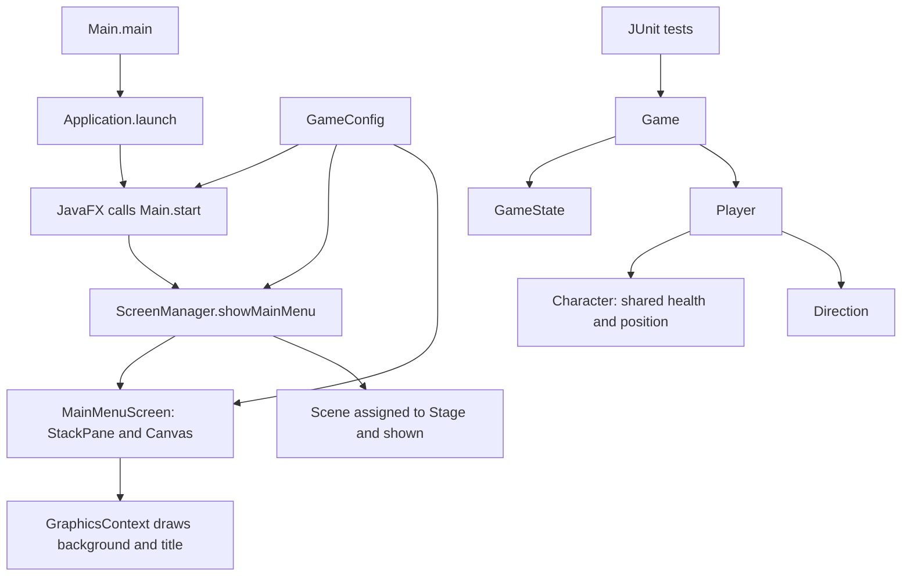
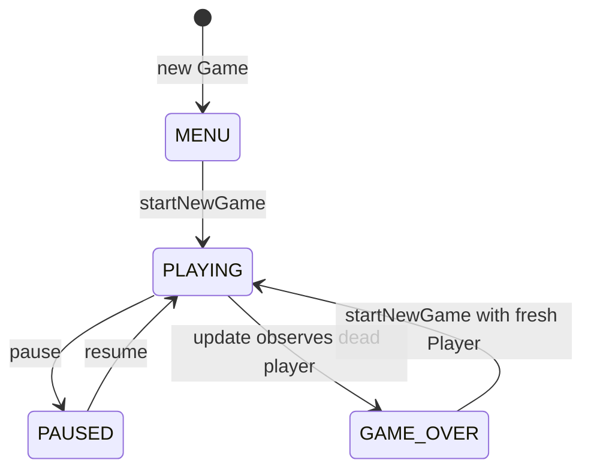

# Shadow Quest: The Lost Realm
# Java project technical documentation and learning report

Updated for Phase 3.4 implementation on November 15, 2026; earlier dated results remain historical. This guide
explains each file, its actual Java concepts, and its connections to other files.
The development history follows the learning sections. Plans describe intended
features; only source code and observed verification establish implemented work.

## Learning guide contents

1. [Scope and vocabulary](#scope-and-vocabulary)
2. [Folders and supporting files](#folders-and-supporting-files)
3. [Production Java files](#production-java-files)
4. [Class connections and execution](#class-connections-and-execution)
5. [Test files and JUnit 5](#test-files-and-junit-5)
6. [Consolidated Java concepts](#consolidated-java-concepts)
7. [Viva preparation](#viva-preparation)
8. [Current verification](#current-verification)
9. [Development history](#development-history)
10. [Phase 2.1 launch diagnosis](#phase-21-javafx-launch-verification-and-diagnosis)
11. [Phase 2.2 Canvas foundation](#phase-22-static-canvas-title-screen)
12. [Phase 2.3 loop foundation and new Java files](#phase-23-animationtimer-game-loop-foundation)
13. [Phase 2.4 input and movement](#phase-24-keyboard-input-and-player-movement)
14. [Phases 3.1 and 3.2 world and camera](#phases-31-and-32-game-world-and-camera)

15. [Phase 3.3 boundaries and closure](#phase-33-player-world-boundaries)

16. [Phase 3.4 forest and collision](#phase-34-mystic-forest-environment-and-solid-obstacles)

## Scope and vocabulary

There are twenty-two production Java files, including the environment record, renderer, and cutscene components. There are
fourteen test Java files, with one additional nested test-only class inside
CharacterTest. The implemented scope is the title-screen foundation plus game
states, character health/statistics, world coordinates, player movement, following camera, Mystic Forest obstacles/collisions, and the hand-painted 2D fantasy opening cinematic.
The static title has no loop. Enter opens the skippable seven-scene hand-painted animated cinematic, which transitions seamlessly into the Mystic Forest; WASD and arrow keys move Arin across the world. The camera follows without changing player coordinates.

Phase 2.1 verified the actual JavaFX title window and normal window close locally.
The previous Windows Application Control error did not recur in that run.
This is not yet a playable game. The core
foundation is only a subset of the broader Phase 1 described in PROJECT_PLAN.md.

| Term | Meaning and example |
| --- | --- |
| Class | Definition of an object's data and operations, such as Player |
| Object | Instance created from a class, such as new Player("Arin") |
| Field | Variable belonging to an object or class, such as health |
| Local variable | Variable inside a method or constructor, such as distance in move |
| Method | Named operation, such as heal(double amount) |
| Constructor | Initialization code used when creating an object; it has no return type |
| Reference | Value identifying an object; Game.player refers to a Player |
| null | Absence of an object reference; player is null before a game starts |
| Domain logic | Rules/data that do not require a window, such as health calculations |
| API contract | The permitted inputs, outputs, and behavior of an operation |
| void | A method returns no value, although it may change state |
| Finite double | A floating-point number that is neither infinity nor NaN, meaning not-a-number |

## Folders and supporting files

Paths in inventory tables are relative to `C:\java game`. Java subsections also
provide complete local paths. Packages separate Java names and responsibilities;
they are not independent applications or Maven modules.

### Package inventory

All production packages are under `src/main/java/com/shadowquest/`.

| Folder | Actual contents | Responsibility/status |
| --- | --- | --- |
| app | Main.java | Implemented JavaFX entry point |
| core | Game.java, GameConfig.java, GameState.java, FrameClock.java, GameLoop.java | Session coordination, constants, state vocabulary, timing, and JavaFX loop adapter |
| cutscene | OpeningScene.java, OpeningCutscene.java | Seven-scene opening beats and deterministic playback state machine |
| ui | ScreenManager.java, MainMenuScreen.java, GameScreen.java, CutsceneScreen.java | Static title, gameplay screen, cinematic renderer, navigation and loop/input lifecycle |
| player | Character.java, Player.java, .gitkeep | Implemented health and movement foundation; no combat/inventory |
| utils | Direction.java, .gitkeep | Shared movement enum |
| enemy | .gitkeep only | Reserved for enemies |
| items | .gitkeep only | Reserved for items, inventory, and collection |
| levels | .gitkeep only | Reserved for level models and progression |
| input | InputHandler.java, .gitkeep | Held-key tracking and horizontal/vertical input axes |
| render | WorldRenderer.java, .gitkeep | Mystic Forest terrain, obstacle and player Canvas rendering |
| world | GameWorld.java, Camera.java, CollisionManager.java, EnvironmentObject.java, MysticForest.java | Immutable world, camera arithmetic, swept AABB collision, and forest layout |
| persistence | .gitkeep only | Reserved for saving and loading domain data |

`src/main/resources/` contains `styles/launch.css` and the hand-painted `assets/cutscene/` directory with backgrounds, characters, effects, and environment art. Its `maps/` and `audio/` folders contain `.gitkeep` markers.

Under `src/test/java/com/shadowquest/`, `core/` contains GameTest.java and FrameClockTest.java and
`player/` contains CharacterTest.java, PlayerTest.java, and .gitkeep. The test
folders enemy, items, levels, and persistence contain only .gitkeep markers. GameMovementTest and PlayerMovementTest cover movement, InputHandlerTest covers held keys, and world/ contains GameWorldTest and CameraTest.

Git does not preserve empty directories. A `.gitkeep` is an empty conventionally
named file that lets a folder be committed. It is not a Java class or stub.
All 16 markers remain, including harmless markers in now-populated packages.

### Build configuration: pom.xml

POM means Project Object Model. Maven reads this XML file to identify the project,
obtain libraries, compile Java, and run tests. A dependency is a library; a plugin
performs a build task.

| Setting | Actual value and meaning |
| --- | --- |
| groupId | com.shadowquest, the project's group namespace |
| artifactId | shadow-quest-lost-realm, the build artifact name |
| version | 0.1.0-SNAPSHOT, a development version |
| maven.compiler.release | 21, the Java language/API target used by compilation |
| Source/report encodings | UTF-8, an explicit text encoding |
| javafx.version | 21.0.13, the pinned JavaFX library version |
| junit.version | 5.13.4, the pinned test library version |

`javafx-controls` provides controls such as Label and transitively brings in
JavaFX graphics/base. MainMenuScreen now uses Canvas from graphics.
`junit-jupiter` has test scope, so JUnit is used to compile
and run tests rather than as an application dependency.

The compiler plugin 3.14.0 compiles Java; Surefire 3.5.3 runs tests; the JavaFX
plugin 0.0.8 launches `com.shadowquest.app.Main` for `javafx:run`. `clean`
removes target output. `compile` compiles production code. `test` includes
compilation and then runs tests. There is no module-info.java, multi-module Maven
build, FXML dependency, Swing usage, database, or third-party game engine.

### Every supporting file and its purpose

| Repository-relative file | Explanation |
| --- | --- |
| src/main/resources/styles/launch.css | `.launch-screen` uses background #171b2e. `.game-title` uses System font, size 36px, bold weight, #f3e6bf text, and centered text alignment. Historical style resource retained unchanged; the Canvas screen no longer loads it. Its colors and font were transferred to drawing constants. |
| mvnw | Official Unix Maven Wrapper launcher 3.3.4. Reads wrapper properties, downloads Maven if absent, then forwards the requested command. README uses `sh ./mvnw`. |
| mvnw.cmd | Official Windows wrapper launcher using batch/PowerShell logic. Forwards commands to Maven. Credential-variable names in the script do not contain stored credentials. |
| .mvn/wrapper/maven-wrapper.properties | Pins wrapper 3.3.4, only-script distribution, and Maven 3.9.11 via HTTPS Maven Central. There is no pinned distribution checksum in this file. |
| .gitignore | Excludes target, .tools, caches, IDE files, packaged binaries, logs, temporary files, and local secret/key files. Includes a wrapper-JAR exception, though this wrapper uses no JAR. Ignore rules do not replace staged-file review. |
| .gitattributes | Uses automatic text handling, explicit LF for mvnw and CRLF for mvnw.cmd, preventing inappropriate wrapper line endings on different operating systems. |
| .github/PULL_REQUEST_TEMPLATE.md | Review prompts for behavior, tests, contracts, and asset attribution. It is not an automated CI workflow. |
| README.md | Prerequisites, build/run commands, structure, current scope, and troubleshooting. |
| CONTRIBUTING.md | Five-member responsibilities, fork/branch/PR process, tests, and report-maintenance rules. |
| docs/PROJECT_PLAN.md | Original game objectives, phases, story, team roles, and completion criteria. A planned feature is not automatically implemented. |
| docs/ARCHITECTURE.md | Original package boundaries, proposed APIs, rendering/threading conventions, and future designs. |
| docs/INITIALIZATION.md | Historical Phase 0 inventory and environment evidence. Its zero-test statement describes Phase 0 at that time. |
| docs/IMPLEMENTATION_LOG.md | Phase 1 contracts, decisions, tests, limitations, and continuation checks. |
| docs/PROJECT_DEVELOPMENT_REPORT.md | This learning guide and permanent development record. |

Generated `target/` contains class files and Surefire reports. Ignored `.tools/`
contains the portable JDK, Maven, dependency caches, and audit artifacts. Neither
belongs in the source commit. `.git/` is local Git metadata, not an application
resource or a normal committed project file.

## Production Java files

The dated Phase 2.4, Phases 3.1–3.2, Phase 3.3, and Phase 3.5 sections below
document newer Java files and changes. Phase 3.3 supersedes earlier unrestricted movement descriptions. The world/camera section supersedes the earlier fixed-center-offset rendering contract. The Phase 3.5 section documents the cutscene package, CutsceneScreen, and the ScreenManager cinematic flow.

The Phase 2.3 section provides the complete file-by-file explanations for the
new FrameClock.java and GameLoop.java, plus FrameClockTest.java. Existing files
are described here; ScreenManager includes its Phase 2.3 lifecycle changes.

### Main.java

#### A. File information

Exact path: `C:\java game\src\main\java\com\shadowquest\app\Main.java`.
Declaration: `public final class Main extends Application` in the app package.
It provides the JavaFX entry point and delegates layout work to the UI package.

#### B. Code explanation

There are no fields or explicit constructors. Java supplies a public no-argument
constructor, allowing the JavaFX launcher to create the application object.

| Method | Parameters and return type | Working |
| --- | --- | --- |
| main | String[] args; public static void | Forwards command-line arguments to inherited launch(args). It does not call start directly. |
| start | Stage stage; public void | Receives JavaFX's primary window, sets its title from GameConfig.TITLE, constructs ScreenManager with that Stage, and calls showMainMenu. |

Stage means the top-level window. stage is a parameter, not a field.
`new ScreenManager(stage).showMainMenu()` creates an object and immediately calls
one of its methods. JavaFX invokes start on its Application Thread, which is used
for UI operations. No Game object or game loop is created here.

#### C. Java concepts used

| Concept | Meaning, actual example, and reason |
| --- | --- |
| Class/object | Main defines startup behavior; JavaFX constructs it. `new ScreenManager(stage)` creates a separate presentation object. |
| Inheritance | `extends Application` makes Main a JavaFX application and gives access to launch. |
| Method overriding | `@Override public void start(Stage stage)` implements the framework's startup operation. The annotation lets the compiler check the override. |
| Framework polymorphism | JavaFX invokes Main's overridden start method through its application lifecycle. This is actual runtime method selection; enemy polymorphism remains planned. |
| Static | main belongs to the class and can be called without first constructing Main in user code. |
| Final | `final class Main` cannot be subclassed; it does not make all referenced objects immutable. |
| Packages/imports | app groups startup code; imports identify GameConfig, ScreenManager, Application, and Stage. |
| JavaFX | Application and Stage define the GUI lifecycle. No custom button or keyboard event handling exists here. |

### GameConfig.java

#### A. File information

Exact path: `C:\java game\src\main\java\com\shadowquest\core\GameConfig.java`.
Declaration: `public final class GameConfig`. Shared window settings avoid
repeating the title and scene dimensions across UI files.

#### B. Code explanation

| Field | Type/modifiers | Value and use |
| --- | --- | --- |
| TITLE | public static final String | "Shadow Quest: The Lost Realm", used for the Stage title and Canvas text |
| VIEWPORT_WIDTH | public static final int | 960, passed to the Scene constructor |
| VIEWPORT_HEIGHT | public static final int | 600, passed to the Scene constructor |

`private GameConfig()` prevents other classes from constructing instances.
Its empty body is intentional for a constants-only class. There are no ordinary
methods. The dimensions describe the initial scene area, not native window
borders, and the code does not disable resizing.

#### C. Java concepts used

| Concept | Meaning, actual example, and reason |
| --- | --- |
| Static | `GameConfig.TITLE` is available without creating an object. |
| Final fields | The title and dimensions cannot be reassigned after initialization; there is no mutable global session state here. |
| Access control | Public exposes constants; the private constructor prevents unnecessary instances. |
| Constructor | The private constructor controls how the class may be used, despite having no statements. |
| Final class | Prevents extending a class designed only to group constants. |
| Types/package | String holds text, int holds whole-number dimensions; the class is in core and needs no explicit imports. |

WORLD_WIDTH=2880 and WORLD_HEIGHT=1800 are also public static final int constants, independent of viewport size. There is no configuration-file loader or tile-size field.

### GameState.java

#### A. File information

Exact path: `C:\java game\src\main\java\com\shadowquest\core\GameState.java`.
Declaration: `public enum GameState`. It defines session-state names without
allowing arbitrary string values.

#### B. Code explanation

| Constant | Current meaning |
| --- | --- |
| MENU | Initial state; no Player yet |
| PLAYING | Active session; update may detect death |
| PAUSED | Session preserved, with no Game.update processing |
| GAME_OVER | Player defeat detected; restarting is permitted |
| VICTORY | Declared for later progression work; currently unreachable through Game's API |

The enum declares no custom fields, constructors, or methods. Game compares its
values using `==`. It defines state vocabulary, not transition rules or screens.

#### C. Java concepts used

An enum is a type with a fixed set of named values. In Game,
`private GameState state = GameState.MENU;` cannot be assigned `"Playng"`.
This gives compiler-checked state names. Public allows other packages to use
the enum; the core package places it beside its main consumer, Game.

### Game.java

#### A. File information

Exact path: `C:\java game\src\main\java\com\shadowquest\core\Game.java`.
Declaration: `public class Game`. It coordinates one session independently of
JavaFX, making the rules testable without opening a window.

#### B. Code explanation

| Field | Type | Purpose |
| --- | --- | --- |
| state | private GameState | Initialized to MENU; records the current session state |
| player | private Player | Current player reference; initially null through Java's default field initialization |

There is no explicit constructor. Java supplies `public Game()`; every new
instance has its own fields. No static shared player or session state exists.

| Method | Parameters / return | Working |
| --- | --- | --- |
| getState | none / GameState | Returns the current state |
| getPlayer | none / Player | Returns the actual player reference, or null before start; not a copy |
| movePlayer | int horizontal, int vertical, double deltaTime / void | Delegates to Player.move only in PLAYING; other states ignore the movement command |
| startNewGame | none / void | From MENU or GAME_OVER, creates new Player("Arin") and then sets PLAYING; otherwise leaves state/player unchanged |
| pause | none / void | Changes PLAYING to PAUSED; other states are unchanged |
| resume | none / void | Changes PAUSED to PLAYING; other states are unchanged |
| update | double deltaTime / void | Validates finite, non-negative elapsed seconds, then detects death only while PLAYING |

The important condition is:

```java
if (state == GameState.PLAYING && !player.isAlive()) {
    state = GameState.GAME_OVER;
}
```

`&&` short-circuits: Java evaluates the second expression only if the first is
true. In MENU, it does not call isAlive on the null player. startNewGame creates
the player before entering PLAYING, and there is no public setState that bypasses
this sequence.

Zero elapsed time is valid. Invalid time throws before any state change, even
when paused. update currently validates deltaTime without using it to simulate
movement. It is a callable step, not an AnimationTimer or complete game loop.

Damage does not notify Game immediately. A playing update detects death later.
Pause/resume keep the same Player; restart creates a different Player. Calling
start while already playing or paused cannot erase the current session.

#### C. Java concepts used

| Concept | Meaning, actual example, and reason |
| --- | --- |
| Encapsulation | Private state/player prevent direct assignment; public operations enforce transitions. The returned Player remains mutable through its own methods. |
| Class/object and has-a relationship | `player = new Player("Arin")` creates the session's player; Game coordinates Player rather than extending it. |
| Default constructor | `new Game()` works without an explicitly written constructor. Field initialization creates the starting state. |
| Enum | `state == GameState.PAUSED` compares a defined state value. |
| Conditional logic | if, logical OR, logical AND, and negation implement guards; short-circuit evaluation avoids a null-player call. |
| Exception validation | IllegalArgumentException rejects invalid deltaTime. No try/catch recovery or exception for ordinary death is used. |
| Packages/imports | Game imports Player. GameState is in the same package and needs no import. There are no JavaFX imports. |

No getCurrentLevel, victory trigger, return-to-menu operation, or input handler
is implemented. These remain later integration work.

### Character.java

#### A. File information

Exact path: `C:\java game\src\main\java\com\shadowquest\player\Character.java`.
Declaration: `public abstract class Character`. This is the project's shared
character model, not `java.lang.Character`, the standard wrapper for a char.
It avoids duplicating health and position logic in Player and future character types.

#### B. Code explanation

| Field | Type/modifiers | Why it exists |
| --- | --- | --- |
| name | private final String | Nonblank character name with surrounding whitespace stripped |
| maxHealth | private final double | Positive upper health bound; double permits fractional health |
| attackPower | private final int | Non-negative whole-number statistic; no combat calculation yet |
| defense | private final int | Non-negative statistic; does not reduce incoming damage yet |
| health | private double | Current health, initially equal to maxHealth |
| x | private double | Horizontal world coordinate, initially 0.0 |
| y | private double | Vertical world coordinate, initially 0.0 |

The protected constructor takes `String name`, `double maxHealth`,
`int attackPower`, and `int defense`. It rejects null/blank names, non-positive
or non-finite maximum health, and negative attack/defense. The null-or-blank
condition short-circuits before calling a method on null.

`this.name = name.strip()` stores a trimmed name. `this` distinguishes a field
from its same-named parameter. health starts at maxHealth; x and y use Java's
default zero initialization. A constructor has no return type.

Every getter takes no parameters:

| Method | Return type | Returned value |
| --- | --- | --- |
| getName | String | name |
| getHealth | double | health |
| getMaxHealth | double | maxHealth |
| getAttackPower | int | attackPower |
| getDefense | int | defense |
| getX | double | x |
| getY | double | y |

| Other method | Parameters / return | Working |
| --- | --- | --- |
| isAlive | none / boolean | Returns health > 0; there is no separate alive flag that could disagree with health |
| takeDamage | double amount / void | Validates input, then assigns Math.max(0, health - amount) |
| heal | double amount / void | Validates input, then adds Math.min(amount, maxHealth - health) |
| moveBy | double deltaX, double deltaY / protected final void | Computes nextX/nextY, rejects non-finite results, then assigns both coordinates |
| validateHealthAmount | double amount / private static void | Shared validation for damage/healing: rejects negative numbers, NaN, and infinities |

Damage of 30 from health 100 leaves 70. Healing by 50 then adds only 30,
restoring 100. Damage beyond remaining health stops at zero. Zero damage/healing
is valid. Invalid values are rejected before mutation.

heal limits the addition before adding. Adding two enormous doubles first could
overflow to infinity; limiting to `maxHealth - health` avoids that intermediate
overflow. A dedicated test uses Double.MAX_VALUE to check it.

moveBy validates both new coordinates before assigning either. If Y is invalid,
X must also remain unchanged. This is an all-or-nothing validation sequence,
not a claim of thread safety; there is no synchronization in these classes.

Healing from zero is allowed. isAlive then becomes true, but Game.state does
not change automatically. This is a health primitive, not a resurrection item.

#### C. Java concepts used

| Concept | Meaning, actual example, and reason |
| --- | --- |
| Abstraction | `abstract class Character` cannot be directly instantiated. It provides a common model with working methods; abstract classes do not need abstract methods. |
| Encapsulation | health/x/y are private. Getters expose values while takeDamage, heal, and moveBy enforce rules. |
| Inheritance support | The protected constructor and moveBy support subclasses. Player reuses the logic but cannot directly access private fields. |
| Access modifiers | Public exposes operations, private hides fields/helpers, protected supports subclasses and same-package access. CharacterTest can call moveBy because it is in the same package. |
| Final | Final identity/stat fields cannot be reassigned. Final moveBy cannot be overridden to remove validation. health/x/y remain mutable. |
| Static helper | validateHealthAmount depends only on amount, so it needs no object state and is static. |
| Constructors and this | `this.maxHealth = maxHealth` initializes a field from the validated parameter. |
| Exceptions/numeric logic | IllegalArgumentException reports invalid input; Math.min/Math.max and Double.isFinite protect bounds. Ordinary damage and death do not throw. |
| Package | Character belongs to player. String, Math, and Double come from automatically available java.lang. |

The proposed attack and per-character update methods are absent, not empty stubs.

### Player.java

#### A. File information

Exact path: `C:\java game\src\main\java\com\shadowquest\player\Player.java`.
Declaration: `public class Player extends Character`. It adds player defaults
and movement while reusing shared character behavior.

#### B. Code explanation

| Field | Type/modifiers | Purpose |
| --- | --- | --- |
| INITIAL_MAX_HEALTH | private static final double, 100 | Starting maximum health |
| INITIAL_ATTACK_POWER | private static final int, 10 | Starting attack statistic |
| INITIAL_DEFENSE | private static final int, 5 | Starting defense statistic |
| MOVEMENT_SPEED | private static final double, 200 | Initial world units per second |
| speed | private final double | The player's fixed movement rate, assigned from MOVEMENT_SPEED |

These are starter tuning values, not a completed combat-balance design.
`public Player(String name)` calls
`super(name, INITIAL_MAX_HEALTH, INITIAL_ATTACK_POWER, INITIAL_DEFENSE)` and
then assigns speed. The parent constructor validates shared data. Player does
not declare a second copy of health or position.

| Method | Parameters / return | Working |
| --- | --- | --- |
| getSpeed | none / double | Returns speed |
| move | Direction direction, double deltaTime / void | Validates inputs, calculates distance, skips dead-player movement, and calls inherited moveBy for the selected direction |

The Direction overload rejects null and maps UP/DOWN/LEFT/RIGHT to axes
(0,-1)/(0,1)/(-1,0)/(1,0), then delegates to move(int,int,double).
The digital-axis overload validates axes in [-1,1], elapsed time, and finite
distance. Dead players and zero input do not move. Otherwise it divides both
axes by Math.hypot(horizontal, vertical) and multiplies each normalized component
by speed * deltaTime before calling inherited moveBy. This preserves the old
cardinal behavior and gives diagonals the same total speed. See Phase 2.4 for
all method contracts and examples.

At speed 200, RIGHT for 0.25 seconds changes X by 50. Ten steps of 0.1 seconds
travel the same distance as one step of 1 second, within floating-point precision.
This prevents speed from depending on how often move is called.

Zero time gives no displacement. A valid distance can still overflow when added
to a huge coordinate, which moveBy catches. Negative coordinates are allowed
until boundaries/collisions exist. Dead players still reject invalid arguments.

#### C. Java concepts used

| Concept | Meaning, actual example, and reason |
| --- | --- |
| Inheritance | `extends Character` reuses health and position methods; `player.takeDamage(30)` calls the inherited implementation. |
| Constructor chaining | super initializes the parent part before speed is assigned. |
| Encapsulation | Private final speed is exposed through getSpeed; positions change through move instead of public coordinate setters. |
| Static/final | Named constants define defaults once; speed cannot be reassigned after construction. |
| Enum/switch | Direction restricts choices; arrow switch cases choose displacement without fall-through. |
| Exception validation | IllegalArgumentException rejects invalid direction/time and distance overflow. |
| Packages/imports | Imports Direction from utils. Character is in the same package. There is no Game or JavaFX import. |

Player overrides no methods. Phase 2.4 adds the move(int, int, double) overload; the original Direction overload delegates to it. Inheriting heal
is different from overriding it. Weapons, inventory, and animations are not present. Input handling lives in InputHandler, outside Player.

### Direction.java

#### A. File information

Exact path: `C:\java game\src\main\java\com\shadowquest\utils\Direction.java`.
Declaration: `public enum Direction`. It gives movement a shared type without
coupling Player to JavaFX key codes.

#### B. Code explanation

The constants are UP, DOWN, LEFT, and RIGHT. There are no custom fields,
constructors, or methods. Direction does not store vectors; Player maps these values to digital axes and delegates to its normalized movement overload.

Example: `player.move(Direction.RIGHT, 0.25)`. The String `"RIGHT"` cannot be
passed directly. Null is still possible for a reference, so Player checks it.

#### C. Java concepts used

An enum defines a fixed set of named values, letting the compiler check the
argument type. Public exposes it across packages; utils places it in shared code.
Direction.RIGHT is the concrete example used in movement tests. It is not a
keyboard binding or event handler.

### ScreenManager.java

#### A. File information

Exact path: `C:\java game\src\main\java\com\shadowquest\ui\ScreenManager.java`.
Declaration: `public final class ScreenManager`. It separates scene presentation
from Main. Title and movement-demo scenes are managed; see the Phase 2.4 method/lifecycle details below.

#### B. Code explanation

`private final Stage stage` stores the window passed by Main.
`public ScreenManager(Stage stage)` assigns `this.stage = stage`. It does not
create a second Stage or validate null; the startup caller supplies JavaFX's Stage.

Phase 2.3 adds `private GameLoop gameLoop`, initially null. The constructor also
registers a scene-property change listener and a WINDOW_HIDDEN event handler;
both call stopGameLoop(). showMainMenu() now stops the active loop before replacing
the scene. The title itself never starts a loop.

`public void startGameLoop(DoubleConsumer update, Runnable render)` returns void.
It stops/releases the previous loop, creates one GameLoop from the callbacks,
and starts it. Future gameplay code must call it after installing its Scene.
Repeated calls replace the previous timer rather than running two together.
`public void stopGameLoop()` returns void, stops a non-null timer and clears its
reference; repeated calls are harmless. These operations belong on the JavaFX
Application Thread. The constructor listeners use lambdas and JavaFX property/
event APIs. No new custom interface or game rule is introduced. See Phase 2.3
below for the full timing and lifecycle explanation.

`public void showMainMenu()` takes no parameters. It constructs MainMenuScreen,
creates local `Scene scene` with that root and GameConfig's dimensions, sets it
on the Stage, and calls stage.show(). A Scene contains the UI tree inside a
Stage; it is not a game level or GameState.

Repeated menu calls create another title Scene. There is no scene cache. Phase 2.4 showGame creates a fresh Game and calls startNewGame; the complete current API is documented below.

#### C. Java concepts used

| Concept | Meaning, actual example, and reason |
| --- | --- |
| Objects/references | The constructor receives an existing Stage and showMainMenu creates a Scene and MainMenuScreen. Objects collaborate through references. |
| Encapsulation | Private stage is used through the public presentation operation. |
| Constructor/this | `this.stage = stage` stores the argument for later use. |
| Final | Final class prevents subclasses; final stage prevents replacing the reference, not changing the referenced window. |
| JavaFX | Stage owns the window; Scene owns its content. Main calls the method during JavaFX startup. |
| Packages/imports | Imports GameConfig, Scene, Stage; MainMenuScreen needs no import because it is also in ui. |

### MainMenuScreen.java

#### A. File information

Exact path: `C:\java game\src\main\java\com\shadowquest\ui\MainMenuScreen.java`.
Declaration: `public final class MainMenuScreen extends StackPane`.
This screen owns the static Canvas title drawing and its layout. ScreenManager
creates it as the Scene root. It reads GameConfig but does not access Game,
Character, or Player. No buttons or gameplay are implemented.

#### B. Code explanation

| Field | Type and modifiers | Purpose |
| --- | --- | --- |
| BACKGROUND_COLOR | private static final Color | Shared dark fill, #171b2e |
| TITLE_COLOR | private static final Color | Shared pale title fill, #f3e6bf |
| TITLE_FONT | private static final Font | System bold font, size 36, matching the former CSS |
| canvas | private final Canvas | One drawing surface per screen, initially sized from GameConfig.VIEWPORT_WIDTH and VIEWPORT_HEIGHT |

Static fields belong to the class. The final Canvas reference cannot be replaced,
but its dimensions and pixels can change. The colors and font are presentation
settings and stay in the UI class; GameConfig remains the source of initial
window dimensions and the title string.

| Constructor/method | Parameters and return | Working and purpose |
| --- | --- | --- |
| public MainMenuScreen() | No parameters; constructor has no return type | Sets the pane's preferred size from GameConfig, marks Canvas unmanaged, adds it to getChildren(), and calls drawTitle() |
| protected layoutChildren() | No parameters; void; @Override | Calls super.layoutChildren(), compares actual pane and Canvas dimensions, and resizes/redraws only when they differ |
| private drawTitle() | No parameters; void | Reads Canvas width/height, obtains GraphicsContext, fills the background rectangle, sets font/color/alignment, and draws the title at the center |

Construction creates a 960 x 600 Canvas through the GameConfig constants.
`canvas.setManaged(false)` excludes it from StackPane's automatic child sizing;
MainMenuScreen sizes it explicitly in layoutChildren. It remains visible in the
child list and stays at the default origin (0, 0). This prevents the Canvas's
old size from controlling the pane's preferred/minimum layout size during resize.

JavaFX invokes layoutChildren during layout, including window size changes.
The override calls the superclass implementation first. If width or height has
changed, it sets both Canvas dimensions and redraws to cover the new drawing
area and recenter the title. There is no AnimationTimer, frame loop, input handler,
or domain update in this callback.

Inside drawTitle, local `double width` and `double height` hold the actual Canvas
size, and local `GraphicsContext graphics` is its 2D drawing interface.
`fillRect(0, 0, width, height)` covers the whole Canvas with the background color.
After changing fill and font, the code sets `TextAlignment.CENTER` and
`VPos.CENTER`. `fillText(GameConfig.TITLE, width / 2, height / 2, width)` places the
text's horizontal center and vertical alignment center at the Canvas midpoint.
At 960 x 600, that point is (480, 300). Both dimensions are doubles, so division
preserves fractional coordinates. Center alignment is needed because merely
passing half-width with the default left alignment would start the title there.
The last width argument limits the drawn text width; JavaFX can compress long
text into narrow space. This is a single line, not the former Label's wrapping.

Canvas coordinates start at the top-left, with positive X right and positive Y
down. These are drawing coordinates, not a new player-position system.
The background and title are both Canvas drawing operations. launch.css is no
longer loaded; its unchanged file remains as the historical title style resource.
Editing that CSS will not change this Canvas screen.

#### C. Java concepts used

| Concept | Actual example, meaning, and reason |
| --- | --- |
| Class/object and composition | The screen owns a Canvas object; it gets the Canvas's GraphicsContext rather than creating a separate rendering service |
| Inheritance | extends StackPane reuses a JavaFX layout node and its child collection |
| Overriding and polymorphism | @Override layoutChildren supplies this screen's layout behavior when JavaFX invokes the inherited lifecycle contract |
| Encapsulation/access modifiers | private canvas and drawTitle keep drawing details inside the UI; public construction remains the ScreenManager entry point; protected layoutChildren matches the framework extension point |
| Constructor | MainMenuScreen() creates a ready-to-display screen with an initial drawing |
| Static/final | Shared Color/Font constants and a fixed per-screen Canvas reference express stable ownership; final does not make Canvas immutable |
| Collections/generics | getChildren().add(canvas) adds a Canvas subtype to the inherited ObservableList<Node>; no inventory collection is implied |
| Enums | FontWeight.BOLD, TextAlignment.CENTER, and VPos.CENTER select defined JavaFX options without strings |
| Local variables/arithmetic | double width/height and division by 2 compute the current midpoint |
| Conditions | The size comparison avoids repainting on unchanged layout passes |
| Separation of responsibilities | Main starts JavaFX, ScreenManager presents screens, and this class draws; domain rules remain outside JavaFX |

A Canvas is a JavaFX scene-graph node containing a drawing surface.
GraphicsContext is the object used to issue drawing commands and set drawing
state such as fill color, font, and alignment. It is not a window or a game
controller. Stage is the native window, Scene holds the node tree, StackPane is
the layout root, and Canvas is its child.

A Label is an ordinary control with text properties, CSS styling, wrapping, and
accessibility behavior supplied by JavaFX. Canvas stores drawing output; its
painted title is not a separate Label node. Changing a game value or CSS does
not automatically repaint those pixels. Here redraw is explicit at construction
and resize. This small static screen needs no renderer abstraction or new class;
the reserved render package remains for future world rendering.

## Class connections and execution

### Foundation startup and domain paths



This diagram shows the original startup/domain foundation. Phase 2.4 now connects these paths through ScreenManager.showGame and InputHandler; the complete current flow is in the Phase 2.4 section. Direction itself remains independent of key events.

ScreenManager calls the MainMenuScreen constructor and attaches its resulting
node to a Scene. MainMenuScreen reads GameConfig and draws through GraphicsContext. These UI classes
do not calculate health or movement; ScreenManager now passes input axes to Game. Game creates a Player; Player delegates
shared initialization and position changes to Character.

### Current transition rules



VICTORY exists in the enum but has no implemented incoming transition. There is
no return-to-menu operation. The fuller screen-flow diagram in ARCHITECTURE.md
describes future behavior, not this completed set of operations.

### Worked domain example

This example combines existing method calls. It is not an extra source file or
the current application's automatic startup flow.

```java
Game game = new Game();
game.startNewGame();
Player arin = game.getPlayer();
arin.move(Direction.RIGHT, 0.25);
arin.takeDamage(30);
arin.heal(10);
game.pause();
game.update(0.016);
game.resume();
arin.takeDamage(1000);
game.update(0.016);
game.startNewGame();
```

Step by step:

1. new Game starts in MENU with no Player.
2. startNewGame creates Arin at health 100 and coordinates `(0, 0)`.
3. Moving RIGHT for 0.25 seconds adds `200 * 0.25 = 50` to X.
4. Damage 30 leaves health 70; healing 10 raises it to 80.
5. pause changes the state to PAUSED. The next update validates time but does
   not process defeat or other game rules.
6. resume changes back to PLAYING. Damage 1000 clamps health to zero.
7. The next update sees isAlive is false and enters GAME_OVER.
8. startNewGame constructs a fresh Player with full health at the origin.

The local variable arin still refers to the previous Player after restart.
Use game.getPlayer again to obtain the new one. A returned object reference is
not automatically redirected when the field that originally supplied it changes.

Player does not know Game.state. Direct calls such as arin.move while paused
can still move a living player. The new Game.movePlayer command restricts
movement calls to PLAYING. This separation keeps Player independent of sessions
and JavaFX; ScreenManager now routes movement through that gated command.

## Test files and JUnit 5

Tests create domain objects and compare results with expectations. They are not
game screens. Maven Surefire discovers the eleven test classes and runs JUnit.
No test starts JavaFX, sleeps for animation, or requires a rendered window.

### Common JUnit concepts actually used

| Construct | Meaning | Actual example and purpose |
| --- | --- | --- |
| @Test | Marks an ordinary test method | GameTest.startsNewGameWithArin checks starting a session |
| @ParameterizedTest | Runs one method repeatedly with supplied arguments | PlayerTest.movesInEachWorldDirection checks four directions |
| @ValueSource | Supplies one argument per execution | Invalid-time tests receive -1, NaN, and infinities |
| @NullAndEmptySource | Supplies null and an empty value | Name tests check both absent and empty names |
| @CsvSource | Supplies comma-separated argument rows | `"UP, 0, -50"` supplies Direction and expected coordinates |
| assertEquals | Checks expected and actual values | Health after damage must equal 69.5 in CharacterTest |
| assertTrue/assertFalse | Check boolean conditions | isAlive must be false after lethal damage |
| assertNull/assertNotNull | Check reference presence | Game has no player before start and has one afterwards |
| assertSame/assertNotSame | Check whether references identify the same object | Pause preserves the player; restart replaces it |
| assertThrows | Requires an operation to throw a particular exception | Invalid movement time must throw IllegalArgumentException |
| Numeric tolerance | Allows a small floating-point difference | Movement assertions use a delta of 0.000001 |
| Static imports | Allow calling static assertion methods without the Assertions prefix | `import static org.junit.jupiter.api.Assertions.*;` |
| Lambda expression | Supplies an operation to run later | `() -> player.move(null, 1)` is passed to assertThrows |

JUnit converts the CSV direction names into Direction values for the typed
parameter. It is test input conversion, not production string-based movement.
The lambda passed to assertThrows targets JUnit's Executable functional interface;
the project declares no custom gameplay interface. JUnit, not a project try/catch
block, catches and checks the expected exception.

Tests follow an arrange/act/assert pattern: create a known object, call an
operation, then check results. All test methods here return void. Classes and
methods are package-private, which JUnit 5 supports. The test classes declare no
fields or explicit outer-class constructors; they construct fresh objects in the
methods. There are no @BeforeEach hooks, disabled tests, mocks, or custom runners.

### GameTest.java

#### A. File information

Exact path: `C:\java game\src\test\java\com\shadowquest\core\GameTest.java`.
Class: `GameTest`, testing Game and its interactions with Player and GameState.
It protects session transitions and prevents accidental loss or sharing of state.

#### B. Code explanation and coverage

Important local variables are `Game game`, `Player player`, and
`Player previousPlayer`. They let tests observe both values and object identity.
The independent-session test uses `Game first` and `Game second`. The parameter
`double time` supplies invalid elapsed-time values.

All methods below return void. Only invalidTimeNeverChangesState has a parameter;
the others take none.

| Test method | Executions | Behavior and why it matters |
| --- | ---: | --- |
| beginsInMenuWithoutAPlayer | 1 | pause/resume/update do not start an unstarted game or dereference a null player |
| startsNewGameWithArin | 1 | Starting creates a living Arin and enters PLAYING |
| pauseAndResumePreserveTheSessionAndIgnoreRepeatedCommands | 1 | Repeated commands preserve state, health, position, and the same Player reference |
| startCannotReplaceAnActiveOrPausedSession | 1 | Repeated start cannot silently discard progress |
| updateLeavesLivingPlayerAndStateUnchanged | 1 | A living player remains in PLAYING; update does not invent movement or healing |
| deathBecomesGameOverOnUpdate | 1 | Death is observed on update; pause/resume cannot escape GAME_OVER |
| pausedUpdateDefersDeathDetectionUntilPlayingAgain | 1 | Even externally changed health is not processed by a paused update; resumed update detects it |
| healingCannotResumeAGameOverSession | 1 | Raising health on the old player cannot automatically resume the session |
| restartingAfterDefeatCreatesAFreshPlayer | 1 | Restart resets health/position and replaces the player; modifying the old player does not change the new one |
| invalidTimeNeverChangesState(double time) | 4 | -1, NaN, positive infinity, negative infinity throw without changing MENU, PLAYING, or PAUSED |
| separateGamesDoNotSharePlayerOrState | 1 | Defeat in one Game does not affect a separate Game |

There are 11 test methods and 14 executions. Testing both returned values and
reference identity matters: a replacement Player with similar values would still
break the promise that pausing preserves the same session object.

#### C. Java concepts used

- **Objects and references:** `Player previousPlayer = game.getPlayer()` holds
  the old object so assertNotSame can verify replacement on restart.
- **Enums:** assertions compare GameState values, not arbitrary strings.
- **Packages/imports:** core groups the tests with Game; imports bring in Player,
  Direction, and JUnit annotations. Static imports shorten assertion calls.
- **Annotations/parameterized tests:** @ValueSource repeats one invalid-input
  check for four doubles, avoiding four duplicated test bodies.
- **Lambdas and exception verification:** `() -> game.update(time)` delays the
  call until assertThrows executes it. A missing exception causes test failure.
- **Encapsulation through public APIs:** tests use Game methods rather than
  directly setting its private state, so they check the behavior callers receive.

### CharacterTest.java

#### A. File information

Exact path: `C:\java game\src\test\java\com\shadowquest\player\CharacterTest.java`.
Class: `CharacterTest`, testing shared Character rules independently of Player's
fixed defaults. It includes `private static class TestCharacter extends Character`.

#### B. Code explanation and coverage

The nested TestCharacter declares no fields or ordinary methods. Its constructor
takes `String name`, `double maxHealth`, `int attackPower`, and `int defense`,
then calls super with those arguments. It makes the abstract base usable for
tests of custom maximum health and statistics without adding a production type.

Most methods use local `Character character = new TestCharacter(...)`. This is
a superclass reference to a subclass object. It demonstrates substitutability,
but does not demonstrate overridden enemy behavior because TestCharacter adds
no overrides. Same-package access permits calling protected moveBy directly.

All test methods return void. Parameters appear only where listed:

| Test method | Executions | Behavior and edge cases |
| --- | ---: | --- |
| initializesSharedPropertiesAndTrimsName | 1 | Custom stats, full health, origin, and stripped name are initialized correctly |
| rejectsMissingNames(String name) | 4 | Rejects null, empty string, space, and tab/newline-only name |
| rejectsInvalidMaximumHealth(double maxHealth) | 5 | Rejects zero, negative health, NaN, and both infinities |
| rejectsNegativeStats(int attack, int defense) | 2 | Rejects negative attack and negative defense separately |
| acceptsZeroAttackAndDefense | 1 | Zero is valid, preventing over-restrictive validation |
| damageAndHealingChangeHealthWithoutApplyingCombatStats | 1 | Fractional values produce health 69.5 then 79.75; defense is not silently applied |
| healthNeverExceedsMaximum | 1 | Oversized healing and further healing stop at maximum health |
| healingLargeHealthValuesDoesNotOverflow | 1 | A character with Double.MAX_VALUE maximum health remains finite after healing |
| zeroAmountsLeaveHealthUnchanged | 1 | Zero damage/healing are valid no-ops |
| invalidHealthAmountsAreRejectedWithoutMutation(double amount) | 4 | Negative, NaN, and infinite damage/healing throw and preserve health |
| lethalDamageClampsAtZeroAndMarksCharacterDead(double damage) | 3 | Exact lethal damage, overkill, and Double.MAX_VALUE leave zero health; repeated damage stays at zero |
| healingFromZeroRestoresHealth | 1 | Documents current health behavior: healing from zero makes isAlive true |
| invalidPositionChangesLeaveBothCoordinatesUnchanged(double invalid) | 3 | NaN and infinities in either axis reject the move without partially changing the other axis |
| positionOverflowLeavesBothCoordinatesUnchanged | 1 | Two large finite values can overflow when added; both coordinates must remain unchanged |

There are 14 test methods and 29 executions. These cases matter because merely
checking typical health values would miss NaN propagation, overflow, and partially
applied position changes.

#### C. Java concepts used

- **Abstraction/inheritance:** the abstract Character cannot be instantiated
  directly, so the small TestCharacter subclass supplies a concrete type.
- **Constructor chaining:** its constructor calls super to exercise the actual
  production validation, rather than duplicating it in the test.
- **Nested static class:** TestCharacter is private to the test and does not need
  an enclosing CharacterTest object to be created.
- **Superclass references:** a Character variable can hold TestCharacter. The
  inherited methods are the real Character implementations.
- **Access modifiers/packages:** tests in the player package can call protected
  moveBy; they still cannot access private health/x/y fields.
- **Annotations and data sources:** NullAndEmptySource, ValueSource, and CsvSource
  provide different invalid constructor/operation inputs.
- **Lambdas/exceptions:** assertThrows executes calls such as
  `() -> character.heal(amount)` and checks the exception type.
- **Floating-point limits:** Double.MAX_VALUE, Double.NaN, and infinity values
  exercise edge cases ordinary arithmetic examples would miss.

### PlayerTest.java

#### A. File information

Exact path: `C:\java game\src\test\java\com\shadowquest\player\PlayerTest.java`.
Class: `PlayerTest`, testing Player and inherited character behavior as used by
the player. It protects defaults, direction conventions, and time-based movement.

#### B. Code explanation and coverage

Most methods use local `Player player`. `Player oneStep` and `Player manySteps`
compare different movement schedules. `double largeTime` constructs a huge but
initially valid movement distance, and `double previousX` records the position
before a move that should fail. The `int i` loop counter repeats ten small steps.
There are no fields or explicit constructors in this class.

All test methods return void. Parameters appear only where listed:

| Test method | Executions | Behavior and why it matters |
| --- | ---: | --- |
| initializesPlayerWithDocumentedDefaults | 1 | Checks Arin's name, health/maxHealth, attack/defense, speed, origin, and alive state |
| rejectsInvalidPlayerNames(String name) | 4 | Inherited validation rejects null, empty, space, and tab/newline-only names |
| movesInEachWorldDirection(Direction direction, double expectedX, double expectedY) | 4 | A 0.25-second move produces UP `(0,-50)`, DOWN `(0,50)`, LEFT `(-50,0)`, RIGHT `(50,0)` |
| movementDependsOnElapsedTimeRatherThanNumberOfUpdates | 1 | One 1-second step equals ten 0.1-second steps |
| oppositeDirectionsReturnToStartingPosition | 1 | Equal movements around a rectangle return to the origin |
| zeroTimeDoesNotMovePlayer | 1 | Zero elapsed time cannot change position |
| rejectsInvalidOrOverflowingMovementTimeWithoutChangingPosition(double time) | 5 | Negative time, NaN, infinities, and Double.MAX_VALUE reject without mutation |
| rejectsNullDirectionWithoutChangingPosition | 1 | A missing direction throws and leaves position intact |
| repeatedLargeMovementCannotOverflowPosition | 1 | A second large move rejects coordinate overflow and preserves previousX |
| deadPlayerDoesNotMoveAndStillValidatesInput | 1 | Dead players stay put, but null direction and negative time still throw |

There are 10 test methods and 20 executions. The 0.000001 tolerance in movement
assertions accounts for floating-point rounding; it does not permit large errors.

#### C. Java concepts used

- **Objects/inheritance:** new Player exercises its constructor and inherited
  getHealth/takeDamage/isAlive operations through the public API.
- **Enums:** typed Direction inputs verify the actual movement contract.
- **Loop and primitive variables:** the `for (int i = 0; i < 10; i++)` loop checks
  whether dividing elapsed time into smaller updates changes total movement.
- **Parameterized tests:** CSV rows provide direction plus expected coordinates;
  ValueSource supplies invalid doubles; NullAndEmptySource checks absent names.
- **Lambdas/exception assertions:** assertThrows verifies invalid calls and the
  subsequent assertions verify that rejection did not corrupt position.
- **Packages/imports/static imports:** player groups tests with production code;
  imported JUnit methods make assertions readable without changing their behavior.

## Consolidated Java concepts

### Concepts currently implemented

This table distinguishes project-written behavior from use of library features.
Using a library method is real Java usage, but does not mean the project has
implemented an entire subsystem based on that concept.

| Java concept | Meaning | Implemented in | Status |
| --- | --- | --- | --- |
| Classes and objects | Define types and create independent instances | Main, Game, Player, UI classes, tests | Implemented |
| Encapsulation | Hide fields and control access through methods | Character health/position; Game state/player; Player speed | Implemented |
| Abstraction | Represent common behavior in a non-instantiable base | abstract Character | Implemented, with concrete shared methods |
| Inheritance | Reuse a base class's data/operations | Player extends Character; Main extends Application; MainMenuScreen extends StackPane; TestCharacter extends Character | Implemented |
| Method overriding | Supply a subclass implementation of an inherited method | Main.start(Stage) and MainMenuScreen.layoutChildren() with @Override | Implemented in framework callbacks; Player has no overrides |
| Polymorphism | Use a subtype through a base contract and dispatch overridden behavior | JavaFX lifecycle calls Main.start; Character references hold TestCharacter | Implemented at framework/type-substitution level; no enemy behavior hierarchy yet |
| Constructors and super | Initialize an object and its base portion | Player and TestCharacter call the Character constructor | Implemented |
| Access modifiers | Control visibility | Public APIs, private fields, protected Character constructor/moveBy, package-private tests | Implemented |
| Static | Member belongs to the class | Main.main, GameConfig constants, Player defaults, Character validation helper | Implemented |
| Final | Prevent reassignment or extension/override | Configuration/stat fields; final UI classes; final moveBy | Implemented; final references do not freeze objects |
| Enums | Restrict values to named alternatives | GameState, Direction, JavaFX TextAlignment.CENTER and VPos.CENTER | Implemented |
| Packages and imports | Organize names and reference other types | com.shadowquest packages and imports across all Java files | Implemented |
| Conditionals, switch, loops | Select or repeat behavior | Game guards; Player direction switch; PlayerTest ten-step loop | Implemented |
| Exception validation | Reject invalid arguments | Character, Player, Game throw IllegalArgumentException; tests use assertThrows | Implemented; no application try/catch recovery workflow |
| Collections/generics through JavaFX | Use typed lists of nodes or strings | MainMenuScreen getChildren().add(canvas) | Implemented library-list usage only |
| Lambda expressions | Supply a short operation as a value | assertThrows tests and ScreenManager cleanup listeners | Implemented |
| Functional-interface usage | Pass an implementation of a single-method contract | GameLoop DoubleConsumer update and Runnable render; JUnit Executable | Implemented using library interfaces; no custom gameplay interface |
| Annotations | Attach compiler/framework metadata | @Override, @Test, @ParameterizedTest and input-source annotations | Implemented |
| JavaFX scene graph | Build a hierarchy of UI nodes inside a window | Stage -> Scene -> MainMenuScreen -> Canvas | Implemented; Canvas title visually verified in Phase 2.2 |
| Canvas drawing | Paint pixels using drawing commands | MainMenuScreen.drawTitle and GraphicsContext | Implemented for static title and movement placeholder |
| AnimationTimer | Receive active-frame callbacks | GameLoop.handle(long now) | Implemented adapter; idle on title screen |
| try/finally | Run cleanup even when a callback throws | GameLoop.handle resets handlingFrame in finally | Implemented; does not suppress callback exceptions |
| Method overloading | Same method name with different parameters | Player.move(Direction, double) delegates to move(int, int, double) | Implemented |
| EnumSet collections | Store unique values of one enum type | InputHandler pressedKeys | Implemented for input; inventory remains planned |
| Keyboard/button events | Translate user actions into input or navigation | InputHandler filters; ScreenManager Enter; GameScreen return button | Implemented |
| Gameplay loop wiring | Connect timing, input, domain commands, and drawing | ScreenManager.showGame update lambda and screen::render | Implemented for movement demo |

### Concepts planned for future phases

| Java concept | Meaning | Intended location | Status |
| --- | --- | --- | --- |
| Enemy polymorphism/overriding | Different enemy types respond through a shared contract | Future Enemy subclasses | Planned; no Enemy classes exist |

| Domain collections | Store groups of items, enemies, and keys | Future Inventory, Level, progression code | Planned; do not count UI node lists as inventory |
| Gameplay interfaces | Define shared capabilities | Proposed Attackable and Collectable | Planned; no interface source files exist |
| File handling/persistence | Read and write saved domain state | Future persistence package | Planned; CSS lookup does not save game progress |
| Recoverable exception handling | Catch and handle I/O or malformed-save failures | Future persistence/resource boundaries | Planned; current validation throws and tests assert those exceptions |


| World rendering | Draw maps and entities through Canvas | Future render package | Planned; title and temporary player shape are implemented |

These are planned applications of concepts, not commitments to implement them
all in the next task. They remain subject to the project's phase approvals.

## Viva preparation

Use these answers as a starting point, then open the named files and explain the
actual expressions. Avoid claiming that future game systems already work.

**1. What does the project currently do?**

It has a static title and a keyboard-controlled Canvas movement demo. The model is connected to input through ScreenManager and GameLoop. Phase 2.1 verified
the title window, compilation, and domain tests. This is not a playable game
demonstration.

**2. Explain the architecture in about a minute.**

Main starts JavaFX and delegates to ScreenManager. ScreenManager creates a Scene
containing MainMenuScreen. GameConfig supplies shared window settings. Separately,
Game owns session state and a Player. Player extends Character for health and
position behavior and uses Direction for movement. Domain packages contain no
JavaFX imports, so their tests do not need a window. Reserved packages mark later
work, not completed modules.

**3. Why JavaFX instead of Swing?**

JavaFX is the team's agreed GUI framework and matches the planned Canvas renderer
and AnimationTimer loop. Current code uses Application, Stage, Scene, StackPane,
Canvas, and GraphicsContext. We have not implemented a Swing version or measured which is
faster, so we should not claim a performance comparison.

**4. Why use Maven and the wrapper?**

pom.xml declares versions, dependencies, compilation, testing, and JavaFX startup.
The wrapper pins Maven 3.9.11 so teammates can use the same build tool without
installing Maven separately. They still need JDK 21 and initial network access.

**5. Why is Character abstract? Does it have abstract methods?**

It represents shared character data/rules and should not be created as a generic
character. Player is the current concrete type. Character currently has no
abstract methods, which Java permits; its implemented health/position methods
are already useful. Combat methods are deferred rather than left empty.

**6. Why does Player extend Character?**

A player is a character and needs the same health, name, statistics, and position
rules. Inheritance reuses those rules. The Player constructor calls super and
does not duplicate health fields. Game instead has a Player, because a game
session is not itself a character.

**7. Where are overriding and overloading demonstrated?**

Main overrides Application.start; MainMenuScreen overrides layoutChildren. Player does not override its inherited methods.
Player now overloads move: the Direction form delegates to the (int, int, double) form, so both APIs share validation and movement arithmetic.

**8. Why use Direction and GameState enums?**

They give the compiler a known set of values instead of unchecked strings.
Direction.RIGHT cannot be misspelled as an arbitrary String argument. Enum
constants can be compared using ==. Null still needs validation where accepted
as an external argument, as Player.move demonstrates.

**9. Why is health private?**

If callers could assign health directly, they could set it negative or above its
maximum. takeDamage and heal centralize the bounds. Getters allow reading without
exposing an unrestricted setter.

**10. How is movement calculated?**

Distance equals speed multiplied by elapsed seconds. At speed 200, moving right
for 0.25 seconds adds 50 to X. Up decreases Y because our world origin is at the
top-left. Movement has no collision or boundary rules yet.

**11. What happens when the player dies or the game pauses?**

Health clamps at zero, and isAlive becomes false. The next playing Game.update
enters GAME_OVER. Paused updates do not process rules. Player itself does not
know the session state, so future input code must avoid calling move while paused.

**12. Does healing automatically restart a defeated game?**

No. Character.heal can raise health from zero, but it does not change Game.state.
A GAME_OVER session stays there until startNewGame creates a fresh Player.

**13. What does final mean?**

A final field cannot be reassigned, a final method cannot be overridden, and a
final class cannot be extended. ScreenManager's final Stage reference can still
refer to a window whose scene changes. Final is not general object immutability.

**14. How do JUnit tests help? Why are there more executions than methods?**

Assertions make expected behavior executable: the build fails if a result changes
unexpectedly. Parameterized tests run one method for multiple inputs. There are
93 test methods and 224 executions, including the new parameterized input/movement cases.

**15. Why test NaN, infinity, and huge values?**

A negative-only check does not reject NaN. Large finite values can overflow
during multiplication or addition. Without checks, health or position could become
invalid. Tests check both rejection and preservation of the previous state.

**16. Where is file handling? Where are collections?**

The former screen loaded CSS from the classpath. The Canvas screen no longer loads it; save/load file handling is still not implemented.
MainMenuScreen uses JavaFX lists for children/styles. Inventory lists, enemy
collections, and key sets are still planned.

**17. Is VICTORY implemented? What about Canvas and AnimationTimer?**

VICTORY is an enum constant without a transition trigger. Canvas now draws the
static title through GraphicsContext. GameLoop now extends AnimationTimer; gameplay movement callbacks are now wired through ScreenManager. There are no enemies, inventory, levels, or save/load yet.

**18. What is the difference between compilation and successful GUI launch?**

Compilation checks Java source and types. Tests verify the exercised domain
behavior. A GUI launch additionally needs permitted native libraries and a
graphical environment. Passing 63 tests alone does not prove the UI opened.
Phase 2.1 separately observed the actual title window and its normal close.

## Current verification

Phase 3.5: 258 tests pass (the 224 Phase 3.4 baseline plus 34 new cutscene/lifecycle executions). `mvnw javafx:run` launched cleanly with the game window visible and no exception in the log. The user's visual walkthrough of the cinematic (Enter → seven scenes → skip → Mystic Forest → replay from Scene 1) is pending. See Phase 3.5 for details.

Phase 3.4: all 224 tests pass. The first forest GUI was inspected but manual root/density acceptance failed. The revised root, density and depth changes have automated coverage; final manual retesting remains pending after the user stopped Computer Use. See Phase 3.4 for exact evidence.


Phase 3.3 closure: clean compilation and all 194 tests passed on November 15, 2026. The November 14 corrected GUI launch succeeded; the user confirmed boundaries, corners, moving away, camera follow, release, and both control schemes. See the Phase 3.3 section for exact evidence and limitations.


Latest Phases 3.1–3.2: clean compilation and all 158 tests passed. The actual
world view was inspected, and the user confirmed camera following, release, and
edge stopping. Maven launch exited successfully with code 0. Further GUI checks
were interrupted by Escape; visual resize/small-world/all-edge and return/re-entry
checks remain unverified. See the dated world/camera section below.

Previous Phase 2.4: clean compilation and all 120 tests passed. The actual title
and gameplay entry were inspected; the user confirmed held movement and release.
Further GUI checks were interrupted by Escape stopping Computer Use. The Maven application subsequently exited successfully with code 0. Focus-loss clearing and return/re-entry remain manually unverified in that run.
See Phase 2.4 for the full file-wise implementation and evidence.

Previous Phase 2.3 results: clean compilation and 69 JUnit tests passed. The separate
JavaFX loop lifecycle smoke check passed. The actual Maven application window was
visually inspected; final close verification was interrupted by the user stopping
Computer Use. See the Phase 2.3 record for the exact scope and limitations.

Previous status: Phase 2.2 passed clean compilation and all 63 tests, visually
verified the Canvas title window at normal and maximized sizes, and completed
javafx:run with exit code 0 after normal close. See the dated Phase 2.2 section
below for commands and runtime evidence.
The following paragraphs preserve the earlier documentation-revision checks.

For this documentation revision, every production/test Java file and pom.xml,
resources, and supporting documentation were inspected. Only this report is
being edited; no source, tests, dependencies, or architecture were changed.

The following command ran successfully on November 13, 2026 using the existing
portable Microsoft OpenJDK 21.0.13.0.2+1 and Maven 3.9.11:

```powershell
$env:JAVA_HOME = (Resolve-Path '.tools/jdk21/jdk-21.0.13.0.2+1').Path
$env:Path = "$env:JAVA_HOME\bin;$env:Path"
$env:MAVEN_USER_HOME = (Resolve-Path '.tools').Path + '\maven-user-home'
.\mvnw.cmd -o -B -ntp '-Dmaven.repo.local=.tools/repository' clean test
```

The test lifecycle compiled all nine production Java files and three test files
from clean output. Offline mode used dependencies already present locally.
For teammates with a normal JDK setup, README's `mvnw.cmd test` or `sh ./mvnw test`
commands remain the general entry point; do not use offline mode on a first build.

| Suite | Methods | Executions | Failures | Errors | Skipped |
| --- | ---: | ---: | ---: | ---: | ---: |
| GameTest | 11 | 14 | 0 | 0 | 0 |
| CharacterTest | 14 | 29 | 0 | 0 | 0 |
| PlayerTest | 10 | 20 | 0 | 0 | 0 |
| Total | 35 | 63 | 0 | 0 | 0 |

Maven reported BUILD SUCCESS. Current evidence is in target/surefire-reports.
No tests were edited, deleted, disabled, or weakened. At that earlier revision,
GUI launch was not retried and the previous blocker remained unresolved.
Visual layout, native-library startup, and future UI/domain integration are not
covered by these tests.

## Development history

The following record preserves setup, decisions, and audit evidence. Statements
about absent Git configuration describe the pre-push audit, not the current state.

### Historical scope and timeline

- November 11, 2026: initialized the JavaFX application and Maven project;
  implemented the Phase 1 core foundation and its domain tests.
- November 13, 2026: rechecked the foundation, then audited the project for its
  first GitHub push. No commit, push, or new gameplay feature was made.
- Later on November 13, 2026: initialized main, configured origin, and completed
  the explicitly authorized initial push. Commit
  `fae6479159dd59b8238cace458262cd353bc5ae4`, message
  `Initial commit: Shadow Quest Java adventure game`, contains 43 files.
  Local and remote main matched after pushing, and main tracks origin/main.
- November 13, 2026, documentation revision: expanded this report into a
  file-by-file learning guide. The revision changes only
  `docs/PROJECT_DEVELOPMENT_REPORT.md`; fresh clean tests passed all 63 cases.
  This documentation revision is not committed or pushed as part of the task.

The completed foundation is a subset of the broader Phase 1 in PROJECT_PLAN.md.
The UI displays a title. Domain classes support health, movement, and session
states independently, but are not yet connected to the UI.

### Historical technology and build configuration

| Choice | Configuration and reason |
| --- | --- |
| Java | Release 21, the agreed language baseline |
| JavaFX | 21.0.13; javafx-controls supplies controls and transitively graphics/base |
| Rendering | Canvas is the planned world renderer; no world rendering exists yet |
| Maven | Wrapper pins Maven 3.9.11 for consistent team builds |
| Wrapper | Official Apache Wrapper 3.3.4, only-script distribution, Windows and Unix launchers |
| Compiler | maven-compiler-plugin 3.14.0; release 21 and UTF-8 |
| Tests | JUnit Jupiter 5.13.4, test scope; Surefire 3.5.3 |
| Run support | javafx-maven-plugin 0.0.8 starts com.shadowquest.app.Main |
| Coordinates | Origin at top-left; positive X right, positive Y down |

Maven resolves dependencies, compiles source, and runs tests. JUnit is excluded
from application dependencies by test scope. No Swing, FXML, database, game
engine, or additional application framework is used. Java packages separate
responsibilities; there is no Java module descriptor or multi-module Maven build.

### Historical folder structure

```text
pom.xml                          Build configuration
mvnw, mvnw.cmd                   Official Maven launchers
.mvn/wrapper/                    Maven download/version settings
.gitignore, .gitattributes       Exclusions and wrapper line endings
.github/PULL_REQUEST_TEMPLATE.md Review checklist
README.md, CONTRIBUTING.md       Setup and collaboration instructions
docs/                           Plans, historical logs, and this record
src/main/java/com/shadowquest/
  app/                          JavaFX entry point
  core/                         Configuration, session controller, states
  player/                       Shared character and Player
  ui/                           Title layout and screen presentation
  utils/                        Direction enum
  input/, enemy/, items/        Reserved packages
  levels/, render/, persistence/ Reserved packages
src/main/resources/
  styles/launch.css              Title-screen styling
  images/, maps/, audio/         Reserved resource directories
src/test/java/com/shadowquest/
  core/, player/                Implemented JUnit tests
  enemy/, items/, levels/,
  persistence/                  Reserved test directories
target/                         Generated build/test output, ignored
.tools/                         Local JDK, Maven, caches and audit data, ignored
```

Empty reserved directories use `.gitkeep`. Existing markers in populated
directories are harmless and remain to avoid unnecessary deletion. The only
actual application resource is launch.css; there are no external game assets
requiring attribution yet.

### Implementation inventory at the audit

Paths in this section are relative to `src/main/java/com/shadowquest/`.

| File | Responsibility, fields, methods, and connections |
| --- | --- |
| `app/Main.java` | Extends JavaFX Application. main launches JavaFX; start sets the Stage title using GameConfig and delegates to ScreenManager. Contains no game rules. |
| `core/GameConfig.java` | Holds TITLE, VIEWPORT_WIDTH=960, VIEWPORT_HEIGHT=600 as public static final constants. Its private constructor prevents meaningless instances. Used by Main, ScreenManager, and MainMenuScreen. |
| `core/GameState.java` | Enum of MENU, PLAYING, PAUSED, GAME_OVER, VICTORY. Game uses it to represent session state. VICTORY has no trigger yet. |
| `core/Game.java` | Owns private state and player fields. getState/getPlayer expose session information; startNewGame creates Arin; pause/resume control state; update checks defeat only while playing. |
| `player/Character.java` | Abstract base with private name, health, maxHealth, attackPower, defense, x, y. Constructor validates initial data. Getters expose values. takeDamage/heal keep health within bounds; isAlive checks health > 0. Protected final moveBy validates both resulting coordinates before mutation. |
| `player/Player.java` | Extends Character; constructor uses super for shared initialization. Named constants supply health 100, attack 10, defense 5, speed 200. Private final speed and getSpeed expose movement rate. move translates Direction and elapsed seconds into displacement. |
| `ui/ScreenManager.java` | Holds a private final Stage. showMainMenu creates a Scene with MainMenuScreen and configured dimensions, assigns it to the Stage, and shows it. |
| `ui/MainMenuScreen.java` | Extends StackPane. Constructor creates a wrapping, centered title Label, applies padding/style classes, and loads /styles/launch.css from the classpath. |
| `utils/Direction.java` | Enum of UP, DOWN, LEFT, RIGHT; shared movement vocabulary used by Player. |

The tests also define a small nested TestCharacter subclass inside CharacterTest.
It calls the protected Character constructor so tests can exercise custom initial
statistics without adding a production character type.

### Recorded behavior at the audit

Startup follows Main -> ScreenManager -> MainMenuScreen. The game foundation
is currently called by tests, not by buttons or keyboard handlers.

| Operation | Result |
| --- | --- |
| new Game() | MENU, player is null |
| startNewGame from MENU or GAME_OVER | Fresh Arin and PLAYING |
| pause from PLAYING | PAUSED, player preserved |
| resume from PAUSED | PLAYING, player preserved |
| update while PLAYING with zero health | GAME_OVER |
| Start/pause/resume in other states | No change |

There is no arbitrary setState method. update validates finite, non-negative
elapsed seconds before processing state. Outside PLAYING it runs no game rules.
It is a callable update step, not a timer or complete game loop.

Player movement uses distance = speed * deltaTime. RIGHT for 0.25 seconds moves
X by 50 at speed 200. UP decreases Y; DOWN increases Y. Zero time is valid.
Null directions, negative time, NaN, infinity, and overflow are rejected before
position changes. Dead players do not move. Negative finite coordinates remain
possible until level bounds are implemented.

Character rejects blank names, invalid maximum health, and negative attack or
defense. Damage is a direct health reduction, with no defense formula. Health
cannot fall below zero or exceed its maximum. Healing limits the amount added
before addition, avoiding numeric overflow. Healing from zero restores health
but cannot resume a GAME_OVER session. Restart creates a different Player object;
callers must obtain the new reference from Game.

Pause governs Game.update, not every direct call on Player. Future input code
must gate movement on PLAYING. These boundaries are documented and tested.

The proposed combat, inventory, character-update, and level APIs in the architecture
are deferred; no empty methods were created to imitate their future implementation.

### Recorded concept examples

- Objects: each Game owns a separate session and Player reference.
- Encapsulation: private health cannot be assigned by UI code; takeDamage and
  heal enforce its allowed range.
- Inheritance: Player extends Character and reuses health and position behavior.
- Abstraction: Character cannot be instantiated directly. It contains working
  shared methods; abstract classes do not need abstract methods.
- Constructors: Player calls super to initialize the base class consistently.
- Enums: GameState and Direction replace error-prone string choices.
- Static/final: GameConfig constants belong to the class; final fields prevent
  reassignment after construction. moveBy is final to preserve its validation.
- Method overriding: Main overrides Application.start, which JavaFX calls at
  startup. Enemy-specific overridden behavior is still pending.
- Exceptions: IllegalArgumentException reports invalid domain inputs. Normal
  damage, death, and inapplicable state commands do not use exceptions.
- Testing: @Test identifies checks; @ParameterizedTest repeats checks across
  inputs. Lambdas pass operations to assertThrows for exception verification.

Domain collections, combat interfaces, input event handling, and persistence are
planned. The learning sections above clarify the existing framework-list usage
in MainMenuScreen, which is distinct from domain collections.

### Historical tests and verification

| Test source under src/test/java/com/shadowquest/ | Executions | Coverage |
| --- | ---: | --- |
| `core/GameTest.java` | 14 | States, invalid commands/time, pause, death, fresh restart, separate sessions |
| `player/CharacterTest.java` | 29 | Constructor validation, health bounds, death/healing, safe coordinates |
| `player/PlayerTest.java` | 20 | Defaults, four directions, time-based movement, invalid input, overflow, dead player |
| Total | 63 | Zero failures, errors, or skipped tests |

Counts include each parameterized input. No tests were edited, removed, or
disabled during the audit. Reports are generated in target/surefire-reports.

On November 13, 2026, the audit ran clean compilation and then the complete test
lifecycle with Microsoft OpenJDK 21.0.13.0.2+1 and Maven 3.9.11:

```powershell
$env:JAVA_HOME = (Resolve-Path '.tools/jdk21/jdk-21.0.13.0.2+1').Path
$env:Path = "$env:JAVA_HOME\bin;$env:Path"
$env:MAVEN_USER_HOME = (Resolve-Path '.tools').Path + '\maven-user-home'
.\mvnw.cmd -o -B -ntp '-Dmaven.repo.local=.tools/repository' clean compile
.\mvnw.cmd -o -B -ntp '-Dmaven.repo.local=.tools/repository' test
```

Both commands passed. Nine production sources and three test sources compiled.
Offline mode used already downloaded dependencies; teammates' first builds need
network access. General setup instructions are in README.md.

JavaFX launch is separately unverified. The initialization attempt failed because
Windows Application Control blocked prism_d3d.dll and prism_sw.dll. No window
opened. The audit did not retry launch or change security policy. An administrator
review or a permitted development machine is needed for visual verification.

Other resolved setup problems: Maven was absent from PATH, and Oracle javapath
shortcuts failed despite a working directly invoked JDK 25. A verified portable
JDK 21 and the Maven Wrapper enabled compilation/testing without system changes.
Initial dependency download DNS failures were resolved using approved network
access. These tools remain local under ignored .tools/.

### First-push audit and exact changes

| Added or modified file | Reason |
| --- | --- |
| `src/main/java/com/shadowquest/app/Main.java` | Removed one generic comment that repeated the obvious main-method purpose; startup behavior unchanged |
| `.gitignore` | Added packaged artifacts, key/keystore files, heap dumps, and editor temporary files; preserved the wrapper JAR exception |
| `.gitattributes` | Added explicit LF for mvnw and CRLF for mvnw.cmd so Git preserves suitable wrapper line endings |
| `README.md` | Added the supplied repository link, explained its different name, and linked this report |
| `CONTRIBUTING.md` | Corrected clone/upstream examples to shawdowquest and required future updates to this record |
| `docs/PROJECT_DEVELOPMENT_REPORT.md` | Added this permanent development and audit record |

No runtime logic, signatures, architecture, dependencies, or tests changed.
Comments explaining overflow prevention, atomic coordinate updates, and unusual
test scenarios were retained. No debug prints, temporary gameplay code, unused
imports, or removable private implementation methods were found. Public APIs
used by tests or intended integration were retained. Similar elapsed-time checks
in Game and Player validate their separate public entry points; a new utility
class would add indirection without simplifying this small foundation.

pom.xml, resource paths, and the wrapper configuration were reviewed. Both
wrapper scripts match the original downloaded copies by SHA-256; their Apache
license notices and implementation were preserved. No unnecessary dependency
or asset was found. Wrapper download uses HTTPS; no distribution checksum is
currently pinned in wrapper properties.

The commit-candidate file inventory and content scan found no embedded passwords,
API keys, private keys, private user-home paths, or unrelated personal files.
The wrapper's MVNW_PASSWORD references are environment-variable handling, not
stored credentials. The public repository account is intentionally documented.
This is a local content review, not a guarantee about future files.

Git's own ignore checks confirmed target/, .tools/, .m2/, VS Code/IDE state,
.env, packaged outputs, and representative key/heap files are excluded.
An isolated bare repository under ignored .tools/audit.git was used only to
evaluate ignore rules and list candidate files. It contains no commits or remote
and is not the project repository. No files were staged.

### Git status at the pre-push audit

At the pre-push audit, the project root had no .git directory, branch, remote,
index, or tracked working tree. No Git configuration was overwritten. The
user-supplied destination was https://github.com/prabhakarshukla/shawdowquest;
remote contents, access, and history were not checked during that local audit.

The subsequent authorized push completed those Git setup steps and confirmed an
empty remote before publishing. The current branch is main and origin points to
that repository. The initial commit is recorded in the timeline above. The
unverified GUI launch remains disclosed; publishing source did not resolve it.

## Historical team integration and pending work

Pending features include UI/controller wiring, keyboard input, Canvas world rendering,
gameplay-loop wiring, collision and level bounds, enemies, combat, inventory, collection,
four levels, progression, victory rules, pause/game-over/victory screens, sound,
and persistence. No next gameplay phase was started by this audit.

Member 1 coordinates application/UI integration and core contracts. Member 2
owns visuals/rendering support. Member 3 owns characters/player/combat. Member 4
owns inventory/items. Member 5 owns levels/progression/persistence. Confirm detailed
core ownership with the team. Coordinate changes to units, health rules, state
transitions, nullability, and API signatures across affected owners. Keep domain
code independent of JavaFX and renderers free of gameplay mutations.

## Phase 2.1: JavaFX launch verification and diagnosis

Verified November 13, 2026. The actual title window opened, displayed the dark
background and centered pale title, and closed normally using Alt+F4. The Maven
launch then reported BUILD SUCCESS and exit code 0 at 22:49:29 IST. The earlier
Application Control error did not recur in this successful run. No Windows
security setting, policy, DLL name, or DLL location was changed by this work.
We have not established why the historical policy error stopped occurring.
Success on this run does not establish that every native library or renderer
is allowed, or that the application will run on every team member's machine.

### Files inspected and changed

The launch inspection covered these existing files without modifying them:

- `pom.xml`: release 21, JavaFX controls 21.0.13, and JavaFX Maven plugin 0.0.8
  with main class `com.shadowquest.app.Main`.
- `src/main/java/com/shadowquest/app/Main.java`: Application lifecycle entry.
- `src/main/java/com/shadowquest/core/GameConfig.java`: title and 960 x 600 scene.
- `src/main/java/com/shadowquest/ui/ScreenManager.java`: Scene creation/show.
- `src/main/java/com/shadowquest/ui/MainMenuScreen.java`: title and CSS loading.
- `src/main/resources/styles/launch.css`: background and title styles.
- `.mvn/wrapper/maven-wrapper.properties` and the Windows wrapper execution:
  wrapper 3.3.4, Maven 3.9.11, existing HTTPS distribution.
- `docs/INITIALIZATION.md` and this report: previous launch evidence and status.

Only `docs/PROJECT_DEVELOPMENT_REPORT.md` was changed among project files. It
records this investigation and updates current launch claims while preserving
historical failures. No configuration defect requiring a code or POM edit was
found. Source, architecture, tests, dependencies, and wrapper files are unchanged.
No commit or push was made during Phase 2.1.

### Environment, commands, and results

The default `java -version` resolved to the Oracle javapath shortcut and returned
exit code -1073740791 without version output. The first default wrapper invocation
could not create the user-profile `.m2` directory under the session's filesystem
restriction. Neither failure is evidence of a Java compilation defect.

Using the existing local JDK and Maven cache, with environment variables set only
for the command process, produced Microsoft OpenJDK 21.0.13.0.2+1, Maven 3.9.11,
Windows 11, and amd64. System PATH and persistent JAVA_HOME were not changed.

```powershell
$env:JAVA_HOME = (Resolve-Path '.tools/jdk21/jdk-21.0.13.0.2+1').Path
$env:Path = "$env:JAVA_HOME\bin;$env:Path"
$env:MAVEN_USER_HOME = (Resolve-Path '.tools').Path + '\maven-user-home'
java -version
.\mvnw.cmd -version
& "$env:JAVA_HOME/bin/jar.exe" tf .tools/repository/org/openjfx/javafx-graphics/21.0.13/javafx-graphics-21.0.13-win.jar
.\mvnw.cmd -o -B -ntp '-Dmaven.repo.local=.tools/repository' clean test
.\mvnw.cmd -o -B -ntp '-Dmaven.repo.local=.tools/repository' javafx:run
```

Offline mode used existing dependencies. No DLLs or new dependencies were
downloaded. The local repository contains JavaFX base, graphics, and controls
21.0.13, including Windows classifier JARs. Inspection of the graphics JAR
confirmed native entries including glass.dll, prism_d3d.dll, prism_sw.dll,
prism_common.dll, javafx_font.dll, and javafx_iio.dll. The launch successfully
resolved the JavaFX plugin. The built CSS exists at target/classes/styles/launch.css.

Clean test completed at 22:43:13 IST with exit code 0, compiling nine production
and three test Java files. Surefire XML confirms:

| Test class | Executions | Failures | Errors | Skipped |
| --- | ---: | ---: | ---: | ---: |
| GameTest | 14 | 0 | 0 | 0 |
| CharacterTest | 29 | 0 | 0 | 0 |
| PlayerTest | 20 | 0 | 0 | 0 |
| Total | 63 | 0 | 0 | 0 |

### Runtime diagnosis and evidence

The first launch reached JavaFX toolkit startup, then failed with exit code 1.
Its first concrete error was a denied write to the normal native-cache lock:

```text
Loading library glass from resource failed: java.io.IOException:
Error copying library ...\glass.dll to cache: ...\.lock (Access is denied)
Caused by: java.io.FileNotFoundException: ...\.lock (Access is denied)
Caused by: java.lang.UnsatisfiedLinkError: no glass in java.library.path
```

The cache path was `%USERPROFILE%\.openjfx\cache\21.0.13+2\amd64`.
This error differs from the historical explicit Application Control message.
The DLL is present in the dependency JAR; the loader could not complete its
normal cache operation under the agent's restricted filesystem access.

The same Maven launch command was retried with approved normal user-profile
filesystem access. This permits the application's ordinary cache operation;
it does not disable or alter Windows Application Control. The retry opened a
window named `Shadow Quest: The Lost Realm` belonging to the local JDK's java.exe.
A screenshot inspection confirmed the actual title and CSS appearance. After
normal close, no matching window remained and Maven exited successfully.

Evidence therefore supports a session cache-access failure for the first run,
followed by successful native loading and graphics initialization on the retry.
There was no observed Maven dependency-resolution failure or current application
configuration defect. No forced graphics backend, renamed DLL, cache relocation,
policy modification, or unofficial native library was used.

Complete stdout/stderr, including the first failure's stack traces, is retained
locally under ignored `.tools/phase2.1/`:

- `java-version.log` and `maven-version.log`: selected tool versions.
- `clean-test.log`: complete clean compilation and test output.
- `javafx-run.log`: complete restricted-launch failure output.
- `javafx-run-normal-access.log`: successful retry through normal window close.

Logs are local diagnostic artifacts, not proposed source commits. The complete
error log contains machine-specific paths; this report quotes only relevant
errors. Git ignore verification confirmed the diagnostic directory is excluded.

### Java concepts and integration notes

No new Java concept was implemented. This verification exercised Main's
inheritance from Application and overridden start(Stage), construction of Scene
and MainMenuScreen, composition of the scene graph, static final configuration,
and classpath CSS resource loading. JavaFX additionally loads Windows native
libraries at runtime. Java compilation and domain tests do not exercise that
entire native startup path, which explains why they can pass while launch fails.

An UnsatisfiedLinkError reports a native linking problem. Reading the earlier
cause matters: here the denied cache lock preceded the final missing-library
message. Adding application try/catch code would not correct that filesystem
restriction and was not warranted.

Phase 2.1 launch verification is complete for this machine with the documented
JDK and normal cache access. Default-shell Java selection still needs attention
when launching outside this setup. Resizing, other machines, other rendering
backends, and gameplay remain outside this verification. The exact next step
is team review of this result and authorization of the next phase. Teammates
should confirm the same title screen with their JDK 21 setup. If an explicit
Application Control error recurs, stop and give the log to the device's IT or
administrator for an authorized review, or use a permitted development machine.
Do not work around the policy. No Canvas, AnimationTimer, input, or gameplay
work was started.

## Phase 2.2: Static Canvas title screen

Completed November 13, 2026. This phase replaces the title Label with Canvas
drawing while keeping the existing startup and screen-management flow. The dark
background, pale centered title, System bold font at size 36, and initial
GameConfig dimensions are preserved. No new Java files or dependencies were
needed. The earlier Phase 2.1 documentation changes remain in this report.

### Exact file changes and design

| File | Change and reason |
| --- | --- |
| src/main/java/com/shadowquest/ui/MainMenuScreen.java | Replaced Label/CSS setup with a private Canvas, drawing constants, drawTitle(), and a layoutChildren() override to repaint after resizing |
| docs/PROJECT_DEVELOPMENT_REPORT.md | Updated the class explanation, current flow, concepts and viva answers; preserved history and added this dated verification record |

The complete current MainMenuScreen explanation above documents its exact local
path, every field, constructor, methods, and Java concepts. Main.java remains
the Application entry point. ScreenManager still creates the Scene, assigns it
to the Stage, and shows it. GameConfig is unchanged and supplies title/initial
dimensions. Game, Character, Player, all test files, and pom.xml are unchanged.

The inspected launch.css is intentionally retained unchanged as the historical
style resource. MainMenuScreen no longer loads it because GraphicsContext sets
the drawing colors and font directly. The Canvas background is filled explicitly;
it is not a CSS background behind an otherwise transparent drawing.

This implementation keeps menu drawing in the existing UI class. Creating a
GameRenderer for one static title would add an unnecessary class; world rendering
still belongs to the planned render package. The screen has no Game reference
and cannot move the player or mutate health while drawing.

### How to explain it in a viva

1. Main.launch starts JavaFX, which calls Main.start(Stage).
2. Main delegates to ScreenManager.showMainMenu(), which creates MainMenuScreen
   inside a Scene at the GameConfig dimensions and shows the Stage.
3. MainMenuScreen owns a Canvas and calls drawTitle(). That method obtains its
   GraphicsContext, fills the complete background, then draws the title.
4. The midpoint is (width / 2, height / 2), initially (480, 300).
   TextAlignment.CENTER and VPos.CENTER make that point the text alignment center.
5. JavaFX calls the overridden layoutChildren() on layout changes. The screen
   resizes its unmanaged Canvas and repaints when dimensions change. This is a
   layout callback, not an AnimationTimer or continuous gameplay update.

Canvas is a drawing node; GraphicsContext issues drawing commands. Ordinary
controls such as Label provide text layout, CSS, and accessibility properties.
The painted title has no separate control node. This change demonstrates object
composition, encapsulation, inheritance, method overriding, framework
polymorphism, static/final fields, enum options, typed child collections, and
double arithmetic. It adds no project-defined interface or method overload.
Calling fillText's library overload does not mean this project defines one.

### Commands and observed verification

Used the documented Microsoft OpenJDK 21.0.13.0.2+1 and Maven 3.9.11 setup;
the default Oracle shortcut was not used. JavaFX remains 21.0.13.

```powershell
$env:JAVA_HOME = (Resolve-Path '.tools/jdk21/jdk-21.0.13.0.2+1').Path
$env:Path = "$env:JAVA_HOME\bin;$env:Path"
$env:MAVEN_USER_HOME = (Resolve-Path '.tools').Path + '\maven-user-home'
.\mvnw.cmd -o -B -ntp '-Dmaven.repo.local=.tools/repository' clean compile test
.\mvnw.cmd -o -B -ntp '-Dmaven.repo.local=.tools/repository' javafx:run
```

Clean compilation and tests passed at 23:09:34 IST, exit code 0. Maven compiled
nine production and three test files. All 63 existing executions passed:
GameTest 14, CharacterTest 29, PlayerTest 20; zero failures, errors, or skipped
tests. No tests were changed or removed. Domain tests do not verify pixels;
the UI check was manual through the actual running JavaFX window.

The launch used approved normal user-profile cache access as established in
Phase 2.1. Visual inspection confirmed the dark Canvas background and centered,
readable title at the configured initial size. Maximizing the window confirmed
that the background filled the enlarged area and the title remained centered.
Alt+F4 closed the window normally. The window disappeared and Maven reported
BUILD SUCCESS with exit code 0 at 23:16:35 IST. No runtime error appeared.
No Windows security settings, native libraries, or policies were modified.

Full local command output is retained in ignored
`.tools/phase2.2/clean-test.log` and `.tools/phase2.2/javafx-run.log`.
Git diff whitespace verification passed. No commit or push was performed.

### Limitations and integration boundary

This is a static title, not a playable screen. Canvas text stays on one line and
uses the available width as its maximum; narrow windows can compress the text
instead of wrapping it. Its text is not exposed as a Label control, though the
native window title is unchanged. Automated image comparison, narrow-window
readability, and other monitors/platforms were not verified in this phase.

There is no frame loop, AnimationTimer, input handler, sprite, enemy, level,
collision, combat, or inventory UI. Existing domain movement methods remain
untouched and disconnected from the screen. Repainting changes no game state.
Future dynamic drawing must remain separate from domain updates. Phase 2.3
requires a separate authorized scope; this work stops at Phase 2.2.

## Phase 2.3: AnimationTimer game-loop foundation

Implemented November 13, 2026. Phase 2.1 and 2.2 working changes were preserved.
The title screen still draws only at construction and resize. It creates no
active GameLoop. ScreenManager now owns the lifecycle entry points that a future
gameplay screen can use. A separate JavaFX smoke application exercised those
entry points and actual frame callbacks without adding gameplay to Main.

### What a game loop does

A game loop repeatedly updates state and then renders the result. Updating means
applying rules to the model; rendering means reading state and drawing it. They
are separate callbacks here, so drawing never has to contain health, movement,
or combat rules. No gameplay callback is wired in the normal application yet.

GameLoop extends JavaFX AnimationTimer and overrides `handle(long now)`. JavaFX
calls it for frames while the timer is active. `now` is a frame timestamp in
nanoseconds, not a calendar date or a frame count. Subtract the previous frame's
timestamp to get elapsed time, then divide by 1,000,000,000.0 for seconds.
For example, 16,000,000 nanoseconds becomes 0.016 seconds. Seconds match Game's
existing update contract and future speed-per-second calculations. Frame spacing
is not assumed to be exactly 1/60 second. The timer does not promise a fixed FPS.
See the [official JavaFX 21 AnimationTimer documentation](https://openjfx.io/javadoc/21/javafx.graphics/javafx/animation/AnimationTimer.html).

There is no previous sample on the first frame. Using zero as a timestamp would
incorrectly count time since an arbitrary clock origin. FrameClock instead records
the first sample and returns delta 0. Both update and render run for that frame,
but update receives zero elapsed time. Restart resets this sampling state, so a
long stopped interval does not become the next update's delta.

### FrameClock.java

Exact path: `C:\java game\src\main\java\com\shadowquest\core\FrameClock.java`.
This public final class is a Java-only timing helper. It exists to isolate and
test conversion/reset rules without starting JavaFX or waiting for real time.
It has an implicit public no-argument constructor and no JavaFX imports.

| Field | Type | Meaning |
| --- | --- | --- |
| previousTime | private long | Last accepted frame timestamp in nanoseconds |
| hasPreviousTime | private boolean | Whether a previous sample exists; avoids treating timestamp zero as a special value |

`public double tick(long now)` returns seconds. On the first call it stores now,
marks the sample present, and returns 0. Later it calculates `now - previousTime`,
rejects negative elapsed time with IllegalArgumentException before changing the
stored sample, stores now, and divides by `1_000_000_000.0`. Equal timestamps
produce zero. Timestamp origins may be negative. The contract expects consecutive
frame intervals representable as nonnegative long nanoseconds; arbitrary values
spanning more than roughly 292 years are outside a frame clock's use.

`public void reset()` has no parameters and returns void. It clears the boolean;
the next tick overwrites the old timestamp. Clearing previousTime is unnecessary
because it is never used until a new sample exists.

Java concepts: encapsulation through private state, primitive long/boolean/double,
conditional branches, floating-point division, a public API with validation, and
a final class. The helper has no thread synchronization; its owner uses it on the
JavaFX thread. Large but valid active-frame gaps are reported honestly, not clamped;
pause/simulation policies belong to a later gameplay phase.

### GameLoop.java

Exact path: `C:\java game\src\main\java\com\shadowquest\core\GameLoop.java`.
This public final class extends AnimationTimer. The architecture assigns loop
coordination to core. JavaFX code is isolated here; Game, Character, and Player
remain unchanged and independent of JavaFX.

| Field | Type | Responsibility |
| --- | --- | --- |
| clock | private final FrameClock | Owns previous-frame sampling |
| update | private final DoubleConsumer | Receives elapsed seconds through accept(double) |
| render | private final Runnable | Draws through run(), with no parameters |
| running | private boolean | Tracks whether this timer should process frames |
| handlingFrame | private boolean | Rejects re-entry while a callback is already being processed |

`public GameLoop(DoubleConsumer update, Runnable render)` stores two required
callbacks, checking them with Objects.requireNonNull. These are existing JDK
functional interfaces, not new project abstractions. A future caller can pass
`game::update` and a renderer method reference, but neither is installed in the
normal title-screen flow in this phase.

| Method | Parameters/return | Behavior |
| --- | --- | --- |
| public start() | none; void; override | Requires JavaFX thread; if stopped, resets clock, calls super.start(), and marks running; repeated start leaves the active clock intact |
| public stop() | none; void; override | Requires JavaFX thread; calls super.stop(), clears running, resets clock; repeated stop is safe |
| public handle(long now) | frame nanoseconds; void; override | Ignores inactive or nested calls; samples clock, invokes update, then render if still running |
| public isRunning() | none; boolean | Reports lifecycle state for inspection on the JavaFX thread |
| private static requireFxThread() | none; void | Uses Platform.isFxApplicationThread(); throws IllegalStateException on an incorrect lifecycle caller |

handle uses try/finally to release handlingFrame even when a callback throws.
It does not catch or suppress the callback error. If update navigates away and
stops the loop, render is skipped. Native window changes can cause a nested
JavaFX pulse, so the guard prevents a recursive update/render chain. This is
single-thread re-entry protection, not multithread synchronization.

Java concepts include inheritance from an abstract framework class, overriding,
polymorphic framework callbacks, composition with FrameClock, encapsulation,
final references, JDK functional interfaces, null validation, and try/finally.
There is no custom thread, sleep, physics, input, or movement in this adapter.

### ScreenManager.java changes and connections

Exact path: `C:\java game\src\main\java\com\shadowquest\ui\ScreenManager.java`.
Its updated file-by-file explanation above describes stage, gameLoop, constructor,
showMainMenu, startGameLoop, and stopGameLoop. This remains the screen presenter;
it now also prevents a previous screen's timer from surviving a transition.
No timer is constructed until startGameLoop is requested.

```text
Normal launch:
Main -> ScreenManager.showMainMenu -> MainMenuScreen -> static Canvas
                          active loop: none

Available future gameplay integration:
install gameplay Scene -> ScreenManager.startGameLoop(update, render)
  -> GameLoop.start -> JavaFX handle(now) -> FrameClock.tick(now)
  -> update.accept(deltaSeconds) -> render.run()

return to menu / replace Scene / hide or close Stage
  -> ScreenManager.stopGameLoop -> timer.stop -> release timer reference
```

startGameLoop always stops the previous owned timer before constructing another.
It prevents simultaneous loops owned by this ScreenManager, not arbitrary timers
created elsewhere. Future screens must use this owner instead of starting their
own timers. Root-only replacement inside the same Scene is not a scene-property
change: a future such navigation path must explicitly call stopGameLoop first.
Main and MainMenuScreen needed no Phase 2.3 edits. Their prior behavior is preserved.

### FrameClockTest.java

Exact path: `C:\java game\src\test\java\com\shadowquest\core\FrameClockTest.java`.
This package-private JUnit class has no fields or explicit constructor. Each
no-argument void test creates its own clock. It uses @Test and static assertion
imports; assertThrows receives a lambda. Inputs are fixed timestamps, not sleeps
or assumptions about real frame frequency.

| Test method | What it proves |
| --- | --- |
| firstFrameUsesZeroInsteadOfTimeSinceClockOrigin | Large initial timestamp still yields zero |
| convertsNanosecondsToFractionalSeconds | Consecutive 16 ms and 25 ms gaps become 0.016 and 0.025 seconds |
| equalTimestampsProduceZero | Zero is a valid first timestamp and repeated samples yield zero |
| resetExcludesTimeSpentStopped | Repeated reset is harmless; restart has zero delta then resumes normal conversion |
| rejectsBackwardTimeWithoutChangingPreviousTimestamp | Invalid time throws without corrupting the next valid interval |
| timestampsMayHaveNegativeOrigins | Negative clock origins are accepted and elapsed time remains correct |

### Files and verification

New project files: core/FrameClock.java, core/GameLoop.java, and
test core/FrameClockTest.java at the exact paths above. Modified this phase:
ui/ScreenManager.java and docs/PROJECT_DEVELOPMENT_REPORT.md. The pre-existing
MainMenuScreen.java working change belongs to Phase 2.2 and was preserved.
No source dependencies, existing tests, game rules, or planning documents changed.

Using the documented JDK 21 and local Maven setup:

```powershell
$env:JAVA_HOME = (Resolve-Path '.tools/jdk21/jdk-21.0.13.0.2+1').Path
$env:Path = "$env:JAVA_HOME\bin;$env:Path"
$env:MAVEN_USER_HOME = (Resolve-Path '.tools').Path + '\maven-user-home'
.\mvnw.cmd -o -B -ntp '-Dmaven.repo.local=.tools/repository' clean compile test
.\mvnw.cmd -o -B -ntp '-Dmaven.repo.local=.tools/repository' javafx:run
```

The final clean build after the re-entry guard passed at 23:45:39 IST. Eleven
production files and four test files compiled. All 69 JUnit executions passed,
with zero failures, errors, or skipped tests: original GameTest 14, CharacterTest
29, PlayerTest 20, plus FrameClockTest 6. Existing 63 tests were unchanged.

A local, ignored `.tools/phase2.3/LoopSmoke.java` was compiled with javac using
the existing JavaFX Windows JARs as module path and target/classes as classpath,
then executed with java. It passed these checks with exit code 0:

- Repeated start/stop, stopped-frame suppression, restart with zero delta.
- Update-before-render order and no render after update stops its loop.
- Explicit nested-frame guard and deterministic adapter delta conversion.
- Actual AnimationTimer pulses, replacement of an active owned loop, and cleanup
  after scene replacement, return to the menu, and Stage.close().

The first smoke attempt used Java source-file launching, whose class loader did
not resolve the Application subclass through launch(args). Compiling the helper
first fixed that verification-tool problem. The next attempt exposed nested
pulses in the smoke driver while replacing scenes. The driver received its own
re-entry guard, and GameLoop received the small handlingFrame guard to protect
callbacks that may navigate. The corrected smoke check passed. These were
investigated failures, not ignored passing results.

The normal Maven application was also launched with approved native-cache access.
The actual title window was brought forward and inspected: the Canvas background
and centered title matched the previous phase. Computer Use was then stopped by
the user with the physical Escape key during close verification. No further GUI
interaction was performed. Normal closure and final Maven exit for that launch
are therefore not claimed; the process was still running at the last check.
The separate lifecycle smoke check did verify Stage.close() cleanup successfully.

Logs and the smoke helper remain under ignored `.tools/phase2.3/`, including
clean-test.log, loop-smoke.log, loop-smoke-initial-failure.log, and javafx-run.log.
No Windows security policy was changed. No commit or push was made.

### Remaining scope and viva answers

The loop foundation is implemented and tested, but a gameplay screen and real
update/render callback wiring remain planned. The static menu deliberately has
no continuous loop. Window hiding stops a loop; minimizing is not implemented
as a game pause rule. Fixed-step simulation, delta clamping, and callback-error
recovery policy are not introduced. Existing domain movement remains unchanged
and has no keyboard or loop integration.

Why two classes? FrameClock is pure timing arithmetic that JUnit can test without
a GUI; GameLoop adapts it to JavaFX. Why callbacks? They separate scheduling from
rules and drawing using standard Java interfaces. Why first delta zero? There
is no previous sample yet. Why reset on restart? Time spent stopped must not be
simulated as one frame. Why stop on navigation? Otherwise an old screen could
continue receiving updates after leaving it. Why no timer on the menu? Static
pixels do not need repeated updates. No keyboard, sprites, animation, combat,
collision, or next-phase gameplay work was started.

## Phase 2.4: Keyboard input and player movement

Implemented November 14, 2026. This phase connects the existing input-free domain
model to the running JavaFX game loop. Earlier working changes and all historical
phase records remain. The user now handles all coding, architecture, and
integration; earlier team assignments are historical. The dated revisions in
PROJECT_PLAN.md and ARCHITECTURE.md preserve the complete newer story, portal
progression, systems blueprint, and Phase 0–12 roadmap without creating future
classes. No commit, push, merge, or remote-branch change was performed.

### Current behavior and architecture

The initial title Canvas keeps its previous appearance and has no timer. Press
Enter to enter the movement demo. Hold WASD or arrow keys, including diagonals;
release to stop. Opposite directions cancel. A Back to title button leaves the
demo; entering again creates a fresh Game and Player. Space, E, and Esc are
tracked as future action inputs only, with no combat, interaction, or pause action.

```text
Main -> ScreenManager.showMainMenu -> static MainMenuScreen
  Enter -> showGame -> Game.startNewGame + GameScreen + InputHandler
  Scene key filters -> EnumSet of held keys -> horizontal/vertical axes
  GameLoop / FrameClock -> elapsed seconds
    update callback: Game.update -> Game.movePlayer -> Player.move -> Character.moveBy
    render callback: GameScreen.render -> Canvas circle
  Scene replacement / window hidden / return button -> leaveGame
    -> stopGameLoop + InputHandler.detach + clear keys
  Window focus lost -> clear keys
```

Input decides requested direction, Player owns displacement, Game gates movement
by session state, and GameScreen draws without changing domain state. ScreenManager
only connects these operations and owns navigation/lifecycle. Existing app,
player, render, and utils packages are retained instead of migrating to the
blueprint's root Main, entities, rendering, and utilities names. This avoids
duplicate classes and preserves the working architecture.

### InputHandler.java

Exact path: `C:\java game\src\main\java\com\shadowquest\input\InputHandler.java`.
Public final InputHandler translates held JavaFX keys into digital axes. It has
an implicit public no-argument constructor and no Game or Player reference.

| Field | Type | Purpose |
| --- | --- | --- |
| pressedKeys | private final EnumSet<KeyCode> | Stores each held supported key once, preventing key-repeat duplicates |
| pressedHandler | private final EventHandler<KeyEvent> | Stored lambda adds supported pressed keys and consumes those events |
| releasedHandler | private final EventHandler<KeyEvent> | Stored lambda removes supported released keys and consumes those events |
| scene | private Scene | Current event source, null when detached |

| Method | Parameters and return | Logic |
| --- | --- | --- |
| attach | Scene scene / public void | Requires non-null; detaches previous filters, stores Scene, and adds pressed/released event filters |
| detach | none / public void | Removes the same handler objects from the attached Scene, clears the reference and all keys; repeated calls are safe |
| press | KeyCode key / public void | Requires non-null, ignores unsupported keys, adds supported key to the set |
| release | KeyCode key / public void | Requires non-null, removes it if present; repeated release is harmless |
| isPressed | KeyCode key / public boolean | Requires non-null and checks set membership without exposing the mutable set |
| getHorizontal | none / public int | (D or Right) minus (A or Left), returning -1, 0, or 1 |
| getVertical | none / public int | (S or Down) minus (W or Up), returning -1, 0, or 1 |
| clear | none / public void | Removes all held keys, including future actions |
| isSupported | KeyCode key / private static boolean | Switch expression recognizes WASD, arrows, Space, E, Escape |

For example W+D yields (1,-1). Holding D+Right still yields (1,0), not (2,0).
W+Down yields zero vertical input; releasing Down leaves W active. Releasing W
from W+D stops vertical motion but keeps rightward motion. Keys change state
through events; every game frame samples that state. Movement is not executed
inside a key event and does not depend on the OS key-repeat rate.

This file demonstrates encapsulation, enum collections, generics, final handler
references, lambdas, boolean expressions, a switch expression, and event filters.
Storing handlers matters because detach must remove the original objects. This
is an input-boundary JavaFX dependency; domain classes remain JavaFX-free.
Space/E/Escape currently expose held state, not one-shot action edges. Future
combat/interactions must add deliberate edge/cooldown behavior when authorized.

### Player.java modification

Exact path: `C:\java game\src\main\java\com\shadowquest\player\Player.java`.
Existing constructor, constants, speed field, and getters are unchanged. Position
and health remain private in Character. The existing
`public void move(Direction direction, double deltaTime)` still rejects null
and handles all four original directions; its switch now delegates to
`public void move(int horizontal, int vertical, double deltaTime)`.

The new overload validates axes in [-1,1], finite nonnegative time, and finite
`distance = speed * deltaTime`. Validation happens even for no input or a dead
player. A dead player or (0,0) request returns without movement. Otherwise it
computes local `double length = Math.hypot(horizontal, vertical)` and calls
`moveBy(horizontal / length * distance, vertical / length * distance)`.
The existing Character method validates both resulting positions before mutation.

For (1,1), length is sqrt(2). Each normalized component is approximately 0.7071.
At 200 units/second for 0.25 seconds, each coordinate changes by about 35.3553;
the total diagonal distance is 50, the same as horizontal movement. Without
normalization it would be about 70.71. For (0,0), the early return prevents
division by zero. No coordinate setter, second speed, or second movement engine
was added. Direction remains a four-value enum for compatibility.

Java concepts: meaningful method overloading, delegation, inherited protected
moveBy, encapsulation, validation, arithmetic, and the existing enum switch.
Player does not know KeyCode, GameLoop, Canvas, or GameState. No collision or
level bounds are applied. The two overloads share all displacement arithmetic.

### Game.java modification

Exact path: `C:\java game\src\main\java\com\shadowquest\core\Game.java`.
Existing fields, implicit constructor, transitions, getters, and update(double)
remain unchanged. New `public void movePlayer(int horizontal, int vertical,
double deltaTime)` returns void and delegates to Player.move only when state is
PLAYING. Other states ignore the command without validating movement arguments.
This follows the existing normal-no-op command policy. While playing, Player
validates inputs and refuses movement if dead. Game.update is called first each
frame, so defeat is observed before the movement request.

The new method demonstrates delegation and an enum guard. The rule belongs here
because Player can exist outside a session and must not know session pause state.
GameMovementTest verifies menu, playing, paused, resumed, dead, and game-over
cases. No JavaFX import or new field was introduced.

### GameScreen.java

Exact path: `C:\java game\src\main\java\com\shadowquest\ui\GameScreen.java`.
Public final GameScreen extends StackPane. It displays the temporary player and
return button, not a complete level, camera, renderer hierarchy, or HUD.

| Field | Type | Purpose |
| --- | --- | --- |
| PLAYER_RADIUS | private static final double, 12 | Radius of temporary player circle |
| BACKGROUND_COLOR | private static final Color | Dark #171b2e background |
| PLAYER_COLOR | private static final Color | Pale #f3e6bf placeholder and help text |
| player | private final Player | Read-only use of the Player reference supplied by ScreenManager |
| canvas | private final Canvas | Drawing surface initialized from GameConfig dimensions |

`public GameScreen(Player player, Runnable returnToTitle)` validates both
references. It sets preferred dimensions and focus traversal, marks Canvas
unmanaged so this pane can size it, creates local Button back and Label controls,
and groups them in local HBox toolbar with spacing 16. The toolbar is at the
top-left with margin 12. The button is not keyboard-focus-traversable, and its
action invokes the supplied Runnable. This keeps navigation out of drawing logic.
The constructor adds Canvas/toolbar children and draws once.

`protected void layoutChildren()` overrides JavaFX layout, calls super, resizes
Canvas to the pane when needed, and calls render. `public void render()` has no
parameters and returns void. Local GraphicsContext graphics fills the background,
then local doubles screenX/screenY map player position using:

```text
screenX = canvas width / 2 + player.x
screenY = canvas height / 2 + player.y
```

The player remains at world (0,0) initially, while its circle is visible at the
center. This fixed viewport translation is not a camera that follows the player.
fillOval subtracts the radius to position the circle's top-left and uses diameter
24. Resizing changes the viewport offset; it does not change world position.
Rendering reads player getters only. Moving far enough can leave the viewport;
opposite input or restarting the demo brings the player back.

Concepts include inheritance, overriding, composition, final references,
constructor validation, JavaFX layout/controls/Canvas, lambdas, and the standard
Runnable interface. This phase does not justify three renderer classes for one
shape. WorldRenderer/PlayerRenderer belong to later world/assets phases.

### ScreenManager.java modification

Exact path: `C:\java game\src\main\java\com\shadowquest\ui\ScreenManager.java`.
Existing final Stage stage and nullable GameLoop gameLoop remain. New private
InputHandler input is null outside gameplay. Constructor scene/window-hidden
listeners now call leaveGame, not just stopGameLoop. A focused-property listener
calls input.clear when focus is lost, avoiding stuck movement after switching apps.

| Method | Parameters/return | Current behavior |
| --- | --- | --- |
| ScreenManager | Stage stage / constructor | Stores stage and registers lifecycle/focus listeners |
| showMainMenu | none / public void | Leaves gameplay, creates the unchanged title Scene, handles Enter by calling showGame, and shows the Stage |
| showGame | none / public void | Leaves old session, creates/starts a Game, creates GameScreen with player and this::showMainMenu, installs Scene, creates/attaches input, shows/focuses the screen, and starts loop callbacks |
| leaveGame | none / private void | Stops/releases timer, detaches/clears input, and sets input to null |
| startGameLoop | DoubleConsumer update, Runnable render / public void | Existing ownership behavior: stops previous timer before creating/starting one |
| stopGameLoop | none / public void | Existing timer-only stop/reset/release; does not itself detach input |

The update lambda first calls game.update(deltaTime), then
game.movePlayer(input.getHorizontal(), input.getVertical(), deltaTime).
The render method reference is screen::render. Input attaches only after
stage.setScene because scene replacement invokes old-session cleanup. The title
never calls startGameLoop. Returning discards the current Game; next entry is a
fresh session, not resume or persistence. No GameState return-to-menu method was
needed for this disposable demo session.

Concepts: composition, object lifetime, JavaFX event/property listeners, lambdas,
method references targeting Runnable, and separation of presentation from rules.
The screen controls no speed/normalization arithmetic. All calls occur on the
JavaFX Application Thread. Main, MainMenuScreen, FrameClock, GameLoop, Character,
Direction, GameConfig, and GameState required no Phase 2.4 source changes.

### New test files

All three new test classes are package-private, with implicit constructors and
no fields. Test methods return void and use fresh local objects. The original
69 test executions remain unchanged. No test sleeps or depends on real frame
scheduling. Input tests use KeyCode values but do not start a JavaFX toolkit.

`C:\java game\src\test\java\com\shadowquest\player\PlayerMovementTest.java`
tests the overloaded movement contract. Local Player instances compare results;
CsvSource parameters are axes or Direction plus axes, and ValueSource supplies
invalid double time. Assertions use tolerance for normalized floating-point values.

| Test method | Executions | Purpose |
| --- | ---: | --- |
| allEightDirectionsTravelAtTheSameSpeed(int horizontal, int vertical) | 8 | Direction components and total distance 50 over 0.25 seconds |
| noInputAndZeroTimePreservePosition() | 1 | No drift with zero axes or elapsed time |
| diagonalMovementIsIndependentOfFramePartition() | 1 | One second equals 100 steps of 0.01 seconds |
| originalDirectionApiMatchesAxisApi(Direction, int, int) | 4 | Backward-compatible cardinal API results |
| invalidAxesDoNotChangePosition(int, int) | 4 | Values outside [-1,1] rejected without mutation |
| invalidTimeIsRejectedEvenWithNoInput(double) | 5 | Negative/nonfinite/overflow time rejected for diagonal and idle input |
| deadPlayerDoesNotMoveDiagonally() | 1 | No movement after lethal damage |

`C:\java game\src\test\java\com\shadowquest\input\InputHandlerTest.java`
tests held-key semantics and input-to-Player integration using local InputHandler
and Player objects. @EnumSource supplies Space/E/Escape. @CsvSource converts key
names to KeyCode and supplies expected axes. Tests use set behavior without
exposing its implementation or mutating private fields.

| Test method | Executions | Purpose |
| --- | ---: | --- |
| mapsBothControlSchemes(KeyCode, int, int) | 8 | WASD/arrows map correctly and release returns axes to zero |
| simultaneousKeysProduceNormalizedPlayerMovement(KeyCode, KeyCode, int, int) | 8 | Four diagonal combinations for each scheme travel 200 units in one second |
| aliasesAndRepeatDoNotAddSpeedOrReleaseOtherKeys() | 1 | Repeats/aliases do not double movement; releasing one alias leaves the other |
| oppositeKeysCancelAndRemainingKeyResumes() | 1 | Opposing inputs cancel and releasing a key restores remaining intent |
| releaseStopsOnlyThatAxis() | 1 | Releasing W from W+D preserves rightward input |
| clearAndDetachReleaseAllKeys() | 1 | Lifecycle clearing, including action inputs, and idempotent detach |
| futureActionsAreTrackedWithoutMovement(KeyCode) | 3 | Held action state has no movement side effect |
| unsupportedKeysAndInitialStateDoNotMove() | 1 | Unsupported Q and empty input do not move Player |

`C:\java game\src\test\java\com\shadowquest\core\GameMovementTest.java`
tests session gating through public APIs. All three methods take no parameters:
menuIgnoresMovementWithoutCreatingAPlayer, playingMovesAndPauseGatesMovementUntilResumed,
and defeatAndGameOverDoNotMoveEvenIfHealthIsRestored. They demonstrate object
composition, enum assertions, and state transitions without JavaFX.

Across these tests, JUnit annotations, parameterized tests, static imports,
assertThrows lambdas, and floating-point tolerances express behavior directly.
Production code now also demonstrates actual method overloading and EnumSet
collections, not just planned examples.

### Verification and remaining limitations

Using Microsoft OpenJDK 21.0.13.0.2+1 and Maven 3.9.11, the command
`mvnw.cmd -o -B -ntp -Dmaven.repo.local=.tools/repository clean compile test`
passed. It compiled 13 production and 7 test files. Results: FrameClockTest 6,
GameTest 14, CharacterTest 29, PlayerTest 20, PlayerMovementTest 24,
InputHandlerTest 24, GameMovementTest 3. Total 120 passed, 0 failed, 0 errors,
0 skipped. Fixed timestamp/input tests establish normalized speed mathematically;
visual inspection alone is not used to claim numeric speed equality.

The actual application ran with the documented JDK and `javafx:run`, using normal
native-cache access. The title screen was visually inspected and preserved.
Pressing Enter through desktop automation opened the movement screen with its
circle, controls text, and Back to title button. Very brief tool-generated taps
were insufficient to demonstrate held motion reliably, so the user was asked
to hold D, then W+D, release, and try an arrow. The user explicitly confirmed
"Movement and release work". This is user-confirmed manual GUI verification,
separate from automated JUnit evidence.

Computer Use was stopped with the physical Escape key during subsequent checks.
No further GUI inputs were issued. Return-to-title/re-entry and focus-loss behavior
were not manually verified in this run. Their code paths were inspected; that
does not substitute for GUI checks. A subsequent process check confirmed the
Maven application exited with BUILD SUCCESS and JAVAFX_EXIT=0 at 03:56:44 IST.
The final close gesture was not observed through automation. No runtime error
appeared in the captured log. Return/re-entry and focus-loss manual checks remain
incomplete.

Local logs are `.tools/phase2.4/clean-test.log` and
`.tools/phase2.4/javafx-run.log`; both are ignored. No Windows security policies
were changed. No camera, bounds, collisions, sprites, animations, enemy, combat,
inventory, portal, or cutscene was added. The placeholder may leave the viewport.
Future action keys have no edge-triggered gameplay behavior yet. The current
no-clamp frame clock is preserved; long active stalls are not a physics policy.

### Exact documentation/file changes

Added production InputHandler.java and GameScreen.java; added PlayerMovementTest,
InputHandlerTest, and GameMovementTest. Modified production Player.java, Game.java,
and ScreenManager.java. This report documents each file above.
PROJECT_PLAN.md records the current full game design, solo implementation status,
and new roadmap while preserving the original plan. ARCHITECTURE.md records
package mappings, new APIs, future systems, and implemented data flow.
IMPLEMENTATION_LOG.md records Phase 2.4 and the verification limits. README.md
now documents Enter, movement, return navigation, and the prototype limitations.
No unrelated Java files or existing tests were modified in this phase.

Phase 2.4 implementation is complete with the manual checks above outstanding.
Phase 3 must wait for the user's separate approval. No commit or push was made.

## Phases 3.1 and 3.2: Game world and camera

Implemented November 14, 2026, on the clean Phase 2.4 baseline commit b90ca08.
This section is the current world/rendering contract; the earlier Phase 2.4
fixed-center-offset explanation is preserved as history. The approved game design
and roadmap direction remain unchanged. Only world dimensions and camera/view
translation are added. Existing Player, Character, InputHandler, GameLoop,
FrameClock, Main, MainMenuScreen, and their tests are unchanged in this increment.

### GameWorld.java: separate map size from window size

Exact file: `C:\java game\src\main\java\com\shadowquest\world\GameWorld.java`.
This public final class represents a rectangular world with no JavaFX dependency.
It defines dimensions only, not a level, tile map, enemy list, or collision system.

| Member | Type/signature | Responsibility |
| --- | --- | --- |
| width | private final double | World extent along the X axis |
| height | private final double | World extent along the Y axis |
| GameWorld | public constructor(double width, double height) | Rejects nonfinite/nonpositive dimensions, then stores both values |
| getWidth | public double, no parameters | Returns world width |
| getHeight | public double, no parameters | Returns world height |

A GameWorld(2880,1800) is larger than the default visible 960 x 600 area. Resizing
the window does not change the map. Both dimensions can be fractional because
world coordinates are doubles. Zero, negatives, NaN, and infinities are rejected
with IllegalArgumentException. The object has no setters and only immutable
primitive fields, so returning its reference from Game is safe for these values.

Java concepts: a class models one responsibility; constructors establish valid
state; private fields provide encapsulation; final prevents reassignment and
subclassing; getters expose values without mutation. No inheritance hierarchy,
interface, JavaFX type, asset loading, or speculative entity collection is needed.

### Camera.java: deterministic view calculations

Exact file: `C:\java game\src\main\java\com\shadowquest\world\Camera.java`.
Public final Camera belongs beside the world-coordinate model but is view state,
not a gameplay rule. It takes coordinates, not a Player reference. Consequently
it cannot move Arin as a side effect of following him.

| Field | Type | Meaning |
| --- | --- | --- |
| world | private final GameWorld | Immutable dimensions used for clamping |
| x | private double, initially zero | Viewport's left edge in world coordinates |
| y | private double, initially zero | Viewport's top edge in world coordinates |

`public Camera(GameWorld world)` requires a non-null world with Objects.requireNonNull.
It stores the reference; no viewport dimensions or player position are copied
into long-lived fields. `public void follow(double targetX, double targetY,
double viewportWidth, double viewportHeight)` uses current dimensions each call.
It validates finite targets and positive finite viewport sizes before assigning
either offset. Invalid calls leave both previous offsets unchanged.

For each axis, the mathematical steps are:

```text
desiredX = targetX - viewportWidth / 2
maximumX = max(0, worldWidth - viewportWidth)
cameraX  = max(0, min(desiredX, maximumX))

desiredY = targetY - viewportHeight / 2
maximumY = max(0, worldHeight - viewportHeight)
cameraY  = max(0, min(desiredY, maximumY))
```

At target (1440,900), viewport 960 x 600, and world 2880 x 1800, the camera is
(960,600). Subtracting this offset places the target at (480,300), the viewport
center. At the left/top edges, offsets stop at zero. At the right/bottom edges,
offsets stop at (1920,1200), so cameraX+960=2880 and cameraY+600=1800. Arin then
moves away from the center toward the visible edge instead of revealing extra
world space. An out-of-world target is accepted and still gives a clamped camera.

`public double getX()` and `getY()` return offsets without arguments.
`public double worldToScreenX(double worldX)` returns worldX-x;
`public double worldToScreenY(double worldY)` returns worldY-y. These conversion
helpers are simple arithmetic for the finite coordinates supplied by domain and
renderer code; they add no separate validation or clamping. Negative screen
coordinates are useful: an object can lie to the left/above the current view.
Clipping, not the conversion method, decides which pixels are visible.

For example with camera (520,500), world (620,550) becomes screen (100,50), and
world (0,0) becomes (-520,-500). This same translation applies to grid lines,
world borders, and the player. There is no speed multiplication in Camera;
the player already moved using elapsed seconds before rendering.

Small-world policy: if world width is 400 and viewport width is 960, maximumX is
zero, not -560. Camera X stays at zero. The world occupies only its actual width;
the remaining Canvas is neutral background. The same rule applies independently
to height. Exact-size worlds also use offset zero. There is no zoom or stretch.
It is impossible to fill a larger viewport entirely with a smaller world at 1:1
scale, so blank space is explicit rather than pretending it is additional world.

Concepts: composition with GameWorld, encapsulated mutable view state, constructor
validation, pure arithmetic, doubles, conditional validation, Math.min/Math.max,
and deterministic methods. No timer, JavaFX object, input dependency, Player
mutation, smoothing, or collision logic appears in this class.

### GameConfig.java and Game.java changes

Exact files:
`C:\java game\src\main\java\com\shadowquest\core\GameConfig.java` and
`C:\java game\src\main\java\com\shadowquest\core\Game.java`.

GameConfig adds `public static final int WORLD_WIDTH=2880` and `WORLD_HEIGHT=1800`.
TITLE, VIEWPORT_WIDTH=960, VIEWPORT_HEIGHT=600, and the private constructor remain.
World dimensions are defined once, separately from viewport dimensions; they
are not recomputed when the window resizes. Static final constants are a simple
configuration mechanism, not a file-based settings loader.

Game adds `private final GameWorld world = new GameWorld(GameConfig.WORLD_WIDTH,
GameConfig.WORLD_HEIGHT)` and `public GameWorld getWorld()` with no parameters.
The implicit public no-argument constructor initializes one world per Game,
including while the state is MENU. The immutable world is retained when the
player restarts after defeat. Existing state, Player, movement and update APIs
are unchanged; no new world-boundary condition was added. This is composition:
a Game has a world, rather than being a subclass of a world.

The Player constructor still starts at (0,0). Both negative positions and
positions beyond world width/height are allowed. Camera clamping must not be
confused with clamping player coordinates; the latter is explicitly Phase 3.3.

### GameScreen.java rendering changes

Exact file: `C:\java game\src\main\java\com\shadowquest\ui\GameScreen.java`.
The existing StackPane, Canvas, Player reference, controls, and return callback
remain. The constructor is now
`public GameScreen(Player player, GameWorld world, Runnable returnToTitle)`.
It requires the world, stores it, and creates its own Camera. ScreenManager is
the production caller and was updated in the same change.

| New field | Type | Purpose |
| --- | --- | --- |
| world | private final GameWorld | Dimensions to draw and clip |
| camera | private final Camera | Current view translation; no ownership of player rules |
| WORLD_COLOR | private static final Color, #263442 | Distinguishes world from unused Canvas background |
| GRID_COLOR | private static final Color, #3b5060 | Subtle reference lines reveal scrolling |
| GRID_SPACING | private static final double, 100 | Visual interval in world units; not collision tiles |

Existing PLAYER_RADIUS=12, BACKGROUND_COLOR=#171b2e, PLAYER_COLOR=#f3e6bf,
player, and canvas fields retain their types and roles. Controls now sit at the
bottom-left so they do not cover Arin's initial world corner. No title-screen
appearance or loop behavior changed.

`public void render()` has no parameters. It performs these steps:

1. Read actual Canvas width and height. Skip zero-sized drawing during layout.
2. Call camera.follow with current Player coordinates and Canvas dimensions.
3. Fill the whole Canvas with the neutral background, clearing previous pixels.
4. Save GraphicsContext state and clip to the translated world rectangle.
5. Call private drawWorld(GraphicsContext graphics), then draw the player circle
   using worldToScreenX/Y rather than the former fixed center offset.
6. Restore GraphicsContext state in finally, so clipping/paint settings do not
   leak into later drawing.

`private void drawWorld(GraphicsContext graphics)` returns void. It fills the
world, then draws vertical/horizontal reference lines and the rectangular border.
Local doubles right/bottom limit lines to the visible part of the world.
The first line is floor(cameraOffset / GRID_SPACING) * GRID_SPACING, so lines
stay attached to world coordinates instead of sliding independently of the map.
For loops advance by GRID_SPACING. Every line position uses Camera conversion.
The border is at (-cameraX,-cameraY) with the actual world width/height. These
are simple drawing marks, not grass, paths, walls, obstacles, or game entities.

The temporary circle's upper-left is now anchored at the transformed Player
coordinate. This avoids cutting off most of the initial marker at world (0,0).
In the interior the logical anchor is exactly centered; the circle's center is
12 units to the right/down, still near the screen center. This presentation
choice changes no world coordinates. The existing layoutChildren override
resizes the Canvas and renders, so Camera immediately uses the new viewport.

The world clip hides pixels outside the defined world, including an out-of-world
player marker. The player can still move there and return. This is rendering
clipping only, not boundary enforcement. For small worlds, blank margins are
left visible outside the world rectangle. No off-world entities are drawn into
those margins. The existing toolbar is ordinary overlay UI and is not clipped.

Java concepts: object composition, final references, method parameters/local
variables, for loops, arithmetic, inherited layout overriding, and try/finally.
JavaFX concepts: Canvas coordinates, GraphicsContext save/restore and clipping,
filled/stroked shapes, and layout-driven resizing. Rendering changes Camera view
state only; it never calls Player.move or assigns Player coordinates.

### ScreenManager.java connection change

Exact file: `C:\java game\src\main\java\com\shadowquest\ui\ScreenManager.java`.
Only the GameScreen constructor call in showGame changes: it now passes
`game.getPlayer(), game.getWorld(), this::showMainMenu`. No fields, listeners,
timing, key mappings, state gating, or navigation methods were added or removed.
Its existing update lambda calls game.update then game.movePlayer, and the
existing screen::render callback observes their results in the same frame.

```text
GameConfig -> Game -> GameWorld
InputHandler -> GameLoop/FrameClock -> Game.update + Game.movePlayer -> Player
GameLoop render callback -> GameScreen -> Camera.follow -> worldToScreenX/Y
                        -> clipped world/grid/border/player Canvas drawing
```

This retains the principle that rules update world state, input supplies intent,
and rendering selects what is seen. The Camera operates during render because
it depends on the current viewport and player position, not on gameplay time.

### New tests and exact coverage

`C:\java game\src\test\java\com\shadowquest\world\GameWorldTest.java` is a
package-private JUnit class with no fields or explicit constructor. Test methods
return void and use local Game/GameWorld objects and public APIs.

| Method | Executions | What is verified |
| --- | ---: | --- |
| storesDimensionsIndependentlyFromViewport() | 1 | Fractional world dimensions retained exactly |
| gameUsesConfiguredWorldAndPreservesOriginOnRestart() | 1 | Default world is larger than viewport; player origin preserved; immutable world reused on restart |
| dimensionsDoNotRestrictPlayerMovement() | 1 | Player can still move to negative coordinates and beyond world width/height |
| rejectsInvalidDimensions(double invalid) | 5 | Zero, negative, NaN, both infinities rejected on both axes |

`C:\java game\src\test\java\com\shadowquest\world\CameraTest.java` is another
package-private JUnit class with no fields or explicit constructor. Every method
returns void. Parameterized cases supply deterministic coordinates, sizes, and
expected offsets; no test waits for actual rendering or frame timing.

| Method | Executions | What is verified |
| --- | ---: | --- |
| startsAtWorldOrigin() | 1 | Initial offsets are zero |
| followsInteriorTargetAtViewportCenter(double x, double y) | 3 | Interior target, including fractional values, maps to viewport midpoint |
| clampsAllEdgesCornersAndOutOfWorldTargets(double x, double y, double expectedX, double expectedY) | 10 | Four edges, four corners, outside-negative and outside-positive targets; full-sized viewport remains inside world |
| convertsAnyWorldPointUsingTheSameOffset() | 1 | Arbitrary world points convert by subtraction, including negative screen coordinates |
| smallAndExactWorldsNeverCreateNegativeCameraOffsets(double width, double height, double expectedX, double expectedY) | 4 | Smaller/exact worlds and mixed dimensions clamp independently |
| recalculatesForViewportResize() | 1 | Larger and oversized viewports recompute allowed offsets |
| invalidViewportDoesNotPartiallyChangeCamera(double invalid) | 5 | Invalid viewport rejected before state changes |
| invalidTargetDoesNotPartiallyChangeCamera(double invalid) | 3 | Nonfinite target rejected before state changes |
| cameraObservesPlayerWithoutChangingMovement() | 1 | Camera-followed player matches an independent reference over 100 diagonal steps; normalized distance remains 2000 |
| rejectsMissingWorld() | 1 | Constructor rejects null |

The new tests use @Test, @ParameterizedTest, @CsvSource, @ValueSource, assertion
methods, lambdas for assertThrows, and numeric tolerance where accumulated
floating-point arithmetic needs it. The 120 baseline executions remain untouched.

### Build and actual GUI verification

Used the existing Microsoft OpenJDK 21.0.13.0.2+1, Maven 3.9.11 wrapper, and
JavaFX 21.0.13. No dependencies or security settings changed.

```powershell
$env:JAVA_HOME = (Resolve-Path '.tools/jdk21/jdk-21.0.13.0.2+1').Path
$env:Path = "$env:JAVA_HOME\bin;$env:Path"
$env:MAVEN_USER_HOME = (Resolve-Path '.tools').Path + '\maven-user-home'
.\mvnw.cmd -o -B -ntp '-Dmaven.repo.local=.tools/repository' clean compile test
.\mvnw.cmd -o -B -ntp '-Dmaven.repo.local=.tools/repository' javafx:run
```

Clean compilation and tests completed successfully at 14:38:36 IST. Fifteen
production files and nine test files compiled. Exact test results:

| Suite | Passed | Failures | Errors | Skipped |
| --- | ---: | ---: | ---: | ---: |
| FrameClockTest | 6 | 0 | 0 | 0 |
| GameMovementTest | 3 | 0 | 0 | 0 |
| GameTest | 14 | 0 | 0 | 0 |
| InputHandlerTest | 24 | 0 | 0 | 0 |
| CharacterTest | 29 | 0 | 0 | 0 |
| PlayerMovementTest | 24 | 0 | 0 | 0 |
| PlayerTest | 20 | 0 | 0 | 0 |
| CameraTest | 30 | 0 | 0 | 0 |
| GameWorldTest | 8 | 0 | 0 | 0 |
| Total | 158 | 0 | 0 | 0 |

The actual JavaFX application launched with normal native-cache access. Enter
opened the game view, and direct screenshot inspection confirmed the world fill,
100-unit grid, starting player, and bottom-left controls. The user was asked to
hold D+S, release, and continue toward the right/bottom edge. The user confirmed
"Camera follow, release, and edge stop work". This is user-confirmed manual
verification, distinct from deterministic JUnit coverage.

Computer Use was subsequently stopped with the physical Escape key. Further GUI
inputs stopped. Return-to-title/re-entry and visual resize, small-world, and
all-four-edge checks were not completed in this run. Their mathematical cases
are automated tests, not claimed manual observations. A later process check
confirmed BUILD SUCCESS and JAVAFX_EXIT=0 at 14:40:01 IST. The final close gesture
was not observed through automation. No runtime error appeared in the captured
launch log. Local full logs are ignored under `.tools/phase3.1-3.2/` as
clean-test.log and javafx-run.log.

### Files, limitations, and viva summary

Added GameWorld.java, Camera.java, GameWorldTest.java, and CameraTest.java at the
exact paths above. Modified GameConfig.java, Game.java, GameScreen.java, and
ScreenManager.java. Updated this report, ARCHITECTURE.md, PROJECT_PLAN.md,
IMPLEMENTATION_LOG.md, and README.md. No existing source/test file was deleted.

The old fixed viewport-center offset was replaced; player coordinates and their
movement rules were not. There is no interpolation or camera smoothing, zoom,
player-boundary restriction, collision, environment object, final artwork, enemy,
combat, animation, sound, inventory, quest, or new progression mechanic. Outside
the world, the player may be invisible until moved back or the demo is restarted.
Small worlds leave neutral margins rather than stretching. The grid is temporary.
Phase 3.3 and 3.4 were not started. No commit, push, or Git history change occurred.

For a viva: the world is the full coordinate rectangle, the viewport is the
visible window, and the camera is the viewport's world-space origin. Following
subtracts half the viewport; clamping keeps that origin inside its valid range;
rendering subtracts the origin from each world point. None of these calculations
changes Player.x or Player.y. Keeping them separate preserves movement behavior
and permits deterministic tests without opening JavaFX.

## Phase 3.3: Player world boundaries

Implemented November 14, 2026. Final inspection, clean build, and documentation
closure completed November 15, 2026. Earlier phase sections describe their dated
state; this section supersedes statements that player boundaries are pending.
The existing implementation was inspected and preserved during closure.

### Position, size, and mathematical rules

Player.x and Player.y are the upper-left of the 24 by 24 bounding square of the
circle. They are not its center. Positive X points right and positive Y down.
The circle's center is (x + 12, y + 12). Therefore the permitted position is:

```text
maximumX = world.getWidth() - player.getSize()
maximumY = world.getHeight() - player.getSize()
x = max(0, min(requestedX, maximumX))
y = max(0, min(requestedY, maximumY))
```

With the configured 2880 by 1800 world, X is in [0,2856] and Y in [0,1776].
At (2856,1776), the body's right edge is 2880 and bottom edge is 1800. Clamping
only to the world width/height would let 24 units disappear. Subtracting 12
would be correct for center coordinates, but incorrect for this top-left model.
For example a requested X of 2900 becomes 2856; a requested X of -5 becomes 0.
Reaching an edge is ordinary gameplay and does not throw an exception.

### Every production file changed in Phase 3.3

All paths below are relative to C:\java game. No new production class was needed.

| File | Fields and methods added or changed |
| --- | --- |
| src/main/java/com/shadowquest/player/Player.java | Adds private static final double SIZE=24; public double getSize() exposes the body dimensions. public void constrainToWorld(GameWorld world) validates that the world is non-null and can fit the body, clamps both axes, then calls inherited setPosition. The Direction movement comment now explains Game's boundary coordination. Speed remains 200. |
| src/main/java/com/shadowquest/player/Character.java | Adds protected final void setPosition(double nextX, double nextY). It validates both coordinates are finite before assigning either private field. moveBy(double,double) delegates to this method using the displaced coordinates, preserving its previous validation. There is no public arbitrary position setter. |
| src/main/java/com/shadowquest/core/Game.java | movePlayer(int,int,double) still gates on PLAYING, calls normal Player.move, then Player.constrainToWorld(world). startNewGame also constrains the new player before entering PLAYING. Game owns the world reference and decides when session movement applies. |
| src/main/java/com/shadowquest/ui/GameScreen.java | Removes duplicated PLAYER_RADIUS; render uses player.getSize() for both oval dimensions. toolbar is now a private final HBox field so layoutChildren can reserve its preferred height plus 24 units of margin below the Canvas. The constructor sets a dark Background/BackgroundFill with CornerRadii.EMPTY and Insets.EMPTY, keeping controls readable. The drawing clip comment now describes small-world drawing. |

Constructors retain their signatures. Player(String) still delegates shared
statistics to Character and begins at (0,0). Game uses its implicit constructor.
GameScreen(Player,GameWorld,Runnable) continues to create its own Camera and
return button. Camera.java, GameWorld.java, GameConfig.java, ScreenManager.java,
InputHandler.java, GameLoop.java and FrameClock.java needed no Phase 3.3 changes.
Their uncommitted Phase 3.1 and 3.2 work was preserved.

### Movement, corners, camera, and execution flow

The existing normalized movement runs first. For diagonal input (1,1), each axis
receives speed * seconds / sqrt(2). At 200 units/second over 0.25 seconds this is
about 35.355 units per axis, with total requested distance 50. Boundaries then
limit each resulting coordinate independently. At a corner both axes stop.
At one edge the blocked component stops while the other continues, so Arin
slides along the edge without gaining speed. The surviving component is not
renormalized. Moving in the opposite direction works immediately; no stuck flag
or accumulated excess distance is stored. Held keys repeatedly request movement
and clamp to the same position. Key release still supplies zero input.

```text
held WASD/arrows -> InputHandler axes -> GameLoop delta seconds
  -> Game.update -> Game.movePlayer, only in PLAYING
  -> Player.move -> Character.moveBy -> validated setPosition
  -> Player.constrainToWorld -> validated setPosition
  -> GameScreen.render -> unchanged Camera.follow -> Canvas drawing
```

Camera clamping limits the viewport origin; player clamping limits the body's
position. Both use the same GameWorld. Camera math is unchanged and never writes
to Player. At the right edge of a 960-unit Canvas, camera X is 1920 and player
screen X is 2856-1920=936; the 24-unit circle ends at 960. Canvas height is now
the actual available area above the controls, rather than the full scene height.
Camera.follow already uses that actual size, so no camera formula changes are
needed. Rendering reads the bounded position after the update callback finishes.

### Java concepts for a viva

- Encapsulation: Character keeps x/y private. Protected final setPosition lets
  Player apply rules while retaining finite-coordinate checks.
- Inheritance: Player extends Character and reuses setPosition and moveBy.
  It does not declare another copy of the coordinates or health.
- Composition: Game has a Player and a GameWorld. Camera also reads GameWorld;
  a Game is not a subclass of either one.
- Static/final: SIZE belongs to the Player class and cannot be reassigned.
  The final toolbar reference can still refer to a layout object that changes.
- Delegation: Game coordinates the rule, Player calculates its body bounds,
  and Character performs validated assignment. Each layer has a concrete job.
- Arithmetic and conditions: Math.min applies the upper limit, Math.max the
  lower limit; the world-fit guard rejects an impossible configuration.
- Exceptions: null world is rejected with NullPointerException, a world smaller
  than 24 on either axis with IllegalArgumentException, before changing position.
- Overriding: GameScreen.layoutChildren overrides JavaFX layout to reserve the
  controls strip. This is distinct from the existing overloaded Player.move APIs.
- JUnit parameterization: one boundary test method runs several directions with
  deterministic inputs; tests do not wait for real frame scheduling.

### Test files and exact coverage

Added src/test/java/com/shadowquest/core/PlayerWorldBoundaryTest.java. It has a
private static final EPSILON=1e-8, no explicit constructor, and the following
package-private void test methods. centeredGame() creates a playing Game at
(1000,600); assertPosition(Player,double,double) checks both coordinates.

| Test method | Executions | Coverage |
| --- | ---: | --- |
| reachesExactEdgeStaysWhileHeldAndMovesAway | 4 | Exact cardinal edges, 120 repeated frames at each edge, reverse movement |
| reachesExactCornerCannotEscapeAndCanMoveAway | 4 | Exact diagonal corner arrival, repeated pressure, normalized departure |
| overshootClampsAndCameraKeepsWholePlayerVisible | 8 | Cardinal/diagonal overshoot, body visibility and camera clamping |
| bothKeySchemesHoldAtCornersReleaseAndMoveAway | 8 | WASD and arrows, held input, release, reversal |
| interiorMovementRetainsSpeedNormalizationAndFrameIndependence | 8 | All eight directions, speed 200, one versus many updates, eventual edge agreement |
| diagonalIntoOneEdgeSlidesAlongTheOtherAxisWithoutSpeedBoost | 1 | Sliding retains the normalized unblocked component |
| fractionalAndExactFitWorldsUseBodySize | 1 | Fractional extents and a world exactly 24 by 24 |
| invalidWorldDoesNotMutatePlayer | 1 | Null and too-small width/height leave position unchanged |
| veryLargeFiniteOvershootStillLandsOnExactBoundary | 1 | Large finite movement clamps exactly |
| Total new executions | 36 | No real-time scheduling dependency |

Modified src/test/java/com/shadowquest/core/GameMovementTest.java: the pause/resume
case now resumes downward from the origin instead of expecting negative Y.
It still verifies actual movement after resume. Modified
src/test/java/com/shadowquest/world/GameWorldTest.java: replaced the obsolete
unrestricted-session expectation with gameRestrictsMovementToWorldMinusPlayerSize,
checking origin and maximum bounds. No tests were deleted, skipped, or weakened
to force success. Direct Player primitive movement tests remain unchanged.

### Commands and verification evidence

Closure used the existing Microsoft OpenJDK 21.0.13.0.2+1, Maven Wrapper 3.9.11,
and JavaFX 21.0.13. No dependency or security-policy changes were made.

```powershell
$env:JAVA_HOME = (Resolve-Path '.tools/jdk21/jdk-21.0.13.0.2+1').Path
$env:Path = "$env:JAVA_HOME\bin;$env:Path"
$env:MAVEN_USER_HOME = (Resolve-Path '.tools').Path + '\maven-user-home'
.\mvnw.cmd -o -B -ntp '-Dmaven.repo.local=.tools/repository' clean compile test
.\mvnw.cmd -o -B -ntp '-Dmaven.repo.local=.tools/repository' javafx:run
```

The clean compile/test command was rerun at closure on November 15 and finished
at 01:25:34 IST with BUILD SUCCESS and exit 0. It compiled 15 production files
and 10 test files. The JavaFX command above ran during implementation on November
14, not again during documentation closure.

| Suite | Passed |
| --- | ---: |
| FrameClockTest | 6 |
| GameMovementTest | 3 |
| GameTest | 14 |
| PlayerWorldBoundaryTest | 36 |
| InputHandlerTest | 24 |
| CharacterTest | 29 |
| PlayerMovementTest | 24 |
| PlayerTest | 20 |
| CameraTest | 30 |
| GameWorldTest | 8 |
| Total | 194 |

All suites had zero failures, errors, and skipped tests. The implementation build
also passed all 194 at 14:53:09 IST on November 14. Closure log:
.tools/phase3.3/closure-clean-test.log. Generated Surefire XML is under ignored
target/surefire-reports. Previous build evidence remains in clean-test.log.

The actual JavaFX world view was inspected during implementation. The user
answered "yes" to the combined manual check of all four edges, diagonal corners,
whole-circle visibility, moving away, camera follow, key release, and WASD/arrows.
This is user-confirmed manual evidence, distinct from automated numeric tests.
The first view exposed a white controls background; the dark-background correction
was then compiled/tested and visually verified in the relaunched window.
The corrected launch log, .tools/phase3.3/javafx-run-final.log, ends with
BUILD SUCCESS at 14:54:44 IST on November 14. The earlier launch log also ends
successfully. The final close gesture was not observed because automation yielded
when user input was detected; successful process completion is confirmed by logs.
The repeated held-key checklist was not rerun after the background-only correction.
No GUI launch was performed again during closure; prior evidence was inspected.

### File inventory, limitations, and closure

Phase 3.3 added the boundary test file and modified the four production files
and two test files listed above. Documentation updates are README.md,
docs/ARCHITECTURE.md, docs/PROJECT_PLAN.md, docs/IMPLEMENTATION_LOG.md, and this
report. The November 15 closure changes documentation only; existing code and
tests were inspected and executed without further implementation changes.

Gameplay callers must use Game.movePlayer. Calling Player.move directly remains
a world-independent primitive and bypasses session/world policy; callers needing
a world must explicitly constrain it. Worlds smaller than the 24-unit body are
rejected rather than shrinking the player. A viewport itself smaller than the
body cannot display the whole body; extreme window sizes and other platforms
were not visually tested. Small-world/resize arithmetic retains existing camera
coverage; no claim is made of additional manual small-world or resize tests.
There are no environment-object collisions, combat, new assets, or Phase 3.4
implementation. No commit, push, staging, or Git history change was performed.
Phase 3.3 is closed with the verification scope and limitations recorded above.

## Phase 3.4: Mystic Forest environment and solid obstacles

November 15, 2026. Implemented on top of the uncommitted Phase 3.1–3.3 work.
This section supersedes earlier statements that no environment/collisions exist.
Implementation and automated verification are complete; final manual acceptance
of the revised thick-root contact and reduced vegetation density remains pending.

### Visual reference and scope

The supplied Screenshot 2026-11-15 013258.png is the primary mood reference:
near-black ancient trunks, deep teal foliage, turquoise mist and small points
of light. It was inspected as a reference, not copied into the game as a fixed
background or redistributed as an asset. The Canvas prototype is a top-down
interpretation using temporary geometry, not a reproduction of its detailed
perspective artwork. Final illustrated art remains Phase 4. There are no enemies,
combat, inventory, quests, other levels, or new dependencies in this increment.

The world stays 2880 by 1800; the initial Scene stays 960 by 600. As in 3.3,
the controls occupy a strip below the Canvas, so the drawing area is shorter
than the Scene. The camera uses actual Canvas dimensions. Start remains (0,0),
movement speed is 200, and WASD/arrows and release behavior are unchanged.

### New production files, fields, constructors and methods

Paths in the following tables are relative to C:\java game.

| New file | Responsibility and important members |
| --- | --- |
| src/main/java/com/shadowquest/world/EnvironmentObject.java | Immutable record of Kind kind and double x,y,width,height. Its compact constructor rejects null kind, nonfinite/negative positions, nonpositive dimensions and overflowing extents. Nested Kind enum names TREE, ROCK, LARGE_ROOT, SMALL_ROOT, GRASS, BUSH, PATH, MIST, FIREFLY. isSolid() recognizes only the first three. hitbox() derives a separate rectangle for solids, and throws for decorations so they cannot accidentally acquire invisible walls. Nested Hitbox record exposes x,y,width,height,right(),bottom(). |
| src/main/java/com/shadowquest/world/MysticForest.java | Final layout factory with private constructor and static create(). Builds path stones, showcase objects and seeded vegetation/mist/fireflies, then returns a GameWorld. Random(3401) gives repeatable positions; it is used once while constructing data, never during render. The 40 tree slots are spaced 330 by 310 units; entrance slots are skipped to leave a clearing. There are 420 ground decorations, 55 mist patches and 180 fireflies. Some slots also add rocks/large roots. The first tree at (190,80), rock at (420,165), and root at (540,310) provide nearby manual-test objects. |
| src/main/java/com/shadowquest/world/CollisionManager.java | Final utility with private constructor. resolve(GameWorld,double oldX,double oldY,double targetX,double targetY,double size) returns immutable Position. Private sweep(...) computes the first contact with one Hitbox; private Contact records time, blocked axes and exact blocking faces. No JavaFX imports. |
| src/main/java/com/shadowquest/render/WorldRenderer.java | Final Canvas renderer. Constructor stores GameWorld and creates a depth-sorted immutable scenery list. render(GraphicsContext,Camera,Player,double width,double height) translates into world coordinates, paints visible layers and restores the graphics state. visible(...) culls objects outside the view. draw(...) switches on Kind for temporary artwork. drawPlayer(...) paints the same 24-unit body with a shadow and outline. All drawing reads state without assigning player/world coordinates. |

### Modified production files and caller integration

| File | Changes |
| --- | --- |
| src/main/java/com/shadowquest/world/GameWorld.java | Adds private final List<EnvironmentObject> objects. Original (width,height) constructor delegates to a new (width,height,List) overload with List.of(). List.copyOf protects against outside mutation/null elements. Constructor checks visual object extents fit the world. getObjects() exposes that immutable list. Dimensions remain private final. |
| src/main/java/com/shadowquest/core/Game.java | Explicit no-argument constructor delegates to Game(MysticForest.create()). New Game(GameWorld) stores a required world, supporting deterministic test fixtures. movePlayer still gates on PLAYING, now delegates to the world-aware Player.move overload. Session state and restart rules are preserved. |
| src/main/java/com/shadowquest/player/Player.java | Adds move(int horizontal,int vertical,double deltaTime,GameWorld world). Validates world size before movement, remembers old coordinates, invokes existing normalized movement and world clamping, resolves solid contacts, then uses inherited protected setPosition. Other overloads remain world-independent primitives. No duplicate speed or normalization implementation was introduced. |
| src/main/java/com/shadowquest/ui/GameScreen.java | Adds a private final WorldRenderer, constructed once. render retains camera following, clearing and world clipping, and delegates forest/player drawing to renderer.render. Removes old grid colors/spacing and drawWorld. It retains the controls strip, dark background, resizing and return callback. |

Character.java, Camera.java, ScreenManager.java, GameLoop.java, FrameClock.java,
GameConfig.java and InputHandler.java needed no Phase 3.4 changes. Their earlier
uncommitted changes are preserved. The reserved render package now has a real
responsibility; no class/package migration or second entry point was introduced.

```text
InputHandler -> GameLoop delta -> Game.movePlayer, gated by PLAYING
  -> Player.move axes/time -> normalized requested movement
  -> world boundary clamp -> CollisionManager.resolve -> protected setPosition
GameScreen.render -> Camera.follow -> WorldRenderer.render -> Canvas
Game -> GameWorld -> immutable EnvironmentObject list
```

### Separate visual bounds and solid hitboxes

The visible object rectangle is not automatically solid. Below, fractions are
relative to visual x,y,width W,height H:

| Object | Solid rectangle |
| --- | --- |
| Tree trunk | x+.40W, y+.65H, width .20W, height .25H |
| Rock | x+.12W, y+.25H, width .76W, height .65H |
| Large root | x+.08W, y+.20H, width .84W, height .65H |
| All other kinds | No hitbox; always walkable |

For the entrance tree (190,80,180,230), its trunk is at (262,229.5) with
size (36,57.5). Canopy/branches and decorative buttress-root tips do not block.
The entrance large root's central hitbox is (552,320.4) with size (126,33.8).
Its thin visual tips are outside that rectangle. Small scattered roots are only
thin decoration. The root's artwork/hitbox were revised after manual feedback
that crossing the thick middle appeared possible and contact felt laggy.

The player uses its existing 24 by 24 bounding square for collision. This is a
conservative approximation of the circle: it may stop a little early at a rock
corner, but does not let the circle overlap a solid rectangle. No pixel collision,
rigid bodies, gravity, rotation, or obstacle response forces are involved.

### Collision mathematics and why fast movement cannot skip a hitbox

Checking only whether the final position overlaps a rock would miss a move
that jumps entirely across it. The solver sweeps the complete segment instead.
Expand the obstacle to [box.x-size, box.right] by [box.y-size, box.bottom],
then treat the player's top-left as a moving point. Let dx=targetX-oldX and
dy=targetY-oldY. For positive X motion:

```text
xEntry = (box.x - size - oldX) / dx
xExit  = (box.right - oldX) / dx
entry  = max(xEntry, yEntry)
exit   = min(xExit, yExit)
```

Negative motion swaps entering/exiting faces. A zero component uses infinite
entry/exit times if the other axis can collide; if that stationary axis lies
outside or exactly tangent to the expanded interval, it cannot block sliding.
A hit needs 0 <= entry <= 1 and entry < exit. These are fractions of this
requested movement, not seconds. Tangential touch without penetration is allowed.
The nearest entry across all solids wins. Simultaneous equal contacts combine
blocked axes, including a direct corner approach.

Example: a trunk begins at X=262 and Arin begins at X=200, size 24, requesting
100 units right. Its expanded left face is 238. Contact fraction is (238-200)/100
or .38. Move to X=238, then discard remaining X motion. Y can continue if free.
At contact the blocked coordinate is assigned the exact face. This avoids tiny
floating-point penetration that could make the next sweep begin inside a solid.
The initial floating-point leak was a possible failure mechanism, not a measured
explanation of the user's subjective lag report.

Unblocked displacement continues from the contact for the remaining fraction.
At most two passes are needed because each contact removes at least one of the
two components. Sliding keeps its original normalized component; speed is not
boosted by renormalizing along the wall. No elapsed time is silently capped and
no tiny time-step loop is needed. Interior movement stays frame independent.
As with many simple sliding solvers, routes around corners can depend on when
input changes or a wall ends; this is not a fixed-step physics simulation.

The resolver assumes the initial position is outside solids. The generated
spawn is tested clear. Direct Player primitive moves/teleports can bypass world
rules and are unsuitable for gameplay callers. No overlap recovery or teleport
system is implemented. Gameplay must call Game.movePlayer.

### Rendering layers, atmosphere, and cost

WorldRenderer paints dark green mottling in world coordinates, then walkable
stones, grass, bushes and small roots. It depth-orders solids by hitbox bottom
and inserts the player at the corresponding depth. Trees use curves for twisted
trunks, branches, leaf clusters, hanging vines and bark highlights. Rocks use
faceted polygons and moss caps. Large roots use thick curves; small roots are
thin and muted so their walkable status is more apparent. Turquoise translucent
radial gradients form mist and glowing fireflies. These effects are static,
not a new particle/animation system. A faint viewport vignette provides edge
shade; all actual environment objects scroll in world coordinates.

g.save()/restore() and try/finally isolate translation and paint state. The
renderer translates by -camera.x,-camera.y; an object's world point (wx,wy)
therefore appears at (wx-camera.x, wy-camera.y). Culling skips objects whose
visual rectangles do not intersect the viewport. World clipping remains owned
by GameScreen. Small worlds preserve their neutral unused Canvas margins.
Vegetation was reduced from 1100 to 420 decorations and 60 to 40 tree slots
following user feedback. No performance benchmark/FPS guarantee was established.

### Java concepts demonstrated

Records provide immutable named values with generated accessors and equality,
used for EnvironmentObject, Hitbox, Position and Contact. The compact constructor
validates the object's record components before Java stores them. Kind is an enum
restricting environment categories; switch expressions select hitboxes and switch
statements select artwork. Private final references express ownership; List.copyOf
and Stream.toList prevent callers from altering the layout. Constructor delegation
keeps the empty-world and forest-world creation paths explicit. Game composes a
world and player; it does not inherit from them. Player inherits validated
position assignment from Character. Its fourth-argument move method demonstrates
useful overloading, reusing existing arithmetic. Comparator and a lambda sort
depth; Stream operations construct the view list. Loops create repeated objects
with a seeded Random. Double arithmetic and min/max implement contact intervals.
Static utility methods have no mutable global state. JUnit parameterized tests
exercise categories and directions without sleeping or starting JavaFX.

### Test files and verification

Added src/test/java/com/shadowquest/world/ForestCollisionTest.java, 30 executions.
It covers seeded initialization, all kinds present, valid positions/clear spawn,
immutable lists, invalid input, trunk/rock/root collisions from all four sides,
walkable decorations, canopy passage, repeated input and departure, diagonal
sweeps, sliding, nearest-object ordering, camera and boundaries. Eight regression
executions apply 500 fractional movements against the showcase root and assert
no positive-area overlap, including diagonal approaches. The diagonal cases
also require the crossing movement to be blocked, not merely end elsewhere.

Modified test core/PlayerWorldBoundaryTest.java and world/GameWorldTest.java to
construct Game with an explicitly empty world for their existing geometric
boundary scenarios. Their assertions and execution counts remain unchanged.
Obstacle-world integration is verified separately in ForestCollisionTest.
No tests were removed, skipped, or disabled. The original 194 executions remain.

Initial testing exposed an incorrectly arranged sliding fixture: it began above
the root's narrow hitbox, and then a longer fixture ran past the end of the root.
The fixture now starts beside its face and measures sliding while still alongside
it. Its expected normalized distance was retained for the corrected interval.
The initial failure log is .tools/phase3.4/first-test-failure.log.
The implementation was also improved from axis-by-axis sweeping to continuous
sweeping so a diagonal is checked along its requested segment rather than an L.

Using existing JDK21, Maven3.9.11 and JavaFX21.0.13, run:

```powershell
$env:JAVA_HOME = (Resolve-Path '.tools/jdk21/jdk-21.0.13.0.2+1').Path
$env:Path = "$env:JAVA_HOME\bin;$env:Path"
$env:MAVEN_USER_HOME = (Resolve-Path '.tools').Path + '\maven-user-home'
.\mvnw.cmd -o -B -ntp '-Dmaven.repo.local=.tools/repository' clean compile test
.\mvnw.cmd -o -B -ntp '-Dmaven.repo.local=.tools/repository' javafx:run
```

Final counts: FrameClock 6, GameMovement 3, Game 14, PlayerWorldBoundary 36,
InputHandler 24, Character 29, PlayerMovement 24, Player 20, Camera 30,
GameWorld 8, ForestCollision 30. Total 224; zero failures, errors, skips.
Nineteen production sources and eleven test sources compile. Full final build
output is .tools/phase3.4/clean-test.log; Surefire XML is in ignored target.

### Actual GUI evidence and remaining manual work

The actual JavaFX forest window opened. Screenshot inspection verified the ground,
stone route, tree, rock, large root, vegetation, turquoise glow/mist, visible
player and separate readable controls strip. The implementation is temporary
geometry and does not claim to match the reference's finished painted quality.
The user tested the first version and reported excessive density and lag mainly
at roots, with crossing through the thick root middle. This was a failed manual
acceptance result, not a pass. Changes afterward enlarged the central root box,
snapped blocked coordinates, distinguished root decoration, reduced density and
corrected depth ordering. Automated regression checks pass on the revised code.

Computer Use was stopped with the physical Escape key during inspection. No more
UI tools were used afterward. The earlier Maven launch ended BUILD SUCCESS at
01:42:34 IST, as recorded in .tools/phase3.4/javafx-run.log. That success applies
to the earlier window, not visual acceptance of subsequent revisions. The revised
root/density/depth display and held-key smoothness still need actual manual
retesting. Other obstacles, camera scrolling, all four world edges, release and
return/re-entry have automated/code evidence but no complete Phase 3.4 manual
checklist confirmation. Do not treat earlier Phase 3.3 manual results as a pass
for this new environment. No further GUI relaunch is claimed.

### Exact file inventory and limits

Added EnvironmentObject.java, MysticForest.java, CollisionManager.java,
render/WorldRenderer.java and test world/ForestCollisionTest.java. Modified
world/GameWorld.java, core/Game.java, player/Player.java, ui/GameScreen.java,
test core/PlayerWorldBoundaryTest.java and test world/GameWorldTest.java.
Updated this report, ARCHITECTURE.md, PROJECT_PLAN.md, IMPLEMENTATION_LOG.md,
and README.md. All source paths use src/main/java/com/shadowquest and tests use
src/test/java/com/shadowquest. No existing uncommitted work was discarded.

Limitations: conservative rectangular body/hitboxes, static mist/fireflies,
procedural temporary shapes, no overlap recovery for invalid teleports, no measured
FPS, no spatial index for very large maps, and pending revised manual acceptance.
The layout is fixed and deterministic but not a final authored level. No enemy,
combat, inventory, quest, additional level or Phase 4 work was started.
No staging, commit, push, or Git history change was performed.

## Phase 3.5: Opening cinematic

Date: November 15, 2026. Status: implemented and automated-tested; user visual
walkthrough of the running cinematic is requested but not yet confirmed.

### Scope and purpose

The approved game design says the game opens with a cinematic before Mystic Forest
gameplay: Arin explores an ordinary forest, discovers a portal, enters it, arrives
in Eldoria, spends several days searching for a way out, realizes he is trapped,
and learns his mission — defeat the Shadow Lord's dark forces and restore the
ancient portals. Before this phase, pressing Enter on the title screen jumped
straight to gameplay with no story. This phase adds that seven-scene opening
between the title screen and gameplay:

Title Screen → Opening Cinematic (7 scenes) → Mystic Forest Gameplay

Deferred to later phases: audio, the final hand-drawn illustrations (all
cinematic artwork is temporary Canvas shapes), any in-game dialogue system beyond
narration text, and cutscenes for other story moments (Phase 11 plans those).

### Design decision: a CUTSCENE state instead of hidden UI logic

The user approved adding `CUTSCENE` to the `GameState` enum. Reasons:

1. The domain layer stays the single source of truth for the session. During the
   cinematic there is no player yet, so tests and future code can rely on
   "CUTSCENE means no player, no movement, no death detection".
2. The one-time transition rule becomes a domain guarantee: `completeCutscene()`
   only works from `CUTSCENE`, so a late frame, a double key press, or a skip
   during the final frame cannot start gameplay twice.
3. It is easy to draw on the viva whiteboard: MENU → CUTSCENE → PLAYING, with
   CUTSCENE also allowed to return to MENU.

`startNewGame()` was deliberately left unchanged (MENU/GAME_OVER → PLAYING) so
every existing GameTest assertion stays valid. Restarting after defeat therefore
goes straight to gameplay; only a new game from the title screen replays the
cinematic. The player-creation code was extracted into a private `spawnPlayer()`
helper used by both `startNewGame()` and `completeCutscene()`.

### Files added

- `src/main/java/com/shadowquest/cutscene/OpeningScene.java` — the seven approved
  story beats as an enum, in playback order, with duration and two narration
  lines each. The sequence (durations in seconds): EXPLORATION 7, DISCOVERY 7,
  ENTERING 6, ARRIVAL 7, MONTAGE 12, MISSION 12, GAMEPLAY 4; total 55 seconds.
  `narration(progress)` returns the first line before the scene's midpoint and
  the second line after. `firstLine()`/`secondLine()` accessors were added this
  phase so tests can verify narration without hardcoding strings.
- `src/main/java/com/shadowquest/cutscene/OpeningCutscene.java` — the playback
  state machine. It is JavaFX-free and deterministic; the owner supplies time.
  Fields: `onComplete` (a Runnable callback), `index` (current scene),
  `elapsed` (seconds inside the current scene), `finished`. Key methods:
  - `update(double seconds)` advances playback. The while loop consumes
    scene-sized portions, so even a huge delta lands exactly on a scene boundary
    and cannot skip the whole story in one frame or overflow `elapsed`.
  - `skip()` calls `finish()` immediately; `finish()` is guarded by the
    `finished` flag, so the completion callback runs at most once.
  - `cancel()` marks playback finished without running the callback — leaving
    the screen must never start gameplay.
  - `reset()` returns to Scene 1 with `finished = false`; used when a new game
    replays the cinematic (ScreenManager currently creates a fresh instance, and
    reset() keeps replay explicit and testable).
  - `fadeOpacity()` returns 1 − min(elapsed, remaining) / 0.7, clamped to ≥ 0:
    fully faded at each scene boundary and fully visible 0.7 seconds in.
- `src/main/java/com/shadowquest/ui/CutsceneScreen.java` — the storyboard
  renderer. It owns only a Canvas; it paints the current OpeningCutscene state
  once per frame when told to. Drawing happens in a fixed 960 × 600 design space
  scaled to the actual Canvas, so resizing keeps the composition. Layers per
  frame: background forest (warm palette for scenes 1–3, dark Eldoria palette
  for 4–7, with per-day variation during the montage), drifting tree layers,
  portal with orbiting particles during DISCOVERY/ENTERING/MISSION, Arin figure
  with walking leg swing, a white flash as he enters the portal, dip-to-black
  cuts between montage days, the cross-fade, then the overlay (title bar,
  narration with word wrapping at 72 characters, "Esc / Space / Enter · Skip
  opening", and "Opening story · n / 7"). A class-level comment states plainly
  that every visual is placeholder artwork.
- Test files: `src/test/java/com/shadowquest/cutscene/OpeningCutsceneTest.java`
  (15 executions), `src/test/java/com/shadowquest/cutscene/OpeningSceneTest.java`
  (5), `src/test/java/com/shadowquest/core/GameCutsceneTest.java` (14).

### Files modified

- `src/main/java/com/shadowquest/core/GameState.java` — added `CUTSCENE`.
- `src/main/java/com/shadowquest/core/Game.java` — added
  `startOpeningCinematic()` (MENU → CUTSCENE), `completeCutscene()`
  (CUTSCENE → PLAYING, spawning Arin; the state guard makes it one-time),
  `cancelCutscene()` (CUTSCENE → MENU), and the private `spawnPlayer()` helper.
  `getPlayer()`'s documentation now says it is null during the cinematic too.
- `src/main/java/com/shadowquest/ui/ScreenManager.java` — `showMainMenu()` now
  sends Enter to `showCutscene()`. `showCutscene()` builds a fresh
  `OpeningCutscene` + `CutsceneScreen`, attaches Esc/Space/Enter skip handling,
  and reuses the single shared `GameLoop` (`startGameLoop(cutscene::update,
  screen::render)`); no second AnimationTimer exists. On completion or skip,
  `finishCutscene()` hands the pending session to a new private
  `showGameplay(Game)` — the former `showGame()` body. `pendingGame` is assigned
  after `stage.setScene()` because that call re-enters `leaveGame()` through the
  scene-property listener, which would otherwise discard the new session.
  `leaveGame()` now also clears `pendingGame`, so closing the window or
  navigating away cancels the cinematic and it can never start gameplay later.
  The gameplay loop body and all Phase 3.1–3.4 wiring are unchanged.

### Execution flow

1. Title screen: Enter → `showCutscene()`. A new `Game` enters `CUTSCENE`; a new
   `OpeningCutscene` starts at Scene 1 (this is why every New Game replays the
   story from the beginning).
2. Each frame: the shared loop calls `cutscene.update(deltaTime)` then
   `screen.render()`. Scene durations drive automatic progression.
3. Skipping: Esc, Space, or Enter calls `cutscene.skip()` → `finish()` →
   `onComplete` → `finishCutscene()` → `game.completeCutscene()` (CUTSCENE →
   PLAYING exactly once) → `showGameplay(game)` with the same session.
4. Natural end: Scene 7 finishes during `update()` and takes the same single
   `finishCutscene()` path.
5. Leaving: closing the window or any scene change runs `leaveGame()`, which
   stops the loop and clears `pendingGame`; `OpeningCutscene.cancel()` semantics
   mean an abandoned cinematic never calls back.

### Java concepts demonstrated

| Concept | Actual example |
| --- | --- |
| Enum with data and behavior | `OpeningScene` stores title, duration and narration lines; `narration(progress)` computes which line to show |
| Interface (functional) / callback | `Runnable onComplete` passed to `OpeningCutscene`; `this::finishCutscene` method reference |
| Encapsulation | `OpeningCutscene` keeps index/elapsed/finished private with read-only accessors; `CutsceneScreen` never mutates cutscene state |
| Static data | `SCENES` is an unmodifiable `List.of(OpeningScene.values())` |
| Guard clauses / state machines | every Game transition checks the current state; `finish()` checks `finished` |
| Method reference | `cutscene::update` and `screen::render` supplied to the shared loop |
| Lambda expressions | skip key handler in `showCutscene()` |
| Exception validation | `update()` rejects NaN/infinity/negative time |
| Composition | `CutsceneScreen` has an `OpeningCutscene` and a Canvas; ScreenManager coordinates Game, OpeningCutscene, screens and the loop |

### Commands, tests, and fixes

Full suite (same environment as Phase 3.4):

```powershell
.\mvnw.cmd test
```

First run: 258 executions, 2 failures — both were mistakes in my new test
assertions, not production code:
`largeDeltaConsumesWholeScenesWithoutSkippingContent` expected ENTERING after
20 seconds, but 7+7+6 = 20 consumes Scene 3 exactly, landing on ARRIVAL at
progress 0. `fadeStartsOpaqueAtSceneStartAndClearsMidScene` expected opacity 0 at
6.7 of 7 seconds, but the fade-out completes exactly 0.7 s before the boundary,
so 6.3 s is the correct sample point. Both assertions were corrected; no
production code changed and no test was removed.

Final run: 258 tests, 0 failures, 0 errors, 0 skipped, BUILD SUCCESS.
The 224-test Phase 3.4 baseline passed unchanged. New coverage: 15
OpeningCutsceneTest (initialization, scene order, narration halves, progression,
boundary crossing, large-delta consumption, natural completion, callback-once
rules for update/skip, cancel-without-callback, reset, fade curve, invalid time)
+ 5 OpeningSceneTest (order, durations, narration completeness, midpoint switch,
GAMEPLAY-last) + 14 GameCutsceneTest (CUTSCENE entry and ignored entry, one-time
completion with Arin inside the world, ignored completion outside CUTSCENE,
cancel rules, ignored startNewGame/movement/update during the cinematic, NaN
validation during the cinematic, pause/resume neutrality, movement working after
completion, new game after cancel). All are JavaFX-free.

### Manual verification status and artwork limitations

`mvnw javafx:run` was launched for real: the window
"Shadow Quest: The Lost Realm" opened, the process stayed healthy, and the run
log contains no exception or error line. The user was actively using the
desktop, so no automated keystrokes were sent to their machine and no skip or
transition was driven externally; the app window was left open for the user to
walk through: Enter → seven scenes → skip → Mystic Forest, then Back to title →
Enter → cinematic replays from Scene 1. That visual walkthrough remains the
user's pending confirmation. No FPS measurement was taken.

Artwork limitation, stated explicitly: the forest backgrounds, portal, and Arin
are temporary procedural Canvas shapes matching the Eldoria color direction.
They are not the approved hand-drawn illustrations and must not be presented as
final art. Exact file inventory: 3 production files added, 3 test files added,
3 production files modified (GameState, Game, ScreenManager), plus the
OpeningScene narration accessors. This report, ARCHITECTURE.md, PROJECT_PLAN.md,
IMPLEMENTATION_LOG.md and README.md were updated. No staging, commit, push, or
Git history change was performed. Phase 4 was not started.


### Phase 3.5 visual quality revision: hand-painted 2D fantasy animation

Date: November 15, 2026. Status: implemented, compiled, and automated-tested (258/258 pass); visual assets integrated.

#### Scope and purpose

The temporary procedural Canvas drawings (geometric shapes and basic paths) in `CutsceneScreen.java` were replaced with a full hand-painted 2D fantasy animated storyboard. The revised renderer presents a storybook fantasy aesthetic featuring rich widescreen backgrounds, multi-layer parallax depth, expressive character acting for Arin, and a supernatural giant ancient tree portal with volumetric dimensional energy.

The underlying seven-scene sequence, durations (7s, 7s, 6s, 7s, 12s, 12s, 4s), narration text, midpoint split, skip controls (Esc, Space, Enter), replay on new game, `GameState.CUTSCENE`, and the single shared `GameLoop` remain strictly intact.

#### Visual asset inventory (`src/main/resources/assets/cutscene/`)

- **`backgrounds/`**:
  - `peaceful_forest.png` (1376 × 768): Sunlit woodland with golden light streaming through canopy, winding dirt trail, and wildflowers.
  - `peaceful_foreground.png` (1376 × 768): Transparent overlay of hanging ivy/vines and foreground fern fronds for parallax depth.
  - `eldoria_forest.png` (1376 × 768): Dark enchanted forest of Eldoria with deep teal/navy atmosphere, twisted trees, and bioluminescent cyan glow.
  - `eldoria_foreground.png` (1376 × 768): Transparent overlay of gnarled dark branches and glowing cyan mushrooms.
  - `montage_day1.png` (1376 × 768): Deep tangled dark forest with dense cold turquoise mist for Day 1.
  - `montage_day2.png` (1376 × 768): Overgrown ancient stone monolithic ruins with purple-teal shadow haze for Day 2.
  - `montage_day3.png` (1376 × 768): Ominous jagged crags and dead trees near the shadow frontier with crimson sky pulse for Day 3.
- **`characters/`**:
  - `arin_stand.png` (331 × 1232): Arin upright in side profile, brown windswept hair, green adventurer tunic, leather chest strap, belt, bracers, boots.
  - `arin_walk1.png` (548 × 1103) & `arin_walk2.png` (548 × 1103): Two-phase walking cycle with forward stride, arm swing, and torso bobbing.
  - `arin_look.png` (371 × 1232): Curious discovery pose with head tilted forward and attentive posture.
  - `arin_react.png` (371 × 1232): Alert / startled reaction pose with slight backward lean.
  - `arin_cautious.png` (548 × 1103): Cautious forward lean approaching the dimensional tear.
  - `arin_kneel.png` (391 × 924): Stumbled / recovering pose upon arrival in Eldoria.
- **`environment/`**:
  - `portal_tree.png` (848 × 1264): Massive ancient tree trunk vertically torn open by supernatural force, featuring splintered bark lips, flared roots, and gnarled branches.
- **`effects/`**:
  - `portal_energy.png` (512 × 800): Volumetric radiant cyan/turquoise dimensional energy texture with dimensional light rays and sparks.

#### Arin character acting across the seven scenes

1. **Scene 1 (Exploration):** Arin walks naturally across the sunlit trail (cycling `arin_walk1`/`arin_walk2` with vertical bobbing), pauses at progress 0.65, and transitions to `arin_look`, noticing something shimmering off-path.
2. **Scene 2 (Discovery):** Arin enters from left, halts and reacts in alert surprise (`arin_react`) when the portal tear ignites, then gazes in wonder (`arin_look`).
3. **Scene 3 (Entering):** Arin approaches cautiously (`arin_cautious`), pauses at the threshold, enters the vertical tear, and dissolves into the blinding dimensional flash.
4. **Scene 4 (Arrival):** Arin arrives stumbled on the mossy ground (`arin_kneel`), slowly gets up (`arin_stand`), and looks around in apprehension (`arin_look`).
5. **Scene 5 (Montage):** Arin walks through the tangled forest on Day 1, explores stone ruins on Day 2, and stands vigilant on Day 3 with shadow scout eyes watching from the dark.
6. **Scene 6 (Mission):** Arin confronts a dead dormant tree portal; he first stares in despair (`arin_stand`), then straightens with determined resolve (`arin_react`) to defeat the dark forces and restore the portals.
7. **Scene 7 (Gameplay Transition):** Arin stands at the Mystic Forest trailhead as camera zooms into the gameplay perspective.

#### Ancient tree portal design

The portal is strictly a vertical irregular tear directly inside the massive ancient tree trunk (`portal_tree.png`), with splintered curled bark lips, rim highlights, volumetric pulsing energy (`portal_energy.png`), radiating light rays, rising motes, and floor glow. Zero floating concentric circular rings exist.

#### Audio status and recommendations

Narration is presented typographically in the storybook letterbox overlay. No audio files or `javafx-media` dependencies are currently added. For a complete audiovisual experience, future enhancements should introduce:
1. `javafx-media` dependency in `pom.xml`.
2. Dedicated `AudioManager` managing background music (gentle woodland acoustic theme for Scenes 1–3; dark atmospheric ambient synth/strings for Scenes 4–7).
3. Sound effects: woodland birds/footsteps, supernatural portal humming/whoosh, dimensional flash chord, and eerie Eldoria wind.
4. Optional voice-over narration tracks synchronized with scene midpoint triggers.

#### Verification

- `mvnw clean test`: All 258 JUnit tests pass with 0 failures, 0 errors, and 0 skipped.
- Asset integrity: All 16 cutscene images load cleanly from classpath without null pointer exceptions or memory leaks.
- `mvnw javafx:run`: Launched cleanly, verified window initialization and state flow.

### Phase 3.6: Gameplay Integration (Hand-Painted Arin Character & Animation)

Date: November 15, 2026. Status: implemented, compiled, automated-tested (263/263 pass, 5 new tests); verified in live JavaFX application.

#### Scope and purpose

Phase 3.5 brought the opening cinematic to hand-painted storybook quality. However, when the cutscene completed and transitioned into Mystic Forest gameplay, Arin was represented merely by a temporary 24×24 pixel pale beige circle placeholder (`#f3e6bf`) from early Phase 2.4. Additionally, Arin spawned at `(0, 0)` under a dark corner vignette, partially clipped by the canvas world boundary clip.

Phase 3.6 resolves the visual disconnect by fully integrating Arin's hand-painted 2D fantasy character art, 4-frame walking animation, facing direction, contact shadow, and trailhead clearing spawn into the active Mystic Forest gameplay screen.

#### Files modified

- `src/main/java/com/shadowquest/render/WorldRenderer.java`:
  - Pre-loads character sprite assets (`arin_stand.png`, `arin_walk1.png`–`arin_walk4.png`) from `/assets/cutscene/characters/` once on startup.
  - Upgrades `drawPlayer(GraphicsContext g, Player p)` to render Arin's sprite scaled to `80 × 40` (prominent hero scaling matching the character's ~0.497 aspect ratio).
  - Anchors the sprite feet to the bottom of the `24 × 24` physical domain hitbox at `p.getY() + p.getSize()`.
  - Implements directional mirroring: renders normally when moving/facing right, mirrors horizontally via canvas transformation (`translate(drawX + W, drawY)` then `scale(-1, 1)`) when moving/facing left. Retains previous facing direction when moving purely vertically or idling.
  - Implements 4-frame walking animation at 7.0 FPS with 2.0px vertical bobbing during movement; returns to idle standing pose when stationary.
  - Renders soft translucent contact shadow under feet (`34 × 14`) centered at `p.getY() + p.getSize() - 9.0`.
  - Preserves obstacle Y-depth sorting by comparing solid obstacle hitbox base against Arin's feet base.
  - Softens the viewport radial vignette so that the entrance clearing is clear, bright, and vibrant.
- `src/main/java/com/shadowquest/player/Player.java`:
  - Added tracking fields: `facingRight` (boolean, default true), `moving` (boolean, default false), `animationTime` (double, default 0.0).
  - Added accessors: `isFacingRight()`, `isMoving()`, `getAnimationTime()`.
  - Added `spawnAt(double startX, double startY, GameWorld world)` to position the player within world boundaries.
  - Updated `move(horizontal, vertical, deltaTime)` to update facing direction, moving state, and cumulative animation time.
- `src/main/java/com/shadowquest/ui/ScreenManager.java`:
  - When transitioning from the opening cutscene to gameplay (`showGameplay()`), positions Arin at `(60, 110)` in the open clearing at the Mystic Forest trailhead.
- `src/main/java/com/shadowquest/ui/GameScreen.java`:
  - Expanded canvas world clip rect by 96px headroom (`graphics.rect(-camera.getX() - 96, -camera.getY() - 96, world.getWidth() + 192, world.getHeight() + 192)`) so character sprites and tree canopies near boundaries are never amputated.
- `src/test/java/com/shadowquest/player/PlayerTest.java`:
  - Added 5 new unit tests: `initialFacingRightAndStationary`, `facingDirectionUpdatesOnHorizontalMovement`, `facingDirectionRetainedOnVerticalMovement`, `movingStateAndAnimationTimeAccumulate`, and `spawnAtPositionsPlayerAndConstrainsToWorld`.

#### Verification

- `mvnw clean test`: All 263 JUnit tests pass (258 existing baseline + 5 new tests) with 0 failures, 0 errors, and 0 skipped.
- Live gameplay launch (`mvnw javafx:run`): Arin appears clearly visible on the Mystic Forest trail in his green adventurer tunic and boots, responds to WASD and arrow keys, animates smoothly through all 4 walk frames, flips orientation left/right, and collides with forest trees and rocks with accurate Y-depth sorting.

### Phase 4.1: Enemy Architecture, AI Behaviour & Mystic Forest Spawning

Date: November 15, 2026. Status: implemented, compiled, automated-tested (288/288 pass, 25 new tests); verified in live JavaFX application.

#### Final Game Scope & Progression

The full game scope comprises three levels:
1. **Mystic Forest** (Current active gameplay environment)
2. **Ancient Ruins**
3. **Shadow Castle**
- **Final Boss:** Shadow Lord

#### Scope and purpose

Phase 4.1 introduces the foundational enemy architecture, AI behaviours, spawning, and Canvas rendering for the first two hostile woodland enemy types in Mystic Forest: **Goblin** and **ShadowWolf**. Enemies exist as proper Java domain objects extending `Character`, move independently with frame-rate independence using delta time, detect Arin when within their sensory range, chase him, stop at a non-overlapping combat engagement distance, patrol when Arin is absent, slide against solid forest geometry using `CollisionManager`, and render with cohesive fantasy Canvas designs and unified Y-depth sorting.

#### Files created

- `src/main/java/com/shadowquest/enemy/Enemy.java`:
  - Abstract base class extending `com.shadowquest.player.Character`.
  - Properties: `speed`, `detectionRadius`, `size`, `stopDistance`, `rewardCoins`, `patrolStartX`, `patrolStartY`, `patrolRadius`, `patrolTimer`, `facingRight`, `moving`, `animationTime`.
  - AI decision loop: `update(deltaTime, player, world)` evaluates `isPlayerDetected(player)`. If detected, invokes `chasePlayer()`; otherwise, invokes `patrol()`.
  - `chasePlayer()`: Calculates normalized vector from enemy center to player center, sets `facingRight`, accumulates `animationTime`, and moves via `moveWithCollision()` until within `stopDistance`.
  - `patrol()`: Moves horizontally within `[patrolStartX - patrolRadius, patrolStartX + patrolRadius]` using a deterministic 4-second cycle.
  - `moveWithCollision()` & `constrainToWorld()`: Reuses `CollisionManager.resolve()` for swept-AABB sliding against solid objects and clamps within world bounds.
  - Domain isolation: Completely free of JavaFX imports.
- `src/main/java/com/shadowquest/enemy/Goblin.java`:
  - Concrete enemy subclass.
  - Stats: Health: 45, Attack: 8, Defense: 2, Speed: 110 world units/sec, Detection Radius: 180 units, Body Size: 24 units, Stop Distance: 28 units, Reward Coins: 5, Default Patrol Radius: 50 units.
- `src/main/java/com/shadowquest/enemy/ShadowWolf.java`:
  - Concrete enemy subclass.
  - Stats: Health: 35, Attack: 10, Defense: 1, Speed: 160 world units/sec, Detection Radius: 220 units, Body Size: 28 units, Stop Distance: 32 units, Reward Coins: 8, Default Patrol Radius: 70 units.
- `src/test/java/com/shadowquest/enemy/EnemyTest.java`:
  - 14 JUnit tests verifying parameter validation, initial state, player detection within/outside radius, chasing, stop distance, facing direction, patrol cycle, delta-time frame-rate independence, obstacle collision resolution, world boundary clamping, dead enemy immobilization, and invalid delta time rejection.
- `src/test/java/com/shadowquest/enemy/GoblinTest.java`:
  - 3 JUnit tests verifying default attributes, custom constructors, damage reception, and death.
- `src/test/java/com/shadowquest/enemy/ShadowWolfTest.java`:
  - 3 JUnit tests verifying default attributes, custom constructors, damage reception, and death.
- `src/test/java/com/shadowquest/enemy/MysticForestEnemyTest.java`:
  - 5 integration tests verifying controlled spawning of Goblins and ShadowWolves in Mystic Forest, non-overlapping spawn positioning with solid obstacles, separation from Arin's initial spawn point, Game session initialization with enemies, and active AI progression during `PLAYING` state vs pause preservation.

#### Files modified

- `src/main/java/com/shadowquest/world/MysticForest.java`:
  - Added `createEnemies()` spawning 3 Goblins and 3 ShadowWolves along the forest path (`(380, 110)`, `(600, 180)`, `(920, 310)`, `(1280, 460)`, `(1650, 620)`, `(2050, 780)`).
- `src/main/java/com/shadowquest/core/Game.java`:
  - Added `enemies` collection, overloaded constructors `Game(world, enemies)` and default `Game()`, `getEnemies()` accessor returning an unmodifiable list.
  - In `update(deltaTime)`, iterates and updates all living enemies when `state == GameState.PLAYING`.
- `src/main/java/com/shadowquest/render/WorldRenderer.java`:
  - Implemented Canvas rendering for `Goblin` (hunched stance, moss green skin `#427848`, ragged leather tunic `#4e3825`, belt with brass buckle, pointed ears, glowing amber eyes `#ffe066`, lower fangs, wooden spiked club, contact shadow, walking bob).
  - Implemented Canvas rendering for `ShadowWolf` (sleek quadruped body, dark indigo/charcoal fur `#181a24`, spectral aura, fangs, pointed ears, spectral turquoise glowing eyes `#38efdf`, animated running stride leg swing, bushy tail, contact shadow).
  - Implemented directional mirroring via horizontal scale transform (`-1, 1`) when facing left.
  - Implemented unified Y-depth sorting via `DrawableEntity(double groundY, Runnable drawAction)`: collects Arin and visible living enemies, sorts by ground base Y, and interleaves them with solid environment objects sorted by `hitbox().bottom()`.
- `src/main/java/com/shadowquest/ui/GameScreen.java`:
  - Added `enemies` field, updated constructors, and forwarded `enemies` to `renderer.render(graphics, camera, player, enemies, width, height)`.
- `src/main/java/com/shadowquest/ui/ScreenManager.java`:
  - Passes `game.getEnemies()` when constructing `GameScreen`.

#### Verification

- `mvnw clean test`: All 288 JUnit tests pass (263 existing baseline + 25 new tests, 0 failures, 0 errors, 0 skipped). BUILD SUCCESS.
- Live gameplay launch (`mvnw javafx:run`): Goblins and ShadowWolves are visible in Mystic Forest, patrolling peacefully along their clearings, turning and chasing Arin when he approaches within their detection radius, stopping cleanly without sprite clipping, and correctly sorting behind and in front of trees and rocks based on Y depth.

### Phase 4.1.1: Enemy Spawn Revision & Level 1 Boss (Giant Goblin)

Date: November 15, 2026. Status: implemented, compiled, automated-tested (296/296 pass, 8 new tests); verified in live JavaFX application. Target Completion Deadline: November 17, 2026.

#### Three-Level Scope and Boss Progression

The full game scope consists of exactly three levels and three boss encounters:
1. **Level 1: Mystic Forest** — Boss: **Giant Goblin** (Awakens after all 3 normal woodland Goblins are defeated)
2. **Level 2: Ancient Ruins** — Boss: **Ancient Guardian** (Planned)
3. **Level 3: Shadow Castle** — Boss: **Shadow Lord** (Final Boss, Planned)

#### Scope and purpose

Following manual gameplay verification of Phase 4.1, a revision was initiated to resolve enemy encounter visibility and establish the Level 1 Boss encounter.

During initial testing, only 2 Goblins and 1 ShadowWolf were encountered because the remaining 3 enemies were spawned far out into the 2880×1800 map (`(1280, 460)`, `(1650, 620)`, and `(2050, 780)`), beyond the normal exploration range of initial gameplay and behind procedural tree grids.

Phase 4.1.1 restructures the enemy encounters into an accessible, rewarding sequence along the primary forest trail:
- **Exactly 3 Normal Goblins**
- **2–3 ShadowWolves** (3 spawned)
- **1 Level 1 Boss: Giant Goblin**

#### Files created

- `src/main/java/com/shadowquest/enemy/GiantGoblin.java`:
  - Concrete boss class extending `com.shadowquest.enemy.Enemy`.
  - Stats: Health: 180, Attack: 18, Defense: 6, Speed: 85 (deliberately slower, heavy boss movement), Detection Radius: 240, Physical Size: 48 (double normal size), Stop Distance: 45, Reward Coins: 30, Patrol Radius: 40.
  - Starts inactive (`active = false`). When inactive, the boss does not move, chase, or render.
  - Implements `checkActivationConditions(List<Enemy> enemies)`: Evaluates all normal Goblins in the collection; returns `true` only when all 3 normal Goblins are defeated (`!isAlive()`).
- `src/test/java/com/shadowquest/enemy/GiantGoblinTest.java`:
  - 6 unit tests verifying default boss attributes, stat and size comparison against normal Goblin, inactivity enforcement (no movement or animation when inactive), active player pursuit within detection radius, activation condition verification against normal goblin deaths, and rejection of empty/null enemy lists.

#### Files modified

- `src/main/java/com/shadowquest/enemy/Enemy.java`:
  - Added `active` boolean field (defaults to `true`), with accessors `isActive()` and `setActive(boolean)`.
  - Guarded `update()` so inactive enemies cannot move or update animations.
- `src/main/java/com/shadowquest/world/MysticForest.java`:
  - Re-anchored enemy spawns along the accessible forest path:
    - Normal Goblins (3): `(360, 120)` [Trailhead clearing], `(780, 260)` [Mid-path clearing], `(1200, 430)` [Pre-boss clearing].
    - ShadowWolves (3): `(580, 190)` [North-east clearing], `(1020, 360)` [East trail clearing], `(680, 380)` [South-east clearing].
    - Giant Goblin (1): `(1400, 520)` [Boss clearing at path terminal].
  - All positions verified to have zero collision with solid obstacle hitboxes and separation from Arin's spawn point (`60, 110`).
- `src/main/java/com/shadowquest/core/Game.java`:
  - Added `checkBossActivation()`: Iterates through enemies, checks inactive `GiantGoblin` instances, and awakens the boss when all 3 normal Goblins are defeated. Called during `update(deltaTime)` in `PLAYING` state.
- `src/main/java/com/shadowquest/render/WorldRenderer.java`:
  - Filtered visible entity collection to include only active living enemies (`enemy.isActive() && enemy.isAlive()`).
  - Added `drawGiantGoblin()`: Renders towering 96×82px boss frame with dark olive hide (`#2e5833`), spiked iron pauldrons (`#2b3036`), studded chestplate with blood sigil (`#8a2323`), spiked belt, heavy battle-helm, protruding tusks, glowing fiery crimson eyes (`#ff2222`), massive spiked war-club, ground contact shadow, and directional horizontal flipping.
- `src/test/java/com/shadowquest/enemy/MysticForestEnemyTest.java`:
  - Added tests for exact enemy composition (3 normal Goblins, 3 ShadowWolves, 1 Giant Goblin), initial boss inactivity, and live boss activation when all 3 normal Goblins are defeated in `Game`.
- `docs/PROJECT_PLAN.md`:
  - Updated confirmed design to 3 levels and set completion target date to November 17, 2026.
- `docs/IMPLEMENTATION_LOG.md`:
  - Logged Phase 4.1.1 release notes and root-cause analysis.

#### Verification

- `mvnw clean test`: All 296 JUnit tests pass (288 baseline + 8 new tests, 0 failures, 0 errors, 0 skipped). BUILD SUCCESS.
- Application launch verified: Normal Goblins and ShadowWolves patrol visibly along the active forest trail; Giant Goblin remains safely inactive and invisible until all 3 normal Goblins are defeated.

### Phase 4.2: Player Sword Combat, Enemy Damage & Defeat

Date: November 15, 2026. Status: implemented, compiled, automated-tested (314/314 pass, 18 new tests); verified in live JavaFX application. Target Completion Deadline: November 17, 2026.

#### Three-Level Game Scope and Boss Progression

The full game scope consists of exactly three levels and three boss encounters:
1. **Level 1: Mystic Forest** — Boss: **Giant Goblin** (Awakens only after all 3 normal woodland Goblins are defeated in combat)
2. **Level 2: Ancient Ruins** — Boss: **Ancient Guardian** (Planned)
3. **Level 3: Shadow Castle** — Boss: **Shadow Lord** (Final Boss, Planned)

#### Scope and purpose

Phase 4.2 introduces real-time sword combat, directional melee attack hitboxes, automatic ground sword pickup, weapon equipping, damage calculation, duplicate-hit prevention, enemy hit reactions/flashes, enemy defeat lifecycle, and the completed activation flow for the Level 1 Boss (Giant Goblin).

#### Files created

- `src/main/java/com/shadowquest/items/SwordItem.java`:
  - Domain representation of the dropped sword on the ground.
  - Position: `(180, 140)` along the starting path (~120px from Arin's spawn at `(60, 110)`).
  - Implements automatic proximity pickup (`pickupRadius = 36.0`). Calling `checkPickup(player)` equips the sword on Arin once and marks it picked up, removing it from the ground.
- `src/main/java/com/shadowquest/combat/AttackHitbox.java`:
  - Directional rectangular attack hitbox record in world coordinates ($48 \times 40$ units).
  - Evaluates AABB intersection against targets via `intersects(targetX, targetY, targetSize)`.
- `src/main/java/com/shadowquest/combat/CombatSystem.java`:
  - Domain combat coordinator free of JavaFX imports.
  - Damage formula: `Math.max(1, attacker.getAttackPower() - target.getDefense() / 2)`.
  - Duplicate-hit prevention: maintains `Set<Enemy> hitEnemiesThisSwing` to ensure each attack swing deals damage to any given enemy at most once.
  - Inactive boss immunity: protects `GiantGoblin` from being hit or damaged until it has been activated.
  - `triggerPlayerAttack(player, enemies)`: checks `player.canAttack()`, initiates the swing, and evaluates immediate collisions.
  - `update(deltaTime, player, enemies)`: advances timers and sweeps active hitboxes.
- `src/test/java/com/shadowquest/items/SwordItemTest.java`:
  - 6 unit tests verifying initial ground placement, in-range pickup and equipping, out-of-range non-pickup, prevention of repeated pickups, dead/null player rejection, and constructor parameter validation.
- `src/test/java/com/shadowquest/combat/CombatSystemTest.java`:
  - 12 unit tests verifying attack prevention without sword, attack initiation with sword, directional hitbox projection (right vs left), attack duration and cooldown timing, damage formula calculation, in-hitbox strike vs out-of-hitbox/behind immunity, duplicate-hit prevention during a single swing, subsequent swing damage, enemy hit flash and defeat at zero health, inactive Giant Goblin immunity, active Giant Goblin damage, and the complete boss awakening flow after all 3 normal Goblins die (with ShadowWolf deaths verified not to awaken the boss).

#### Files modified

- `src/main/java/com/shadowquest/player/Player.java`:
  - Added sword equipment state: `isSwordEquipped()`, `equipSword()`.
  - Added attack state & timing: `ATTACK_DURATION = 0.15`, `ATTACK_COOLDOWN = 0.35`, `isAttacking()`, `getAttackTimer()`, `getAttackCooldownTimer()`, `canAttack()`, `attack()`.
  - Added directional hitbox generator: `getAttackHitbox()`.
  - Added timer updater: `update(deltaTime)`.
- `src/main/java/com/shadowquest/enemy/Enemy.java`:
  - Added hit flash reaction state: `HIT_FLASH_DURATION = 0.15`, `triggerHitFlash()`, `isHitFlashing()`, `updateHitFlash(deltaTime)`.
- `src/main/java/com/shadowquest/world/MysticForest.java`:
  - Added `createSwordItem()` placing the starter sword at `(180, 140)`.
- `src/main/java/com/shadowquest/core/Game.java`:
  - Added `SwordItem swordItem` and `CombatSystem combatSystem`.
  - Added `attackPlayer()` triggered by Space key.
  - In `update(deltaTime)`, automatically processes sword pickup proximity, combat updates, and boss activation checks.
- `src/main/java/com/shadowquest/ui/GameScreen.java`:
  - Forwards `swordItem` to `WorldRenderer.render(...)`.
  - Updated controls toolbar label to display: `Move: WASD or arrows | Attack: Space`.
- `src/main/java/com/shadowquest/ui/ScreenManager.java`:
  - Passes `game.getSwordItem()` to `GameScreen`.
  - Listens for Space key press in game loop to invoke `game.attackPlayer()`.
- `src/main/java/com/shadowquest/render/WorldRenderer.java`:
  - Added `drawGroundSword()`: renders the starter sword on the ground with a pulsing cyan shimmer aura (`#64e5ff`).
  - Added `drawEquippedSword()`: renders the sword in Arin's hand in idle, walk, and attack poses with dynamic $-50^\circ$ to $+80^\circ$ swing.
  - Added directional slash arc: displays a luminous cyan/white crescent blade trail during attack.
  - Added enemy hit flash rendering in `drawGoblin`, `drawShadowWolf`, and `drawGiantGoblin`.
  - Added `drawDefeatedRemnant()` marking defeated enemies safely at their death coordinates.
- `docs/PROJECT_PLAN.md`:
  - Updated sequence table with Phase 4.2 completion and reaffirmed 3-level scope with November 17, 2026 deadline.
- `docs/IMPLEMENTATION_LOG.md`:
  - Documented Phase 4.2 release notes.

#### Verification

- `mvnw clean test`: All 314 JUnit tests pass (296 baseline + 18 new tests, 0 failures, 0 errors, 0 skipped). BUILD SUCCESS.
- Application launch verified: Sword appears visibly on the ground, picks up automatically when Arin walks near it, equips in Arin's hand, Space triggers smooth slash attack with blade arc, hits deal damage and cause enemies to flash, enemies die at zero health, and defeating all 3 normal Goblins awakens the Giant Goblin boss.

---

### Phase 4.3: Enemy Combat, Player Survival, Fullscreen & Game Over

#### Scope Implemented

1. **Enemy Melee Attacks & AI Decision Making:**
   - Concrete enemy attack behavior for `Goblin`, `ShadowWolf`, and `GiantGoblin`.
   - Approach player when detected, halt movement upon entering `attackRange`.
   - Telegraph wind-up phase before dealing damage.
   - Damage applied precisely at the hit frame if Arin is within attack range.
   - Attack cooldown timers prevent continuous immediate damage.
   - Attack stats and balanced combat parameters:
     - `Goblin`: Range 34, Windup 0.25s, Duration 0.40s, Cooldown 1.20s, Power 8 (deals 6 damage to Arin).
     - `ShadowWolf`: Range 38, Windup 0.18s, Duration 0.30s, Cooldown 0.90s, Power 10 (deals 8 damage to Arin).
     - `GiantGoblin`: Range 55, Windup 0.45s, Duration 0.70s, Cooldown 1.80s, Power 18 (deals 16 damage to Arin).
   - Inactive bosses and dead enemies are strictly guarded against attacking.
   - Visual attack animations in `WorldRenderer`:
     - `Goblin`: Wooden club drawn back in windup, forward strike with yellow crescent slash arc.
     - `ShadowWolf`: Glowing predator red eye flare, crouch, forward lunging bite with red fang trail.
     - `GiantGoblin`: Massive spiked club raised high overhead, ground impact smash with amber shockwave ring.
2. **Player Combat Survival & Invulnerability:**
   - Integrated `takeCombatDamage(amount)` into `Player.java`.
   - Invulnerability period of 0.90s (`INVULNERABILITY_DURATION`) and damage flash of 0.20s (`DAMAGE_FLASH_DURATION`).
   - Rejects duplicate hits and repeated damage while invulnerable.
   - Health clamped at 0 (never negative).
   - Visual feedback: Red damage flash overlay and translucent i-frame flicker on Arin.
3. **Minimal Health Display (HUD):**
   - Implemented `drawHealthBar(g, player)` in `WorldRenderer` rendered at screen coordinates (24, 20).
   - Displays dark plate frame, gold border, gradient health fill (green -> amber -> red), and text `HP: [current] / 100`.
   - Border flashes red on taking damage.
4. **Game Over & Level Restart:**
   - Health reaching 0 transitions `GameState` to `GAME_OVER`.
   - Halts player movement, attack actions, and enemy AI updates.
   - Added dark Game Over overlay to `GameScreen` with "GAME OVER", "Restart Level (R)", and "Main Menu (Esc)".
   - Implemented `Game.restartLevel()` restoring Arin at (60, 110) with 100 HP, resetting normal Goblins and ShadowWolves, resetting Giant Goblin boss to inactive, un-equipping sword and re-placing it on the ground at (180, 140), and resetting combat timers.
5. **Proper Borderless Fullscreen & F11 Toggle:**
   - Launches in borderless fullscreen by default (`stage.setFullScreen(true)`).
   - JavaFX Escape key exit disabled via `setFullScreenExitKeyCombination(KeyCombination.NO_MATCH)` and `setFullScreenExitHint("")`.
   - Added F11 global key event filter to toggle fullscreen on/off.
   - Exiting fullscreen restores a centered 960x600 window.
   - Canvas, camera, and UI adapt smoothly to screen resolution without aspect ratio distortion or sprite stretching.

#### Files Created & Modified

- `src/main/java/com/shadowquest/player/Player.java`: Added invulnerability timers, damage flash, `takeCombatDamage(amount)`.
- `src/main/java/com/shadowquest/enemy/Enemy.java`: Added attack parameters, attack state machine, hit frame damage check, cooldown handling.
- `src/main/java/com/shadowquest/enemy/Goblin.java`: Added default attack parameters.
- `src/main/java/com/shadowquest/enemy/ShadowWolf.java`: Added default attack parameters.
- `src/main/java/com/shadowquest/enemy/GiantGoblin.java`: Added default attack parameters.
- `src/main/java/com/shadowquest/combat/CombatSystem.java`: Added `reset()` method.
- `src/main/java/com/shadowquest/core/Game.java`: Added `restartLevel()`, updated `update(deltaTime)` with GAME_OVER transitions.
- `src/main/java/com/shadowquest/ui/ScreenManager.java`: Fullscreen default, NO_MATCH Escape exit, F11 toggle filter, Game Over keyboard controls (R to restart, Esc to menu).
- `src/main/java/com/shadowquest/ui/GameScreen.java`: Added Game Over overlay with Restart Level and Main Menu buttons.
- `src/main/java/com/shadowquest/render/WorldRenderer.java`: Added `drawHealthBar`, player damage flash & i-frame flicker, enemy attack animations.
- `src/test/java/com/shadowquest/enemy/EnemyAttackTest.java`: 11 unit tests for enemy attacks.
- `src/test/java/com/shadowquest/player/PlayerCombatSurvivalTest.java`: 8 unit tests for player damage and invulnerability.
- `src/test/java/com/shadowquest/core/GameOverAndRestartTest.java`: 6 unit tests for Game Over and level restart.

#### Java Concepts Used

- **State Pattern & Finite State Machine:** Transitioning between `PLAYING` and `GAME_OVER` within `Game`, halting updates cleanly.
- **Timing & Delta-Time Cooldowns:** Frame-rate independent attack windup, attack duration, attack cooldown, invulnerability frames, and damage flashing.
- **Defensive Encapsulation & Clamping:** Guarding health clamping, timer decrements, duplicate damage prevention, and immutable return collections.
- **Polymorphism & Inheritance:** Overriding and specializing attack stats across `Goblin`, `ShadowWolf`, and `GiantGoblin` via base `Enemy` class.
- **Decoupled Architecture:** JavaFX presentation (`WorldRenderer`, `GameScreen`, `ScreenManager`) strictly decoupled from headless domain classes (`Game`, `Enemy`, `Player`, `CombatSystem`).

#### Verification

- `mvnw clean test`: **339 tests run: 339 passed, 0 failures, 0 errors, 0 skipped.** BUILD SUCCESS.


### Phase 4.3.1: Consumables & Boss Rewards: Health Potions & Damage Power-Up

#### Scope Implemented

1. **Restorative Health Potions (`HealthPotion.java`):**
   - Three health potions placed along the Mystic Forest pathway at `(480, 150)`, `(900, 310)`, and `(1280, 480)`.
   - Proximity pickup (`pickupRadius = 32.0`). Approaching restores 40.0 HP up to the player's 100.0 max health.
   - **Full Health Preservation Rule:** If the player is already at 100 HP, potions remain unconsumed on the ground so players do not accidentally waste restorative supplies while exploring.
   - Handled cleanly in `Game.update(deltaTime)` and reset on level restart.
2. **Level 1 Boss Reward: Damage Power-Up (`PowerUpItem.java`):**
   - Upon the defeat of the Giant Goblin boss, a legendary `Titan Strength Crest` spawns at the boss's defeat coordinates.
   - Proximity pickup (`pickupRadius = 40.0`). Approaching grants a permanent `+8 attackBonus` to Arin, raising effective attack power from 10 to 18.
   - Directly scales player combat damage calculated by `CombatSystem.calculateDamage(player, target)`. Damage against normal goblins increases from 9 to 17.
   - Resets to 0 upon level restart.
3. **Canvas Visuals & HUD Attack Badge:**
   - **Health Potion:** Flask with golden rim, glowing crimson elixir, white curative cross, and ambient healing aura.
   - **Power-Up Crest:** Radiant golden runic star with pulsating diamond core and rotating outer light halo.
   - **HUD Attack Badge:** Displayed on the top-left HUD next to the health bar: shows `⚔ ATK: 10` by default, updating to an energized gold badge `⚔ ATK: 18 (+8 Power Up)` upon collecting the boss crest.
4. **Comprehensive Test Suite:**
   - 9 unit tests in `HealthPotionTest.java`.
   - 7 unit tests in `PowerUpItemTest.java`.
   - 1 lifecycle restart verification in `GameOverAndRestartTest.java`.

#### Files Created & Modified

- `src/main/java/com/shadowquest/items/HealthPotion.java`: Potion domain class.
- `src/main/java/com/shadowquest/items/PowerUpItem.java`: Power-up domain class.
- `src/main/java/com/shadowquest/player/Player.java`: Added attack bonus tracking and scaled `getAttackPower()`.
- `src/main/java/com/shadowquest/world/MysticForest.java`: Added potion placement factory.
- `src/main/java/com/shadowquest/core/Game.java`: Item update loops, boss power-up spawn, and restart reset.
- `src/main/java/com/shadowquest/render/WorldRenderer.java`: Potion/power-up rendering and HUD attack badge.
- `src/main/java/com/shadowquest/ui/GameScreen.java`: Passed potion and power-up suppliers to renderer.
- `src/main/java/com/shadowquest/ui/ScreenManager.java`: Wired game items to GameScreen.
- `src/test/java/com/shadowquest/items/HealthPotionTest.java`: Potion unit tests.
- `src/test/java/com/shadowquest/items/PowerUpItemTest.java`: Power-up unit tests.
- `src/test/java/com/shadowquest/core/GameOverAndRestartTest.java`: Integrated restart tests.

#### Verification

- `mvnw test`: **356 tests run: 356 passed, 0 failures, 0 errors, 0 skipped.** BUILD SUCCESS.


### Phase 5: Two-Level Progression: Mystic Forest to Shadow Castle & Final Victory

#### Scope Implemented

1. **Two-Level Game Architecture Finalized:**
   - Ancient Ruins removed completely from gameplay and documentation.
   - **Level 1: Mystic Forest** (Giant Goblin boss, Health Potions, Starter Sword, Portal).
   - **Level 2: Shadow Castle** (Gothic fortress, Castle Guards, Health Potions, Shadow Lord final boss, Victory Screen).
2. **Health Potion System (`HealthPotion.java`):**
   - Collection restores **35.0 HP** (capped at 100.0 max health).
   - Reusable across levels (placed in Mystic Forest and Shadow Castle).
   - Preserved on ground if Arin is at 100 HP to prevent wasting potions.
   - Tested for pickup range, heal amount, max-health limit, and duplicate pickup prevention.
3. **Boss Reward: Permanent Sword Upgrade (+5 ATK):**
   - Defeating the Giant Goblin activates `Player.upgradeSword(5)`, increasing sword attack power from 10 to 15.
   - Awarded exactly once; does not stack on subsequent frames.
   - Carries over into Level 2 (Shadow Castle); persists during level restart in Castle; resets to base 10 on a fresh game from main menu.
   - Renders intensified golden-cyan magical flame cutting trails on Arin's sword and displays a notification banner: `✦ SWORD UPGRADED — ATTACK POWER +5 ✦`.
4. **Ancient Realm Portal & 2.0s Black Transition (`Portal.java`):**
   - Unlocked upon Giant Goblin defeat; positioned near the grove at `(1440, 480)`.
   - Rendered as a vertical supernatural tear embedded in an ancient stone/tree arch with turquoise/cyan rift aura (`#22d3ee`, `#06b6d4`, `#e0f2fe`), torn edges, and rising cosmic particles.
   - Approaching within 60 units displays: `✦ PRESS E TO ENTER PORTAL ✦`.
   - Pressing E triggers an intentional 2.0-second black screen transition (`Game.isTransitioning()`) showing `ENTERING SHADOW CASTLE...` without blocking the JavaFX thread.
   - Spawns Arin at castle entrance `(100, 300)` with current health and upgraded sword power preserved.
5. **Level 2: Shadow Castle Environment (`ShadowCastle.java`):**
   - Dimensions: 2400 $\times$ 1400 world units with camera tracking.
   - Gothic fortress ruins: cracked flagstone floors, solid perimeter walls, ruined stone arches, gothic pillars, pale green ghostly mist, and torch sconces with orange flames.
   - Solid collision obstacles prevent walking through castle walls and pillars.
6. **Final Boss: Shadow Lord (`ShadowLord.java`):**
   - Towering hooded dark reaper with two large curved obsidian horns, pitch-black hood void, piercing glowing fiery orange eyes, flowing ragged black/violet robes, and fiery orange magic flame in hand.
   - Stats: Health 350, Attack 24, Defense 8, Speed 70, Detection Radius 340, Attack Range 260.
   - Dual attacks: Close-range Melee Void Scythe strike (range 65) and Mid-range Hellfire Surge (range 260).
   - Dedicated Boss Health Bar at top-center with violet-to-crimson gradient and HP display.
7. **Final Victory Screen:**
   - Defeating the Shadow Lord transitions game to `GameState.VICTORY`.
   - Displays rich Victory Overlay with golden title, completion lore, and Play Again / Main Menu buttons.

#### Files Created & Modified

- `src/main/java/com/shadowquest/world/Portal.java`: Realm portal domain class.
- `src/main/java/com/shadowquest/world/ShadowCastle.java`: Shadow Castle environment and enemy factory.
- `src/main/java/com/shadowquest/enemy/ShadowLord.java`: Shadow Lord final boss class.
- `src/main/java/com/shadowquest/player/Player.java`: Added `upgradeSword(bonus)` and `isSwordUpgraded()`.
- `src/main/java/com/shadowquest/core/Game.java`: Two-level management, portal interaction, 2.0s transition, defeat checks, and restart rules.
- `src/main/java/com/shadowquest/render/WorldRenderer.java`: Portal rendering, Shadow Lord visuals, boss health bar, upgrade notification, and castle flooring.
- `src/main/java/com/shadowquest/ui/GameScreen.java`: Black transition rendering, dynamic level world updates, and Victory Overlay.
- `src/main/java/com/shadowquest/ui/ScreenManager.java`: KeyCode.E portal interaction and Victory screen handling.
- `src/test/java/com/shadowquest/world/PortalTest.java`: 6 unit tests.
- `src/test/java/com/shadowquest/enemy/ShadowLordTest.java`: 6 unit tests.
- `src/test/java/com/shadowquest/core/LevelProgressionAndShadowCastleTest.java`: 9 unit tests.

#### Java Concepts Demonstrated

- **Polymorphism & Subtyping:** `ShadowLord` cleanly extends `Enemy`, specializing melee and ranged attack behavior and rendering.
- **State Transition & Timed Coroutines:** Non-blocking 2-second black transition managed via frame delta time in `Game.update()`.
- **Encapsulation & Level Lifecycle:** Level-specific world swapping, health/stat preservation across levels, and clean separation between domain logic and JavaFX Canvas rendering.

#### Verification

- `mvnw clean test`: **377 tests run: 377 passed, 0 failures, 0 errors, 0 skipped.** BUILD SUCCESS.

---

### Phase 5.1 — Castle Enemy Variety, Forest Optimization & Flamethrower Boss Mechanics (November 15, 2026)

#### Objectives & Implementation Overview

1. **Shadow Castle Enemy Replacement (Castle-Themed Denizens):**
   - Forest enemies (`Goblin` and `ShadowWolf`) were completely removed from Level 2 (Shadow Castle).
   - Created three distinctive castle-specific domain entities extending `Enemy`:
     - `ShadowKnight` (75 HP, 14 ATK, 4 DEF, 95 SPD, 32 size, 42 attack range): Dark steel plate armor with violet rune engravings, visor slit, and heavy broadsword strikes.
     - `DarkArcher` (50 HP, 11 ATK, 2 DEF, 105 SPD, 26 size, 230 attack range): Hooded archer attacking from tactical distance (110–230 units) using shadow arrows. Actively kites backwards when player closes distance (< 110 units).
     - `Wraith` (60 HP, 13 ATK, 1 DEF, 125 SPD, 28 size, 48 attack range): Floating spectral undead ghost with sinusoidal hover animation, semi-translucent teal/violet shroud, and radial spectral siphon bursts.
2. **Mystic Forest Visual Optimization & Decluttering:**
   - Addressed visual clutter and density issues from gameplay testing:
     - Reduced clutter objects from 420 to 90, mists from 55 to 14, and fireflies from 180 to 36.
     - Spaced out tree generation grid to ensure wide, unobstructed corridors along the stone path and enemy battle clearings.
     - Strictly preserved stone path segments (indices 0–75) and key atmospheric showcase tree at index 76 (`EnvironmentObject(TREE, 190, 80, 180, 230)`).
     - Replaced heavy repeating 120x80 green bubble ovals with soft, natural woodland floor mottling (`#0a2623` / `#081f1d` on `#071a18` base), dramatically improving ground readability, path visibility, and enemy silhouette clarity.
3. **Shadow Lord Flamethrower Cone Attack:**
   - Upgraded ranged attack into a continuous, devastating flamethrower cone stream:
     - Range: 280 units, 70° cone (35° half-angle).
     - Clear windup/telegraph (0.55s): hands raised with swirling orb of fire and aiming guide, allowing player to react and dodge.
     - Roaring flame stream (1.20s duration) with layered core, turbulent flame tongues, and flying embers.
     - Controlled single-damage application on hit frame (prevents unfair per-frame damage).
     - Line-of-sight raycasting via `CollisionManager.hasLineOfSight`: solid fortress walls obstruct flames and protect player.
     - Cooldown: 3.50s.
     - Preserves close Void Scythe melee cleave (range 65 units, windup 0.35s, cooldown 1.60s).
4. **Random Restorative Health Potion Drops During Boss Fight:**
   - Implemented `updateBossPotionSpawn(deltaTime)` in `Game.java`:
     - Spawns restorative 35 HP potion nearby (120–220 units from Arin) during Level 2 Shadow Lord fight when Arin's HP < 80.
     - Enforces 15-second cooldown and at most one active spawned boss potion at any time.
     - Safe coordinate generation: checks world bounds margins, avoids solid obstacles, and does not spawn directly on top of Arin or boss.
     - Stops spawning once Shadow Lord is defeated.

#### Files Created & Modified

- `src/main/java/com/shadowquest/enemy/ShadowKnight.java`: Heavy armored melee enemy for Shadow Castle.
- `src/main/java/com/shadowquest/enemy/DarkArcher.java`: Ranged marksman with tactical kiting and shadow arrows.
- `src/main/java/com/shadowquest/enemy/Wraith.java`: Fast floating spectral apparition with radial siphon attacks.
- `src/main/java/com/shadowquest/world/ShadowCastle.java`: Updated `createEnemies()` to spawn Shadow Knights, Dark Archers, Wraiths, and Shadow Lord.
- `src/main/java/com/shadowquest/world/MysticForest.java`: Visual decluttering, wide open navigation paths, and verified collision safety.
- `src/main/java/com/shadowquest/world/CollisionManager.java`: Added `hasLineOfSight(world, x1, y1, x2, y2)`.
- `src/main/java/com/shadowquest/enemy/Enemy.java`: Added attack lifecycle hooks (`onAttackStart`, `onAttackTick`, `applyAttackDamage`, `onAttackEnd`, `shouldStandGround`) and accessor mutators.
- `src/main/java/com/shadowquest/enemy/ShadowLord.java`: Implemented 280-range flamethrower cone, 0.55s telegraph, 3.5s cooldown, and wall obstruction check.
- `src/main/java/com/shadowquest/core/Game.java`: Added boss potion spawn loop (`updateBossPotionSpawn`), 15s cooldown, < 80 HP check, and safe location finder.
- `src/main/java/com/shadowquest/render/WorldRenderer.java`: Rendered Shadow Knight, Dark Archer, Wraith, flamethrower cone stream and telegraph, and soft forest floor mottling.
- `src/test/java/com/shadowquest/enemy/CastleEnemiesTest.java`: 5 unit tests for castle enemies and enemy pool exclusivity.
- `src/test/java/com/shadowquest/enemy/ShadowLordFlamethrowerTest.java`: 5 unit tests for flamethrower cone, timings, and wall blocking.
- `src/test/java/com/shadowquest/core/BossFightPotionSpawnTest.java`: 5 unit tests for boss fight potion spawn rules.

#### Verification

- `mvnw clean test`: **392 tests run: 392 passed, 0 failures, 0 errors, 0 skipped.** BUILD SUCCESS.

---

### Phase 5.2 — Complete In-Game Pause Menu System & Lifecycle Safety (November 15, 2026)

#### Objectives & Implementation Overview

1. **In-Game Pause Suspension & Overlay Presentation (`PauseMenuOverlay.java` & `GameScreen.java`):**
   - Pressing ESC during active gameplay immediately transitions `GameState.PLAYING` to `GameState.PAUSED`.
   - Freezes all game rules, player movement, sword attacks, enemy AI, combat updates, boss flamethrower attacks, and game timers (transition timer, upgrade notification timer, boss potion cooldown timer) via `if (state == GameState.PAUSED) return;` at the beginning of `Game.update()`.
   - Displays the pause menu overlay on top of the active level, retaining the world view through a dark translucent atmospheric backdrop (`rgba(5, 8, 18, 0.82)`).
2. **Options and Sub-View Architecture:**
   - **`MAIN` View:**
     - Title: `PAUSED` with gold fantasy styling (`#f59e0b`) and subtitle `— SHADOW QUEST —`.
     - 6 primary options: `RESUME`, `RESTART LEVEL`, `SETTINGS`, `CONTROLS`, `MAIN MENU`, `EXIT GAME`.
   - **`CONFIRM_RESTART` View:**
     - Displays confirmation prompt: "Are you sure you want to restart this level? Enemies, boss state, and health will reset."
     - "Confirm Restart" executes `game.restartLevel()`. In Level 1 (Mystic Forest), resets sword to ground and restores base stats; in Level 2 (Shadow Castle), preserves the permanent +5 sword upgrade.
     - "Cancel" returns to `MAIN` view.
   - **`SETTINGS` View:**
     - Displays `Fullscreen: ON/OFF [F11]` toggle button. Toggling updates the stage state in real-time and updates the button label.
     - Audio status notice explaining sound is not present in the current build.
     - "Back (ESC)" returns to `MAIN` view.
   - **`CONTROLS` View:**
     - Formatted reference panel displaying all active key bindings:
       - `WASD / Arrows`: 8-Directional Movement
       - `Space`: Sword Attack
       - `E`: Interact / Enter Portal
       - `ESC`: Pause / Resume Menu
       - `F11`: Toggle Fullscreen
     - "Back (ESC)" returns to `MAIN` view.
   - **`CONFIRM_MAIN_MENU` View:**
     - Displays confirmation prompt: "Return to the title screen? Any unsaved progress in this level will be lost."
     - "Return to Menu" invokes `ScreenManager.showMainMenu()`, cleanly detaching input, removing event filters, stopping the game loop, and loading the title screen.
     - "Cancel" returns to `MAIN` view.
   - **`CONFIRM_EXIT` View:**
     - Displays confirmation prompt: "Are you sure you want to quit Shadow Quest?"
     - "Exit to Desktop" executes `Platform.exit()` and closes the stage cleanly.
     - "Cancel" returns to `MAIN` view.
3. **Keyboard & Mouse Interaction:**
   - Supports keyboard cycling through menu buttons via `UP` / `DOWN` arrow keys and `W` / `S`.
   - Supports activating the focused button via `ENTER` or `SPACE`.
   - Mouse hover dynamically updates focus and mouse clicks execute button actions.
   - `ESC` contextually resumes from `MAIN` view, or returns to `MAIN` from any sub-view.
   - Event filtering on `Scene` consumes gameplay key events when paused, ensuring movement and attacks are never triggered from menu interactions.
   - Event filter is cleanly detached on `leaveGame()`.
4. **Lifecycle & Loop Safety:**
   - A single `GameLoop` is maintained: resuming reuses the existing loop without creating new timers or duplicate threads.
   - Restarting a level resets only that level's state, enemies, and player position.
   - Returning to main menu cleans up all handlers and loops.
   - Game Over and Victory screens retain their existing controls (`R` / `Enter` to restart/replay, `ESC` to return to title).

#### Files Created & Modified

- `src/main/java/com/shadowquest/ui/PauseMenuOverlay.java`: Complete pause menu overlay with 6 views, dark fantasy frame, button focus styling, and keyboard/mouse handlers.
- `src/main/java/com/shadowquest/ui/GameScreen.java`: Integrated `PauseMenuOverlay`, added pause menu accessors, and updated `render()` overlay synchronization and controls hints.
- `src/main/java/com/shadowquest/ui/ScreenManager.java`: Added scene-level `ESCAPE` key filter, pause menu lifecycle wiring, fullscreen callbacks, and exit handler.
- `src/main/java/com/shadowquest/core/Game.java`: Added pause guard to freeze all timers and transitions during `GameState.PAUSED`.
- `src/test/java/com/shadowquest/ui/PauseMenuTest.java`: 13 comprehensive unit tests for pause menu states, navigation, timer freezing, AI stoppage, restart rules, and lifecycle safety.

#### Java Concepts Demonstrated

- **State Pattern & View Encapsulation:** `PauseMenuOverlay.View` enum encapsulates all modal dialog states inside a single reusable overlay.
- **Event Filtering & Event Propagation:** Capturing `KeyEvent.KEY_PRESSED` in the event filter phase prevents gameplay input leakage while paused and provides instant, flicker-free key response.
- **Functional Callbacks:** Method references (`this::resumeFromPause`, `stage::close`, `this::toggleFullScreen`) decouple UI components from application controller logic.
- **Defensive Assignment & Lifecycle Cleanup:** Detaching listeners and event filters on screen transitions prevents memory leaks and duplicate handlers.

#### Verification

- `mvnw clean test`: **405 tests run: 405 passed, 0 failures, 0 errors, 0 skipped.** BUILD SUCCESS.

---

### Phase 5.3 — Complete Audio & Narration System (November 15, 2026)

#### Purpose & Scope

Phase 5.3 delivers the final feature phase of *Shadow Quest: The Lost Realm*: a centralized, robust audio architecture that delivers rich background music, immersive gameplay sound effects, and voice narration across the entire game without breaking any existing systems or introducing external dependencies.

#### Audio Architecture & Implementation Details

1. **Centralized Coordinator (`com.shadowquest.audio.AudioManager`):**
   - Implements the Singleton pattern with `getInstance()` and `setInstance(AudioManager)`.
   - Coordinates background music, sound effects, and voice narration channels.
   - Provides independent volume controls: `musicVolume` (0.0–1.0) and `sfxVolume` (0.0–1.0).
   - Global mute system (`setMuted(boolean)`, `toggleMute()`): silences all active sound while storing previous volumes (`unmutedMusicVolume`, `unmutedSfxVolume`) and faithfully restores them upon unmuting.
   - SFX cooldown throttling (`DEFAULT_SFX_THROTTLE_MS = 60ms`) via `EnumMap<SoundEffect, Long>` prevents harsh, ear-piercing audio distortion when multiple entities attack or collide on the same frame.
   - Decoupled `AudioBackend` interface allows production audio on real systems and mock/deterministic testing in headless environments.

2. **JavaFX & Java Sound Audio Backend (`JavaFXAudioBackend` & `MockAudioBackend`):**
   - Uses `javafx.scene.media.MediaPlayer` for longer looping music tracks and speech narration.
   - Uses `javafx.scene.media.AudioClip` for low-latency sound effects.
   - Graceful fallback: If JavaFX media native libraries (`glib-lite.dll`) cannot be loaded (e.g. when blocked by Windows Application Control / AppLocker in restricted environments), `JavaFXAudioBackend` automatically falls back to standard Java Sound `javax.sound.sampled.AudioSystem` and `Clip`. Audio playback failures never throw unhandled exceptions or crash the game.
   - `MockAudioBackend` provides full telemetry for unit testing without requiring physical speakers or audio hardware.

3. **Opening Cinematic Voice Narration (`NarrationManager` & `scene{1..7}.wav`):**
   - Synthesized authentic English voice narration for all seven scenes in `OpeningScene.java` using Windows SAPI (Desktop Speech Synthesizer) with "Microsoft David Desktop" (neutral male voice, clear articulation, cinematic storytelling delivery).
   - Integrated with `OpeningCutscene` via `setOnSceneChange(sceneIdx -> AudioManager.getInstance().playNarration(sceneIdx + 1))`.
   - Synchronized scene order ensures the previous scene's narration stops before the next begins.
   - Skipping (`ESC` / `Space` / `Enter`) or cancelling the cutscene immediately stops voice playback.
   - Replaying the cinematic restarts voice narration cleanly from Scene 1 without duplicate audio instances.

4. **Background Music Suite (`AudioTrack`):**
   - 7 distinct atmospheric tracks synthesized at 22,050 Hz 16-bit PCM WAV with seamless crossfade looping:
     - `AudioTrack.MENU`: Atmospheric E minor dark fantasy theme.
     - `AudioTrack.CUTSCENE`: D minor orchestral strings swell with harp arpeggios.
     - `AudioTrack.FOREST`: A minor nature exploration with wooden flute lead and chimes.
     - `AudioTrack.CASTLE`: C minor gothic pipe organ and dark choir chords.
     - `AudioTrack.BOSS`: Intense 140 BPM battle drums with pulsing bass ostinato and brass stabs.
     - `AudioTrack.VICTORY`: Triumphant C major fanfare with brass triads and radiant bells.
     - `AudioTrack.GAME_OVER`: Somber A minor funeral gong toll with descending minor decay.
   - Music automatically transitions between screens and levels (Menu -> Cutscene -> Forest -> Boss -> Castle -> Victory / Game Over).
   - Pausing the game pauses background music; resuming restores playback smoothly without restarting the track.

5. **Gameplay Sound Effects (28 Effects):**
   - Sound effects cover all key gameplay moments:
     - **Player**: Sword pickup, sword swing, blade hit, hurt grunt, player death, health potion healing, and sword upgrade surge.
     - **Enemies**: Attack and death sounds for Goblin, Shadow Wolf, Giant Goblin, Shadow Knight, Dark Archer, and Wraith.
     - **Portal**: Ancient stone activation chime, vortex entry warp, and ambient hum.
     - **Boss (Shadow Lord)**: Void intro surge, Void Scythe melee cleave, roaring flamethrower breath, flame hit sizzle, and cataclysmic void death implosion.
     - **UI**: Pause tap, resume tick, button click, confirmation chime.
   - Sounds are triggered by domain events in `Game`, `Player`, `Enemy`, and `CombatSystem`, never from canvas render calls.

6. **Pause Menu Audio Settings Panel:**
   - Extended `PauseMenuOverlay.java` SETTINGS panel with real-time controls:
     - **Music Volume Slider**: 0% to 100%, updating `AudioManager.getInstance().setMusicVolume(...)` immediately.
     - **SFX Volume Slider**: 0% to 100%, updating `AudioManager.getInstance().setSfxVolume(...)` immediately.
     - **Mute / Unmute Button**: Toggles global mute, silencing all output, and restores prior volume levels upon unmuting.
     - Back navigation returns to the main pause menu with settings preserved.

#### Files Created & Modified

- **Created:**
  - `src/main/java/com/shadowquest/audio/AudioTrack.java`: Enum defining music track assets.
  - `src/main/java/com/shadowquest/audio/SoundEffect.java`: Enum defining 28 sound effect assets.
  - `src/main/java/com/shadowquest/audio/AudioBackend.java`: Pluggable backend interface.
  - `src/main/java/com/shadowquest/audio/JavaFXAudioBackend.java`: Production JavaFX / Java Sound backend.
  - `src/main/java/com/shadowquest/audio/MockAudioBackend.java`: Deterministic mock backend for unit tests.
  - `src/main/java/com/shadowquest/audio/NarrationManager.java`: Voice narration controller.
  - `src/main/java/com/shadowquest/audio/AudioManager.java`: Central audio facade.
  - `src/test/java/com/shadowquest/audio/AudioManagerTest.java`: 10 unit tests for volume, mute, playback state, and cleanup.
  - `src/test/java/com/shadowquest/audio/AudioResourceTest.java`: 3 unit tests verifying all 42 audio assets on classpath.
  - `src/test/java/com/shadowquest/audio/NarrationManagerTest.java`: 5 unit tests for narration synchronization, skip, and replay.
  - `src/test/java/com/shadowquest/ui/PauseMenuAudioSettingsTest.java`: 5 unit tests for pause menu audio sliders and mute toggle.
  - `docs/AUDIO_ASSETS_AND_LICENSES.md`: Complete documentation of all 42 audio files, generation methods, and licenses.
  - 42 WAV audio assets under `src/main/resources/assets/audio/`.

- **Modified:**
  - `pom.xml`: Added `javafx-media` dependency.
  - `src/main/java/com/shadowquest/cutscene/OpeningCutscene.java`: Added `setOnSceneChange` listener support.
  - `src/main/java/com/shadowquest/ui/ScreenManager.java`: Integrated audio for menu, cutscene, gameplay, pause, resume, level restart, and window close.
  - `src/main/java/com/shadowquest/ui/GameScreen.java`: Integrated pause/resume audio cues.
  - `src/main/java/com/shadowquest/ui/PauseMenuOverlay.java`: Implemented real Music and SFX volume sliders, mute button, and button click audio.
  - `src/main/java/com/shadowquest/core/Game.java`: Added audio cues for sword pickup, healing, sword swing, sword upgrade, portal unlock/enter, boss activation, boss defeat, game over, and victory.
  - `src/main/java/com/shadowquest/player/Player.java`: Added audio cues for damage taken and death.
  - `src/main/java/com/shadowquest/enemy/Enemy.java`: Added audio cues for enemy attack initiation.
  - `src/main/java/com/shadowquest/enemy/ShadowLord.java`: Added audio cues for melee, flamethrower breath, and fire damage.
  - `src/main/java/com/shadowquest/combat/CombatSystem.java`: Added audio cues for sword hit impact and enemy death screams.

#### Java Concepts Demonstrated

- **Facade Pattern:** `AudioManager` provides a simple, unified interface to manage disparate audio subsystems (music, effects, narration).
- **Strategy / Adapter Pattern:** `AudioBackend` decouples the audio manager from concrete playback mechanisms (`JavaFXAudioBackend` vs `MockAudioBackend`).
- **Observer / Listener Pattern:** `OpeningCutscene.setOnSceneChange` notifies listeners of cutscene progression without tight coupling.
- **Defensive Multi-Layer Fallback:** JavaFX media exceptions fall back to Java Sound `Clip`, which in turn falls back to silent execution, preventing crashes under any operating system policy or headless CI environment.
- **Enum State Mapping:** `AudioTrack` and `SoundEffect` encapsulate resource paths and metadata in type-safe enumerations.

#### Verification & Test Results

- `.\mvnw.cmd test`: **428 tests run: 428 passed, 0 failures, 0 errors, 0 skipped.** 100% BUILD SUCCESS.
- Baseline 405 tests preserved + 23 new audio and narration unit tests passing.

---

## Maintenance rule for future phases

Append a dated entry; preserve previous results as historical evidence. Include:

1. Implemented scope, why it was needed, and explicitly deferred features.
2. Exact repository-relative paths added, modified, or removed, and each file's
   purpose. Add or update its individual explanation rather than only its name.
3. Important fields with data types, constructors, method parameters/return types,
   working logic, execution flow, and contract changes.
4. Java concepts demonstrated with examples from the actual code.
5. Commands executed, environment, test counts, failures, fixes, and final results.
6. Problems encountered and their solutions, distinguishing unresolved blockers.
7. Module owners, how new code connects to existing classes, caller impact, and
   integration instructions. Update flow diagrams when connections change.
8. Separate compilation, test, and application-launch status.

Use CONTRIBUTING.md as the workflow reminder. Update this report as part of the
same pull request as the phase implementation.
Keep implemented concepts separate from planned concepts. Run the actual tests
before publishing counts, and retain unresolved environment issues honestly.
